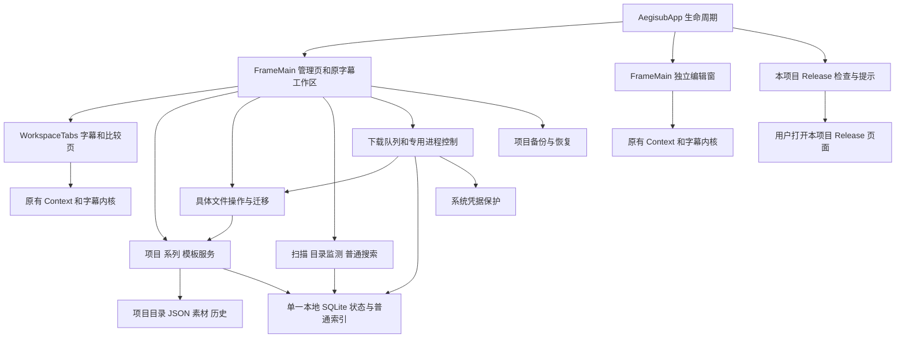

# Aeg 工作台：架构设计修订稿

2026-11-19 · 版本 0.6 · 独立审查修订。源码基线为 `codex/compare-tab` 的 `60f96f7acffaa99602d12d38156a6fbb85dbd392`。工作区已接入 S1 窗口和保存保护，以及 S2 清单、模板和单库项目登记。Linux 验证和待验平台见[执行记录](s0-baseline.md)。

需求基线为 [PRD 1.0](PRD.md.txt)。已确认的 D01–D03 适用于对应条款。R 编号用于把产品需求连到设计、实施和验收。当前源码证据见第 13、14.1 节。两份 10 月记录来自较早的 Windows 工作树。审查结果见[技术勘察](technical-survey.md)，逐项验收见[实施计划](implementation-plan.md)。

## 1. 产品边界与已确认决策

### 1.1 D01、D02、D03：已确认，不再询问

| 决策 | 已确认内容 | 对本稿的约束 |
| --- | --- | --- |
| D01 | **不做全文搜索**；保留项目/系列名称与元数据、文件名、下载任务及必要结构化字段搜索 | 不读字幕/翻译稿/文档正文建索引，不引入 SQLite FTS5、分词器、正文解析器或短词后备机制；普通文件索引和目录监测继续实现 |
| D02 | **不为低于正式支持下限的旧系统建设兼容层**；Windows 优先，兼顾跨平台方向 | Windows 10/11 x64 仅是候选，最低受支持版本由实际工具链、依赖和测试确认；不承诺未经验证的平台，不把旧系统适配或未承诺平台完整后端列为首版任务 |
| D03 | **只检查本项目 `xiaotianMC/Aegisub` 的 GitHub 正式 Releases 并提示** | 比较本地自定义版本与本项目正式版本；展示说明和对应页面链接，用户自行下载/安装；保留手动检查，不建设应用更新包下载、安装、替换、helper、升级事务或程序回滚系统 |

PRD 3.1、14.1 第 7 项要求能搜项目、系列、文件、下载任务。D01 明确检索字段范围。PRD 12.1 指定 Windows 优先并兼顾 macOS/Linux，D02 补充正式支持下限政策。D03 调整 PRD 10.3–10.5、13.1、14.5 第 5 项和第 16 章的升级执行方。应用检查版本、展示说明，由用户到本项目发布页手动获取和安装。发行方仍须提供可核对的来源与完整性信息，升级仍须保护配置和项目。

唯一默认发布页面：[xiaotianMC/Aegisub Releases](https://github.com/xiaotianMC/Aegisub/releases)。不得自动转向原版仓库、旧更新服务器或任意配置仓库。

### 1.2 继续保留的第一版功能

- 项目管理是应用内独立页面，默认与字幕编辑器同窗切换，并支持独立编辑窗口；管理多个项目，编辑器每次处理明确指定的项目/字幕会话，不建设并行多项目编辑调度。
- 独立项目、系列/各集、完整元数据、封面、手动状态及系统建议、目录模板和导入导出、仪表盘、完整文件管理器。
- 普通全局搜索、目录变化监测、主动和外部项目移动后的重新关联、基本历史及常见操作的可恢复性。
- yt-dlp 独立子进程；项目内和全局/批量入口、Bilibili/YouTube/其他支持来源及本地导入；临时/长期授权和多个账号配置；并发、取消、重试、持久任务、归档/素材注册和重启核查。
- 项目配置跟随项目文件夹，全局设置留应用配置；配置版本和受控数据迁移、项目备份及基本恢复。
- 未保存字幕保护、不静默覆盖/删除、不自动上传诊断、不引入未经同意遥测、必要本地日志和凭据安全。
- GitHub 源码、Windows 安装包和便携包；完整自定义应用版本、正式 Release 检查与提示、自定义修改保留的上游合并流程。

关闭应用可以停止下载。首版交付基本错误处理、安全检查、关键恢复，以及手动升级后的数据兼容。PRD 13.2 将组合异常、性能和长期运行专项、更完善的撤销与历史版本恢复、基于首版反馈的界面和工作流改进列入第二阶段。

### 1.3 需求追踪矩阵

“需求出处”指 PRD 章或小节，D 编号为后续决策。R15 仅保留早期方案的删除记录。R26.a–f 中的浏览器读取和手动 Cookie 导入是已有方案对账号需求的细化，具体兼容组合及授权提示仍待验证。首版里程碑为 S0–S8，第二阶段为 P2。T01–T18 见实施计划，F01–F18 见第 13 章。

| ID | 需求/修订依据 | 当前实际情况 | 修订后实现与验收 | 需求出处 |
| --- | --- | --- | --- | --- |
| R01 | 首页、导航、项目卡片/最近项目 | 无参数直接进入编辑器，已有比较页，F01–F03 | 同窗管理页，S1/S3，T01/T05 | 2.2 A/D、3.1–3.2 |
| R02 | 独立项目与完整元数据 | 现有 Project 是字幕会话，F05 | 项目 JSON/管理服务，S2/S3，T04 | 4.1–4.3 |
| R03 | 注册旧目录且不动旧内容 | LoadList 只识别打开文件，F05 | 注册/校验/位置登记，S2/S3，T04/T07 | 4.2、14.1 |
| R04 | 系列与子项目/整体进度 | 无产品系列模型，F05/F06 | 系列清单/相对关联，S2/S3，T04/T09 | 2.2 B、4.1–4.2 |
| R05 | 五种手动状态与建议 | 无项目状态领域数据 | todo/doing/review/done/paused，仅用户确认改变，S3/S6，T05/T11 | 3.3、4.4 |
| R06 | 封面/平台缩略图/默认图 | 有图像/视频基础，无项目封面链，勘察 E01/E08 | 平台元数据或本地视频缩略图，失败显示默认图，S3/S6，T05/T11 | 3.2、4.3、6.6 |
| R07 | 全局/项目模板与导入导出分享 | Options 不是任意项目存储，F07 | 模板 JSON/项目快照，S2/S3，T04/T14 | 4.5、7.1 |
| R08 | 完整仪表盘 | 旧首页及项目管理命令已移除，F01/F03 | 第 3.4 节仪表盘八项内容与入口，S3，T05 | 3.3 |
| R09 | 浏览、多选、批量、排序 | 只有 fs 原语，F08 | 完整文件管理器，S4，T06/T07 | 3.4 |
| R10 | 建目录、重命名 | 原语可复用，缺确认/历史，F08 | 具体 FileOps，S4，T07 | 3.4、8.2 |
| R11 | 移动、复制、批量 | Copy/Rename 不提供跨卷业务安全，F08 | 逐项结果及必要恢复检查点，S4/S5，T07/T09 | 3.4、5.3 |
| R12 | 移出管理/回收站/永久删除及独立策略 | Remove 不是回收站或撤销，F08 | 两类对象独立偏好与逐项确认，S4，T07/T14 | 8.1、11.4 |
| R13 | 拖放导入、文件名搜索、在系统文件管理器打开目录 | 编辑页拖放可询问比较或正常打开，F02/F05 | 管理页导入与编辑页拖放按目标路由，S1/S4，T02/T06/T07 | 3.4–3.5、6.4 |
| R14 | 项目/系列元数据、文件名、任务普通搜索 | MRU/字幕内查找不能替代，F10 | 结构化查询和普通索引，S5，T08 | 3.1、14.1，D01 |
| R15 | D01 删除原工作台正文搜索范围 | 旧稿新增建议，不是既有产品能力 | **已删除；无实现阶段、无对应正文搜索测试** | D01，早期方案删除记录 |
| R16 | 外部新增/删改/重命名 | wx 有能力，应用未接入，F09 | 扫描+watcher+校准，S5，T06 | 5.1、12.3 |
| R17 | 应用内移动并保持字幕关联 | 缺项目迁移协调，F05/F08 | 同/跨卷专用安全步骤，S5，T09 | 5.2 |
| R18 | 外部移动/系列父目录重定位 | 未实现 | UUID/位置映射/逐集核查，S5，T09 | 2.2 E、5.2 |
| R19 | 编辑/下载/占用/同名冲突 | 基础异常不足，F04/F08 | 暂停危险操作、核查并确认，S4–S6，T07/T10 | 3.4、5.3、11.4 |
| R20 | 默认同窗管理↔编辑 | FrameMain 内已有编辑/比较工作区，F01/F02 | 保留内部工作区，外层增加管理页，S1，T01/T02 | 3.5、12.2 |
| R21 | 独立编辑窗口 | 已有多个 FrameMain/Context，F02/F03 | 同类宿主 EditorOnly，S1，T01/T02 | 3.5 |
| R22 | 原有格式/编辑和自定义功能兼容 | 已有编辑及比较集成测试，完整目标包待验，F04/F06/F15 | 保留读写、比较/撤销及转录等既有编辑功能，S0/S1/S8，T03 | 1.2、3.5、12.2、14.5 |
| R23 | 未保存保护及准确的打开结果 | 已有安装、重绑定和提交后警告，打开入口尚未统一，F04/F05 | 区分发布前失败、已发布恢复受阻、已提交带警告，S1，T02 | 5.3、11.4、14.5 |
| R24 | yt-dlp/目标来源/本地导入 | 有模型下载和转录进程，缺项目媒体下载，F11 | 网络下载使用专用子进程，本地文件走导入，S6，T10/T11 | 6.1–6.2、6.4 |
| R25 | 项目、全局、批量；允许后分配 | 未实现 | project_id 可空/持久 Inbox，S6，T10/T11 | 6.4–6.5 |
| R26 | 浏览器登录/读取、手动 Cookie、临时/长期、多账号、状态/清除 | 转录已接系统凭据，尚缺下载账号/站点授权，F09/F09.a/F11.a | 第 10.1 节 R26.a–f，S6.a–d，T12.a–h | 6.3、11.3、12.5 |
| R27 | 任务字段、持久化、进度/速度/ETA | dispatch 不是队列存储，F12 | 单一本地 DB 的任务表，S2/S6，T10 | 6.5 |
| R28 | 并发、取消、失败重试 | 转录能启动/取消子进程，下载整树收束及重启语义待建，F11/F12 | 下载器专用控制，S6，T10 | 6.5、12.4 |
| R29 | 重启任务核查与真实续传分开 | 未实现 | attempt/部分文件核查，S6，T10/T11 | 6.5、9 |
| R30 | 来源/内容重复、跳过/覆盖/另存 | Copy 可覆盖，F08 | 查重及本次目标确认，S4/S6，T07/T11 | 5.3、6.6 |
| R31 | 下载、归档、素材注册/询问编辑 | 未实现 | 按平台/系列/集数预览目标，分段提交、幂等登记，S6，T11 | 2.2 C、6.6 |
| R32 | 项目 ID/规则/封面/历史随目录 | ASS Properties 不等于项目清单，F06 | 项目权威 JSON，S2，T04/T09 | 4.3、7.1–7.2 |
| R33 | 全局配置与项目数据分离 | 已有 Options/Path，F07 | 复用已知偏好；模板/任务分开，S2，T04/T13 | 7.1–7.2 |
| R34 | 格式版本/受控数据迁移 | 无通用项目 schema 迁移，F07 | 校验、副本转换、保留旧配置，S2/S7，T13 | 7.3、14.5 |
| R35 | 操作历史/常见撤销 | 字幕 Undo 不覆盖磁盘，F04/F08 | 按操作类型受限撤销，S4，T07 | 8.2 |
| R36 | 配置自动保存、项目备份/恢复 | 只有字幕备份基础，F04 | 项目快照与安全恢复，S7，T13/T14 | 7.3、8.3 |
| R37 | 重启路径/索引/任务/页面核查 | 未实现 | 首页提示上次项目、页面与未完任务，S2/S6/S7，T16 | 2.2 D、9 |
| R38 | 完整应用版本/上游维护 | 旧 revision 计数不适合 fork 比较，F14/F15 | 自定义版本与来源信息，S0/S8，T15 | 10.1–10.2 |
| R39 | D03 本项目正式 Release 检查/提示/链接 | 现有旧服务器/六字段协议，F13 | 固定本项目 API、可靠比较/错误提示，S8，T15 | 10.3、14.5，D03 |
| R40 | 源码/安装/便携交付 | 构建打包流程存在，F14 | 人工获取发布包和手动升级数据兼容验证，S8，T17 | 10.4–10.5、12.5、13.1，D02、D03 |
| R41 | 系统工具优先、缺失提示、独立版本记录 | 裁剪 FFmpeg 库不是完整 CLI，F11/F16 | 固定工具配置/兼容探测/官方获取说明，S6/S8，T11/T17 | 10.6、15.4–15.5 |
| R42 | 无遥测/诊断上传、日志不存秘密 | 本地日志有基础，缺通用脱敏，勘察 E37 | 必要脱敏/保留期/账号清除，S0–S8，T12/T14 | 1.2、11.1–11.3 |
| R43 | 后台工作、有界资源、关应用停止下载 | dispatch 可复用，无业务调度，F12 | 应用内任务，无常驻服务，S5/S6，T01/T06/T10 | 1.3、12.3–12.4 |
| R44 | 首版单元/集成/回归/便携/安全测试 | 已有编辑、比较、所有权及条件注册的 Automation 测试，F15 | T01–T17，S0–S8；基线资源检查 T18 | 13.1、14.6 |
| R45 | 第二阶段异常、性能、历史恢复与首版反馈 | 没有可当承诺的当前基准，F15 | P2 按 T18 扩大专项，历史恢复与反馈改进复测 T05/T07/T13 | 13.2、14.6 |

## 2. 实际仓库与推荐架构

### 2.1 已验证事实与未验证边界

当前使用 C++20、Meson/Ninja 和 wxWidgets。配置默认要求 wxWidgets 3.3.4，回退依赖固定为 v3.3.4。启动直接创建 FrameMain，每窗拥有一个真实 Context 和包含字幕、比较页的 WorkspaceTabs。项目目录清单、目录级监测、持久下载队列和工作台 SQLite 尚待实现。现有 Project 管理当前字幕及关联媒体。已有系统凭据封装、转录进程、模型下载、本地和云端识别可供相应部分复用。[F01–F12]

更新检查仍查询旧服务器，以整数 revision 比较六字段文本。安装器的 `MinVersion=6.1sp1` 是声明。操作系统下限、签名资源及 Windows 安装/便携包兼容性由目标机器实测确定。[F13–F16]

本地 `build/git_version.h` 和 `build-ci/git_version.h` 都标记 `a5cef9ad2`。本次独立审查的写盘异常实验、发布脚本对照、源码所有权检查及其限制见技术勘察。S0 仍需给出与目标 HEAD 一致的完整构建/回归记录。

### 2.2 总体结构：保留业务边界，取消通用框架前提



建议用现有原生 UI/事件，不引入浏览器运行时、IPC 服务、ORM 或插件系统。图表示职责，不要求每格都变成接口/工厂。只在**已支持平台需要的差异点**放小范围文件/回收站、进程、凭据实现；不预建未承诺平台的完整后端。

| 模块 | 首版职责 | 直接边界 |
| --- | --- | --- |
| App/Workbench | 页面/窗口、当前项目、退出预检和服务生命周期 | UI 不直接复制文件或写任务表 |
| 项目/系列/模板服务 | UUID、元数据、目录规则、手动状态、清单保存/位置登记 | 不把原 Project 改成目录管理器 |
| EditorBridge | 明确打开目标、已有会话激活、保存/取消、文件移动协调 | 使用既有字幕 reader/writer，不另存一份可写字幕到 DB |
| FileOps | 具体文件动作、逐项结果、确认/占用检查、必要检查点和受限撤销 | 无跨所有资源的通用事务/补偿承诺 |
| 普通索引/搜索 | 文件名/属性、项目/系列/任务元数据投影、watcher 校准 | 不读取字幕或文档正文；索引不驱动磁盘删除 |
| 下载队列/YtDlpRunner | 任务、attempt/output、并发/取消/重试、管道和进程树 | 仅服务已确定工具，不构建通用进程编排平台 |
| 账号与凭据 | 简单多账号记录、会话/长期授权、状态/清除 | 不建设 OAuth 插件、账号云同步或自动密钥轮换框架 |
| 备份/启动恢复 | 项目快照、未完成任务/文件步骤核查、配置迁移 | 数据库损坏不直接删库；不承诺全自动恢复一切 |
| Release 检查 | 版本来源、固定仓库查询、比较/说明/链接/错误 | 不处理应用包下载或程序文件安装 |

UI/Context 仍由 wx 主线程拥有；扫描/缩略图等有界工作复用 dispatch 并回投主线程。DB 连接按线程使用，写入串行；长时间等待下载管道不占满通用线程池。回调携带 session/task ID 和有效性标记，关闭对象后丢弃过时回投。

## 3. 同窗管理与编辑器生命周期

### 3.1 推荐保留共同 FrameMain 宿主

Workbench 模式在 FrameMain 内放一层页面选择器，一页是新建的项目管理面板，另一页整体承载现有 WorkspaceTabs。EditorOnly 使用同一份字幕工作区。内部 wxSimplebook 的编辑页/比较页、比较会话所有权、状态栏前两格的标签条及其页索引由 WorkspaceTabs 管理。编辑器构造一次，保持既有 Context、子控件父子关系和 GL 生命周期。[F01–F03]

`AegisubApp::OnInit` 目前先创建 FrameMain，再处理文件参数。建议无文件启动显示管理页，有文件时直接进入目标字幕工作区，额外窗口使用 EditorOnly。按明确会话或文件身份选窗。命令行和 MacOpenFiles 当前共用的 `frames[0]`、排队的拖放回调及最近文件入口都要改接路由。管理页自行处理文件导入，编辑区保留“比较 / 正常打开 / 取消”。页切换保留比较中的勾选、滚动位置和原文档。

菜单、热键、命令面板、拖放和状态栏先按外层页面路由。字幕区继续使用 `WorkspaceTabs::Permits/AllowsCommand` 与模型写入检查。回到管理页可浏览项目，但替换字幕、移动在用媒体或保存的请求仍须检查当前比较会话和待恢复状态。隐藏页暂停播放、隔离焦点；比较期间自动保存遵守既有写入限制，结束后恢复。

### 3.2 行为合同

- 默认管理↔编辑在同一顶层窗口切换；独立编辑窗口同属第一阶段。已存在独立字幕文件可不注册项目，保留原有文件关联/命令行入口。
- 多项目列表/仪表盘选择不等于替换当前文档。打开另一个指定项目/字幕时，先处理当前会话保存/取消，再切换关联；不建设多个项目同时编辑的调度功能。
- 每个 Context 只对应当前指定字幕及可选 project_id；独立窗同样明确关联。打开已在编辑的同一文件优先激活已有会话，不悄悄开第二可写副本；既有独立编辑窗兼容行为单独回归。
- 管理页使用管理命令/服务，编辑页使用原菜单/热键；不把缺成员/空 Context 传给既有命令。焦点、滚轮、Ctrl+S、拖放和标题按当前页面路由。
- 用户已确认 Q03 的关闭行为。两种窗口都先处理未保存字幕。主工作台关闭字幕成功后回首页，独立编辑窗关闭自身。取消或保存失败保留原字幕。全局退出、语言或主题重启先收集所有窗口和任务的决定。预检期间保留比较选择及窗口。若比较锁住待保存文档，先把焦点交回用户处理，再发起退出。全部同意且文档版本仍匹配后才停止队列、关窗和重启；任一取消保留其余窗和任务。已明确执行的保存有效。
- 关闭应用停止下载，语言重启也走全应用退出协调；不为此建设常驻服务。仅提供独立打开，不默认承诺携带未保存内存状态即时脱离/再嵌入。

### 3.3 未保存内容和失败结果

EditorBridge 在主线程区分纯切页、打开已有会话、打开基线供比较、替换字幕及仅打开媒体。选择项目、登记目录或预览文件名不会触发字幕加载。决定替换时先按目标操作处理未保存内容，再走现有 `Project` 和 `SubsController`。混合拖入字幕与媒体时先分类和预检，取消或字幕准备失败须在改变视频、时间码和关键帧之前返回。关联 Automation 或 AviSynth 的正常打开沿用现有信任提示。

| 底层发生的事件 | 管理页可见结果 | 编辑器与项目关联 |
| --- | --- | --- |
| 已有会话 / 用户取消 / 发布前读取失败或被写入门禁拒绝 | 分别激活原窗、取消、报告失败或占用 | 保留原内容、dirty、撤销栈和关联；此前用户主动保存的结果生效 |
| 候选文档已发布，必要观察者未完成重绑定（`RecoveryBlocked`） | 显示“新字幕已载入，编辑暂时锁定”及恢复入口 | 记下待完成的目标，暂停进一步打开、保存、媒体变更；显式重试现有 `RetryModelInstallation` 或走宿主恢复/关闭路径。未知结果不自动重放打开 |
| 已提交，备份、MRU、FileOpen 或关联媒体后续步骤失败 | 打开成功并列出具体警告 | 关联实际已打开的字幕，保留媒体加载结果。重试恢复只运行一次已保存的提交后工作 |
| 已提交且后续正常 | 打开成功 | 更新关联、选中页面和标题 |

`SubsController::Load/Close` 已用 `SubtitleModelInstallation` 发布候选并确认观察者，`Save` 先写快照才更新文件名和保存基线。写文件与之后的通知是两个时点，后者抛错时磁盘可能已有输出，重试覆盖前要核实。工作台桥接层传递这些结果，不再自行交换 AssFile 或直接写活模型。打开新文件后到达的旧自动保存、下载或 UI 回调以会话寿命及文档代次丢弃。既有字幕编辑器正文查找/替换继续可用。[F04/F05/F17/F18]

磁盘保存另有独立缺口。本次在 Linux 临时目录直接编译当前 `io.cpp`，序列化写入部分内容后抛错，`agi::io::Save` 在析构中仍将临时文件改名，覆盖了原目标。对工作台清单及承诺保护的字幕保存路径使用显式提交：在同目录创建唯一临时文件，只有序列化、写入、刷新及关闭均成功才替换原件，失败释放自有临时文件。沿用格式 writer，对其真正报告成功的时点做验证；变更旧 IO 接口前核对现有调用者。T02/T13 在已有目标上注入中途失败，同时核对原文件字节和内存状态。[F04/F08]

### 3.4 首页、项目与系列页面

| 页面 | 用户看到的内容 | 动作与状态 |
| --- | --- | --- |
| 左侧导航与首页 | 卡片显示项目名称、手动状态、封面、最近更新时间及当前文件夹路径。首页另列最近项目与未完成任务 | 提供新建、注册已有文件夹、打开、搜索及筛选。PRD 3.1 建议的首页、所有项目、系列项目、下载中心、最近打开、模板管理、设置均有可达入口，具体菜单分组可调整 |
| 项目仪表盘 | 元数据、状态与建议、最近文件、视频素材、字幕文件、下载任务、快速打开编辑器、项目目录与操作，共八项 | 最近文件可定位到所在目录。编辑器入口走第 3.3 节的打开流程。失联目录显示最后已知路径和重新定位入口 |
| 系列页 | 按集数列出子项目，显示集号或标签、名称、各集状态和打开入口，汇总系列进度 | 各集有独立素材目录及字幕工程。可用“已完成集数 / 总集数”展示进度，同时标记离线或状态未知的集，避免把未知算作完成 |

无文件参数启动时显示首页，突出上次项目和未完成任务。保存上次项目 UUID 与相关页面标识，用户可从“继续上次工作”返回可用页面。若目录失联或页面指向的任务已移除，首页分别提供重定位或任务列表入口。带字幕文件启动仍遵循第 3.1 节的文件路由。

## 4. 项目、系列、素材、任务与历史模型

下表给出首版数据合同。当前实现已写入项目或系列清单、模板及本机位置表。后续里程碑逐步填入素材、集关联及下载等业务数据。项目 ID 跨目录保持稳定，时间按 UTC 存储，revision 与 schema_version 分开。

| 对象 | 首版必要字段/约束 | 权威位置 |
| --- | --- | --- |
| Project | project_id、schema_version、revision、name、description、source（网址或视频 ID）、source_language（原语言）、target_language（目标语言）、tags、owner、五种状态、cover、目录规则/模板快照、可选所属系列提示、created/updated、登记资产及必要历史 | 项目 JSON；所属关系以系列清单为准，实际根路径在本地位置表 |
| Series/Episode | series_id、元数据/状态/封面、project_id 引用、集号或标签、集名、排序、相对位置 | 系列 JSON；子项目可独立打开，整体进度从各集汇总 |
| Asset | asset_id、kind、项目内相对路径或明确 external 引用、来源平台/ID/格式、size/mtime/hash?、related_assets、origin_task/output | 项目 JSON；普通目录文件不全部登记成素材 |
| DownloadTask | task_id、batch_id?、source_kind（网页下载或本地导入）、来源平台和来源标识（解析时补齐）、网页任务的原始 URL 或 protected_url_ref、display_url、project_id?、网页任务使用的 anonymous/account_id、归档规则快照、目标路径、state、artifact_stage、进度/速度/ETA?、重试次数、脱敏错误原因、created_at/updated_at、关联的 output_id 列表 | 单一本地 DB；project_id 可空，授权失败转 needs_attention，不改成匿名 |
| Attempt/Output | attempt_id、工具版本/格式、account_id/credential_revision 快照、开始结束/退出原因、授权临时区清理状态；output_id、staging/最终相对位置、归档状态、asset_id? | 同一本地 DB；不保存裸 Cookie/令牌/完整 argv；清理标记只含不透明 ID/阶段 |
| AccountProfile | account_id、站点、显示名、auth_source(browser/import)、browser/profile/container 选择、persistence(session/remembered)、secret_ref?、credential_revision、unknown/validated/expired/revoked/needs_reauth、验证时间/范围 | 同一本地 DB 只存描述/引用；session 秘密只在内存，remembered 秘密在系统保护存储；profile 路径不是秘密凭据，也不能随项目迁移 |
| HistoryEntry | event_id、时间、动作、结果、受影响资产/旧新路径、可撤销条件/限制 | 项目 JSON 的必要历史；详细下载日志不全复制进去 |
| PendingStep | type、task/项目/asset ID、旧新路径、预期对象信息、阶段/待人工处理原因 | 仅必要的长操作/关联变更记录，不作为通用 journal 语言 |
| Template | template_id/version/revision、相对目录/角色、命名规则 | 全局 JSON；项目保存应用时快照 |
| LocalLocation/Session | UUID→本机当前根、在线/失联、最近访问；上次项目 UUID 和页面标识；当前窗/字幕/project_id/dirty/有效性 | DB 保存必要位置/恢复提示；内存字幕仍由原编辑器管理 |

项目清单保存可迁移的业务真相，不把本机绝对根目录当项目身份。系列的集关联以 UUID 校验，目录名/集数不是唯一键。推荐每子项目一个所属系列；如果必须跨系列复用或共享盘多人并写，另作需求评估，不预建协作框架。

系列成员资格由 `series.json` 中的子项目 UUID 列表裁决。子项目可省略所属提示；提示不一致时以已核实的系列清单刷新。新建一集先保存可独立打开的子项目，再在校验系列 revision 后加入成员。中断可留下独立项目，用户重试时按 UUID 加入一次。若两个系列都认领同一项目，显示冲突并暂停改归属，保留双方清单。

在系列页确认“从系列移除”后，按子项目 UUID 更新系列清单、历史和进度。子项目离线时也能移除，独立项目登记、任务、字幕和素材均保留。删除项目目录使用第 7.3 节的项目删除操作。

来源 ID 相同不等于同内容/质量；查重键应考虑格式，必要时后台 hash。`origin_task_id + output_id` 在素材登记中唯一以支持补注册；同一输出已登记，重试不重复增资产。下载登记、字幕实际编辑或导出成功都可触发状态建议，例如导出后建议进入 review。用户可采纳或忽略，只有采纳或手动选择才写状态。

`output_id` 属于逻辑产物，跨 attempt 保持稳定，另存目标不会令同一产物重复登记。将任务目标、产物标识、预期文件身份/校验值和归档意图先存入本机库。文件提交后在项目 JSON 的一次替换内同时保存素材和历史，最后回填本机库。恢复时依次查询该逻辑键、核验目标实物和清单修订。目标被更换、归属有歧义或已有不同内容时保留双方并等待处理。

非敏感原始 URL 原样保留；含可复用令牌/query 时完整值放受保护存储，普通记录只存引用和脱敏显示 URL。项目迁移不携带本机授权，不能把“需要记录原始 URL”解释为必须明文落盘。

## 5. 数据存储重新比较与推荐

### 5.1 四种方案比较

| 维度 | 1 仅项目 JSON及本地配置文件 | 2 单一 SQLite为主要存储 | 3 项目 JSON＋单一本地 SQLite | 4 JSON＋分离状态/索引 DB |
| --- | --- | --- | --- | --- |
| 可读性 | 可用文本工具检查 JSON 清单和普通配置 | 主要数据需 SQLite 工具查看 | 项目清单可直接读，本地任务和索引需数据库工具 | 清单可直接读，查询本机资料需区分两个库 |
| 数据结构升级成本 | 逐份识别和转换版本，跨文件一致性由应用保证 | 主要表可以事务迁移，目录携带数据仍须校验版本 | 分别迁移项目清单与本机库，用稳定 ID 核对两侧引用 | 需管理清单及两套库版本，派生索引可重建 |
| 大项目适用性 | 大清单整份读写，跨项目搜索需要扫描 | 可按索引分页，注意业务与索引的写竞争 | 大文件列表分页查询，项目登记素材和历史过大时测清单重写耗时 | 可隔离扫描写入，需实测额外维护成本 |
| 目录迁移 | 项目内清单直随目录；本地任务另存 | 若项目配置只在本机 DB 不满足约束，须额外随目录保存项目配置或明确导出格式 | 项目资料随目录；DB 只更新 UUID→根路径 | 同方案 3 |
| 下载恢复 | 少量任务可用专用 JSON；并发/部分更新/查询需自管 | 事务适合任务/attempt/output | 用单库事务处理本机任务即可 | 双库不会直接增强下载本身恢复 |
| 索引重建 | 文件名列表可扫/内存筛选，跨大量项目持久查询成本上升 | 清晰区分派生表和业务表后只重建派生表 | 同方案 2，项目真相另有清单 | 可直接重建索引库，但需两套连接/schema/备份规则 |
| 普通搜索 | 小规模够用；频繁全量加载需约束 | B-tree/普通字段查询即可 | 项目/系列/任务投影＋文件名/属性查询 | 本次无需为了普通搜索强制拆库 |
| 备份恢复 | 项目可读；多本地文件的一致快照需控制 | 单库一致性备份直接，但不能替代项目可迁移配置 | 项目包＋本机 DB 备份，边界清晰 | 状态库独立，但操作/投影同步更多 |
| 便携版 | 可放便携工作台目录，清理仅作用于命名缓存子目录 | 本机库放独立持久目录（第 5.3.2 节），与漫游配置分开 | 清单与位置无耦合，便携数据根明确 | 也可行，但多两个文件及其附属文件管理 |
| 实现/测试成本 | 初始最低，任务与大量索引扩大后需更多自制更新逻辑 | 需 SQLite，但全项目权威/导出边界容易混淆 | 新增一种存储依赖和一套本地 DB；项目继续复用 JSON | 最高，现有规模证据不足以证明必要 |
| 损坏风险 | 单项目隔离好；不应反复写所有项目全局大 JSON | 本机状态/索引同库故障影响面较大 | 项目数据仍在目录；本机库损坏要保留/恢复，不能当缓存删除 | 状态/缓存隔离更好，但不是唯一的安全方案 |
| 多项目管理 | 可做，数量扩大后查询/写入成本增加 | 可做 | 适合任务与普通索引需求 | 大索引持续膨胀/维护干扰业务时再评估 |

方案 2 不是获准将项目配置只保存在全局 DB：它仍须满足配置随目录的约束，不能靠“日后记得导出”代替。方案 1 也不是不可靠，只是完整下载队列和持久索引会增加自行维护的更新逻辑。

**已采用方案 3。** 项目和系列 JSON 随目录保存。第二版本机数据库 `workbench.sqlite` 保存项目位置、任务、输出、执行尝试、待核查步骤、账号描述与引用，以及单独的项目文件索引。首个实际流程是登记项目内已有文件。重建索引只替换所选项目的文件条目和扫描记录。旧版数据库升级前先创建并核查备份。Meson 优先使用系统 SQLite，也可使用仓库固定版本与校验值的源码包。[执行记录](s0-baseline.md)

### 5.2 单库内区分业务表与可重建表

| 表/资料 | 归属和重建规则 |
| --- | --- |
| tasks/attempts/outputs、账号描述/secret_ref、项目位置、必要 PendingStep、上次页面 | 本机持久业务状态；不能因索引重建而清空 |
| 项目/系列搜索投影、file_entries、scan_state | 可重建表；按 project_id/generation 清理和重扫，必要的 DB 索引也仅重建这些表 |
| project/series JSON、素材登记/必要历史、封面/模板快照 | 项目权威资料，单库中的摘要只读投影，不能反向覆盖较新清单 |
| 可选缩略图缓存 | 只可清理明确归属缓存；不能把 Inbox 或任务部分文件当缩略图缓存 |

清理/重扫按表和项目范围执行，**禁止通过删整个 DB 实现重建索引**。单库损坏保留原文件，恢复一致备份并核查任务/实物；项目仍可从目录清单重新登记。本机 DB 的损坏影响和恢复耗时是单库简化的实际风险，不假装已经由分表消除。

用 SQLite 原生事务和参数绑定、串行写入、有界事务/忙等待；连接不任意跨线程传递，默认不放共享网络盘，不加载任意扩展。备份用一致性方式，不随手复制仍在写的主库文件。首版先采用满足读写的普通日志模式；是否用 WAL 按真实竞争和文件系统验证决定，不为此再建服务。参见 [SQLite 备份文档](https://www.sqlite.org/backup.html)。

将来只有发生明确证据——索引体积/重建 IO 持续干扰任务提交、独立清理周期/损坏隔离要求或备份时间不可接受——才触发拆分状态库和缓存库。拆分是后续选项，首版没有双库验收任务。

### 5.3 目录、配置与历史的最小布局

#### 5.3.1 项目和系列：随真实目录迁移

新建项目和系列已使用下列各自的 `.aeg` 结构。视频、字幕和分集等目录取自创建时的模板。登记既有文件夹只增加项目元数据。系列清单保存分集项目 UUID、集号或标签、登记时的名称以及相对目录。打开时核对目录中项目的 UUID，并读取当前名称和状态。完整备份包归 S7。

```text
<项目根>/
├── .aeg/
│   ├── project.json                 项目配置、模板快照、素材登记、必要历史
│   ├── covers/                      项目实际封面文件；清单用相对路径引用
│   └── backups/
│       └── config/                  项目清单自动快照；不是完整素材备份
├── video/                           模板示例：项目内视频
├── audio/                           模板示例：项目内音频
├── subtitles/                       模板示例：字幕
├── translations/                    模板示例：翻译稿
└── exports/                         模板示例：导出结果

<系列根>/
├── .aeg/
│   ├── series.json                  系列配置、各集 UUID/相对位置、必要系列历史
│   ├── covers/                      系列封面，与各集封面分别归属
│   └── backups/
│       └── config/                  系列清单自动快照
└── episodes/                        模板示例，不固定要求此目录名
    ├── ep01/                        一个完整“项目根”，含自己的 .aeg/project.json 等
    └── ep02/                        另一个完整“项目根”

<用户为本次导出选择的备份目标>/        与上述项目/系列源目录分开选择
└── <项目或系列标识>-<快照标识>.zip     完整或轻量备份包；显示实际包含/排除清单
```

完整备份包含所选项目内素材、清单、必要历史和封面；轻量备份明确省略素材。自动配置快照实际在相应 `.aeg/backups/config/`；完整包存放在用户选择的目标，不默认塞进该目录，也不递归包含既有备份包。外部引用只保存引用和缺失/重连提示，**不默认复制项目外素材进备份**；用户另行明确选择打包外部素材时才列出体积、来源和恢复路径。项目内配置/历史/封面随目录迁移，本机任务和凭据不随项目目录搬迁。

#### 5.3.2 全局与本机数据：一个本地数据库

`<UserRoot>` 表示既有 `?user`。`<MachineRoot>` 是工作台持久数据根，按安装版或便携版分别解析；`<PrivateTempRoot>` 是受限短期区。Windows 安装版建议通过 LocalAppData 已知文件夹选择独立产品子目录，例如 `%LOCALAPPDATA%/AegisubWorkbench`。该示例名由 Q01/Q02 定稿，路径须在 Aegisub 缓存树外。便携版在现有可读配置触发便携模式时将 MachineRoot 设为 `?data`。两种布局均只有一份本机库。

```text
<UserRoot>/
├── config.json                      全局偏好，例如界面、下载并发、更新提示和日志设置
└── workbench/
    └── templates/                   全局可复用模板 JSON；项目持有应用时快照

<既有 ?state>/
└── log/                             既有核心日志；崩溃处理以 ?state 为根

<MachineRoot>/
└── workbench/
    ├── workbench.sqlite             唯一本机 DB：任务/attempt/output/位置/账号描述与引用/普通索引
    ├── inbox/
    │   └── <task_id>/               未分配下载的持久产物、部分文件；不是缓存
    ├── credentials/
    │   └── <secret_id>.bin          需要文件承载时的当前用户 DPAPI 保护 blob；不是明文 Cookie
    ├── logs/                        新工作台普通脱敏日志，轮转/清理；不落原始工具输出
    ├── backups/                     用户选择创建的本机 DB 一致备份；不是项目备份或凭据备份
    └── private-tmp/                 默认 <PrivateTempRoot>，仅当前用户可访问的短期授权区
        └── <run_id>/
            └── <attempt_or_capture_id>/
                ├── browser-export.txt  浏览器采集阶段可能含多站点 Cookie，过滤后立即清除
                ├── cookies.txt         本次模拟验证/下载可读写的站点范围 Cookie 副本
                └── tool-tmp/           子进程 TEMP/TMP；可能含浏览器数据库临时副本

<下载目标卷上的受控 staging>/
└── <task_id>/<output_id>/            项目下载/跨卷复制的媒体部分文件，与授权临时区分开
```

`secret_ref` 是本机 DB 中指向系统凭据条目或受保护 blob 的不透明引用，**不是 Cookie、令牌或可跨机解密的授权**；系统凭据条目本身不在此目录树内。项目清单不保存 account_id/secret_ref、浏览器 profile、Cookie 或本机任务状态。含敏感查询参数的原始 URL 也走受保护存储，只留脱敏显示值和引用。本机 DB 备份仍含有价值的任务/路径资料，要受限保存，不能当缓存删除；不包含真实秘密或 private-tmp。数据库自己的日志/附属文件由所选 SQLite 模式管理，不是第二个应用数据库。yt-dlp 内部的浏览器数据库临时副本也不是新的持久状态库，必须一并清理。

**平台路径。** Windows 安装版的 `?user` 和 `?state` 同指 Roaming AppData 下的 Aegisub，`?cache` 在 Local AppData 下的 Aegisub；`?local` 仍是 `?cache` 的兼容名。便携启动把 `?user/?state/?cache` 一起指向 `?data`。普通 Linux 配置用 XDG 配置、状态、缓存目录，已有 `~/.aegisub` 时沿用旧布局。现有核心日志实际写 `?state/log`。清理只枚举具体缓存子目录，即使便携版各根重合也必须跳过工作台库、Inbox、凭据和用户模板。本机状态目录不可写时显示不可用，恢复后重开同一库。Q02 涉及迁移时显示真实路径和既有资料。[F07]

Cookie 临时区创建前校验当前用户权限、真实路径和非 junction/符号链接，明确限制继承的宽权限。便携介质若不能提供所需权限，建议向用户说明并选择系统本机受限临时位置（如 `%LOCALAPPDATA%/<经确认的应用标识>/workbench/private-tmp/`），仅存本次秘密材料；持久 DB/Inbox 不跟着迁移。无法取得受保护临时区则阻止带账号的任务，不能使用项目目录或公共临时目录作明文回退。该方案的文件系统/ACL 行为待 S0/S6 验证，不据此新增 OS 支持承诺。[Windows 文件权限](https://learn.microsoft.com/en-us/windows/win32/fileio/file-security-and-access-rights)

#### 5.3.3 保存、失联与不可用提示

| 情况 | 必须给出的结果与边界 |
| --- | --- |
| 项目/系列目录不可写、保存失败 | 显示具体目标与错误，保持“未保存”状态；允许查看/明确另存或选择可写位置，不把改动悄悄只存本机 DB 后报成功；相关归档/登记停在可恢复阶段 |
| 目录外部移动/离线 | 以 UUID 标失联并提供定位原目录；保留历史/任务/产物，暂停向旧路径归档；不自动创建同名空项目。主动移动按第 8.1 节校验关联 |
| MachineRoot/本机 DB 不可写、忙或损坏 | 明确队列与位置状态不可持久化，停止新任务/调度及有依赖的写操作；保留库和 Inbox，提供重试/一致备份恢复或受控数据根迁移。可独立查看项目、使用原编辑器，不伪装为全新空库；不自动切换第二个库 |
| 临时区删除失败 | 停止相关进程树后重试，显示 cleanup_pending 和本机残留位置；限制访问并留到启动核查，不能声称已全部清除或将其归类为普通缓存 |

注册素材及必要历史先与项目元数据保存在同一受控 JSON 快照中；系列必要历史同属 `series.json`，不引入额外历史文件的跨文件提交协议（如跨 `project.json` / `history.jsonl` 提交）。普通文件目录项不全部写入项目清单。清单保存采用 `expected_revision` / `fingerprint` 检查、唯一的同目录临时文件、显式写入检查与替换、备份保存。固定临时名、析构 `rename` 的既有 IO 封装不能直接证明全部新要求已满足。[F08]

数据根的调度锁只覆盖该根。来自另一个安装或便携实例的进程可能打开同一项目。协作写入者按规范化后的项目/系列目录取得受操作系统管理的同一把清单写锁，在锁内重读 revision 和文件指纹，写入并检查同目录唯一临时文件、按平台同步、原子替换后再通知 UI。锁争用、旧版号或写入失败保留用户修改与原清单。替换成功但持久性确认失败时重新核验并提示。网络/同步盘和忽略锁的外部编辑器只作冲突检测，能力不明时以只读方式打开。

简化代价是大素材登记/长历史会增加 JSON 重写成本；达到可测阈值后再决定分段历史或项目内其他存储，保留原历史，不未经确认静默裁剪。模板仍保存项目应用时快照，更新全局模板只影响新项目；改动既有目录经 FileOps 明确操作。

## 6. 第一版基础设施 A/B/C 审核

### 6.1 A 类：首版必须保留

| 设施 | 首版必要最小实现 |
| --- | --- |
| 项目/系列/模板/仪表盘 | 稳定 ID、随目录清单、真实目录、元数据/状态/封面和关联 |
| 持久任务和普通索引 | 一套本地 DB、业务/派生表分开、表级重建和一致备份 |
| 完整文件管理与安全 | 用户确认、占用/目标/路径核查、逐项结果、具体恢复条件 |
| 目录监测/普通搜索 | 扫描+watcher 校准、元数据/文件名查询，不减成只读目录列表 |
| yt-dlp 下载全链 | 专用进程控制、并发/取消/重试、三个完成边界和重启实物核查 |
| 同窗/独立编辑器 | 真实 Context、统一打开与未保存保护、原功能回归 |
| 凭据/日志 | 临时与长期多账号所需系统保护、脱敏、撤销/清除、本地必要记录 |
| 备份与基本恢复 | 项目完整/轻量范围明确、配置版本/备份、必要中断核查 |
| 安装/便携发布 | 普通包、明确数据根、依赖/许可、手动安装新包后数据兼容 |
| 版本/发布提示 | 本项目自定义版本及固定 GitHub Releases 检查，不混入原版 |

### 6.2 B 类：逐项重新论证，不按旧稿默认建设

| 旧设施/解决问题 | 首版是否确实需要 | 更简单实现 | 简化后具体风险 | 扩展触发条件 |
| --- | --- | --- | --- | --- |
| 两个 SQLite 库：隔离状态与索引 | 不需要强制双库 | 单库分业务/派生表，定向重建 | 整库损坏和重扫 IO 仍影响业务 | 实测索引干扰、备份/损坏隔离要求 |
| 完整文件操作 journal：任意操作全断点恢复 | 不需覆盖所有普通动作 | 仅登记资产改名/跨卷移动/归档等必要 PendingStep；普通原子动作记结果 | 非关键普通动作崩溃时历史可能缺一项，需重扫核实 | 业务要求每个操作完整审计或复杂中断链 |
| 通用补偿框架：统一跨资源反向执行 | 不需要 | 为改名、同卷移动、回收站恢复写具体受限撤销 | 无法自动撤销所有批量/跨卷动作 | 多类重复且已验证可安全补偿的场景出现 |
| 多实例调度/跨进程协调系统：防重复执行 | 不需要租约/心跳/IPC/接管系统 | 同一数据根简单单写保护；第二管理实例只读/提示已有实例；独立窗仍在同进程 | 第二进程不能并行调度，不能靠本机保护保证跨机同步盘写入 | 明确要求多进程可写队列/跨设备并写 |
| 通用进程管理框架：任意工具编排 | 不需要 | 专用 YtDlpRunner，仅必要句柄/管道/进程树和退出结果 | 每新增工具需审计少量具体代码 | 新增多个不同执行协议且重复明显 |
| 高级授权抽象：多平台 OAuth/刷新插件 | 不需要通用框架；账号功能仍必需 | 简单 AccountProfile＋系统凭据＋受限临时 Cookie，按站点提示授权状态 | 需用户处理失效，不能统一自动刷新 | 明确站点有可靠 OAuth/刷新需求 |
| 跨磁盘完整事务：跨盘原子搬迁 | 不需要也不能凭 DB 保证磁盘原子 | 保留源→复制校验→提交新位置→确认清理未变源，少量检查点 | 中断可能留下两份，要用户核查，不能承诺一步全撤销 | 实测/产品需要更细自动恢复，但仍须承认非原子 |
| 全自动撤销/恢复：任意操作一键还原 | 不需要 | 每类动作声明条件、检查当前对象/旧目标；不安全时提示 | 永久删除、外部修改/清空回收站后无法恢复 | 用户明确要求更长版本保留/快照能力 |
| 常驻后台服务：关应用后继续任务 | 首版无需求 | 随应用启动/退出的队列 | 退出后停止任务，重启核查后再继续 | 未来明确要求退出后继续下载；本次归 C |
| 通用插件/工具注册和升级服务 | 不需要 | 固定 yt-dlp/ffmpeg/ffprobe/必要 runtime 的路径、版本和兼容检测 | 新工具需改明确配置；用户自行更新 | 确认第三方插件生态或多个新执行引擎 |

简单单写保护只负责防止两个管理进程同时写同一数据根，不引入 owner lease/心跳或自动任务抢占；若保护失败/已有写者则不启动第二套下载。命令行打开字幕仍要有可见明确结果，不能丢文件参数。项目清单另做基本写入冲突检查；共享/同步盘跨机写入若成为需求须重新评估，不能声称现已提供协作一致性。

### 6.3 C 类：删除或本次不建设

- D01 删除的工作台正文搜索、正文提取、全文索引、FTS5、分词与短词后备。
- D03 排除的自动下载/安装更新、更新 helper、程序替换、自动升级事务及程序文件回滚、专用自动更新安装器；原有普通 Inno 安装器/便携打包保留。
- D02 排除的旧系统兼容层，以及未承诺平台的完整后端和额外首版测试矩阵。
- 无需求支撑的通用框架、插件平台、常驻服务；B 类列出的“大而全”版本不作为首版前置条件。

必要备份和**配置数据迁移失败保留旧数据**继续保留，它们服务项目安全和用户手动升级，不是被删除的程序自动更新系统。现有字幕正文查找/替换、媒体解码和缩略图生成也保留，不能误删成 D01 的对象。

## 7. 文件管理、普通搜索与目录监测

### 7.1 普通搜索范围和查询

搜索只覆盖项目/系列名称与元数据、标签/语言/状态/负责人/来源 ID 等结构化字段、相对文件名/目录与文件属性、下载任务标题/ID/平台/状态/错误分类及必要来源信息。结果按实体类型显示并跳转；文件结果打开原文件，不提供正文命中行/字幕时间定位。

本地 file_entries 记录 project_id、相对路径/显示名、类型、大小、mtime、可选文件身份和扫描 generation；项目/系列/任务搜索文档是相应权威数据的普通投影。使用普通 B-tree 索引、等值/范围/前缀和参数化 LIKE/字符串匹配；子串查询可能线性扫描，应后台分页、可取消、显示作用范围。中文文件名按 Unicode 大小写/比较策略验证，不为此引入分词系统。LIKE 的 `%/_` 等用户字面字符要正确处理。

保留磁盘原名与原路径，单独派生搜索键。SQLite 默认 LIKE 对非 ASCII 字符的大小写折叠有限。索引与查询使用同一 Unicode 规范化和大小写折叠规则，可沿用 `agi::util::ifind` 内部使用的 ICU 实现。T08 用中文、组合字符、非 ASCII 大小写及字面 %/_ 验证。删除、重命名及文件身份核验仍使用真实路径和文件身份。[SQLite 表达式文档](https://www.sqlite.org/lang_expr.html)

删除/重建派生表后，任务和账号等业务状态保留。离线/过期/尚未扫完时显示索引状态，不能把部分结果当全盘“没有”。不读文档正文建索引，也不依赖字幕格式 reader、文本片段缓存或内容提取后台队列。

### 7.2 监测和大目录基本控制

推荐复用 wxFileSystemWatcher，加首次扫描、批处理和失联/溢出重扫；这部分是新增应用逻辑，不能因 wx 接口存在就说已实现。[F09]

扫描和缩略图在后台进行；目录树按需展开、结果分页，不一次创建海量控件/全文件 hash。扫描前启动监听并记录增量，结束后校准；每次结果按 generation/指纹核实。文件名/普通属性先索引，内容 hash 仅在复制校验/重复判定等具体需要时计算。

忽略受控 staging/缓存/临时替换以避免事件洪流；自身动作使用短期路径/预期指纹对照消重，不全局关闭 watcher。外部 rename 能关联则关联，缺失/跨卷事件按删增再核查；监测是变化提示，不是可靠审计日志。根失联保留项目记录并提示定位。参见 [Windows 目录通知说明](https://learn.microsoft.com/en-us/windows/win32/api/winbase/nf-winbase-readdirectorychangesw)。

按项目保留最后一次完整扫描结果。新 generation 只在遍历成功并回放扫描期间的变更后发布；取消、根失联、子树拒绝访问或事件丢失时保留旧行并标记相应范围过期。增量缓冲设上限，超限合并成一次定向重扫；旧代回调不得删除新代条目。

### 7.3 具体文件操作和必要恢复

文件管理器支持目录浏览、多选、批量、新建目录、改名、复制、移动、删除、拖放导入、按文件名搜索和排序。“在系统文件管理器中打开目录”以所选目录或文件的父目录为目标。UI 先给具体源、目标、冲突和删除影响；执行前再次核实路径边界、权限、源身份、空间、占用和目标状态；不沿用底层 Copy 的无条件覆盖行为。[F08]

| 操作 | 首版安全与恢复规则 |
| --- | --- |
| 新建/同卷改名/移动 | 无覆盖提交，记录结果；登记资产路径变化先记最小 old/new/asset 检查点，清单更新后清除；反向操作前核对对象和旧目标空闲 |
| 复制/跨卷移动 | 唯一临时目标、复制校验后提交；移动保留源至新位置和关联验证成功；记录 copied/committed/cleanup_pending 等有限阶段 |
| 覆盖 | 本次明确确认，尽可能保留旧目标可恢复副本；目标变化重新确认，不用“先判断存在”代替最终不覆盖提交 |
| 批量 | 每项结果可见，部分成功不伪装整批原子；取消在安全点停止，已完成项按其具体条件撤销 |
| 移出管理 | 项目只解除本机登记，保留项目清单、系列成员和磁盘文件，未完任务留待处理。文件若已登记为素材，只解除该素材的登记与项目内引用，先列出受影响关联。普通目录浏览仍按磁盘列出文件，重扫不重建素材登记。仅在磁盘发现的文件可提示“未登记” |
| 回收站/永久删除 | 独立政策和确认；系统回收成功才显示成功；回收失败不降级永久删除；永久删除明确不可撤销 |

PRD 8.1 的两个删除偏好分别保存在全局设置中。项目操作按项目偏好预选，普通文件按文件偏好预选，用户可以逐次更改。确认时展示具体路径、预计影响的文件与未完成任务，回收和永久删除均须确认。若目标是分集，还需列出将更新的系列和集号。用户确认，分集目录回收或永久删除成功后，应同步从共享系列清单中移除该集，按剩余成员重新计算进度。仅移出本机管理时，保留该集在系列中的位置。取消保留原登记及文件，回收失败保留原件并报告原因。若关联的产物仍在归档或登记中，待该步骤安全结束后再解除登记。完成任务的历史仍可显示曾登记的产物，解除登记后不会因重启而重新注册。

历史先保存必要事实和可恢复条件；不会为每次目录浏览/每个 watcher 事件创建事务。普通动作若在文件成功与历史写入之间中断，重扫可恢复实际列表，但该历史可能不完整；这是简化的具体边界。涉及已登记资产路径、下载归档及跨卷迁移的必要映射不能省略检查点。恢复只对仍可核实归属的对象推进，不按陈旧记录自动删文件。

下载正在写入时改名/删除其工作目录，应先取消并等待整个进程树结束或暂缓操作。编辑中的字幕外部改名/修改，先保留内存并核查，提供定位/重载/另存/保留选择；不自动覆盖 dirty 文档。文件被外部程序占用要明确失败/待处理，不无限重试或杀未知进程。

## 8. 项目迁移、配置保存与备份

### 8.1 移动和重新关联

应用内移动先列明项目/系列、子集、当前编辑、活动任务、外部引用和目标冲突；用户确认，暂停相关写入。处理未保存内容时提供保存/保留内存并安全协调/取消；无法可靠释放 provider 时要求结束相关操作再移动，不丢字幕。

同卷执行安全 rename；跨卷使用第 7 章有限步骤。只有目标校验、清单/位置/会话关联更新成功，且用户已明确选择移动清理、源对象未变化，才清理源。中断可能留下两份副本，恢复时比较身份和具体阶段；不承诺跨盘 ACID 或全自动反向执行，也不能为简化直接删源。

外部移动后保留失联项目，允许指定新目录并读取 UUID；有限检查已知父目录，不无提示全盘扫描。系列父目录重定位按 series_id、子 project_id 和相对位置逐一恢复，缺失集保持离线；同 UUID 副本明确选择活动位置或生成新身份，不按最近 mtime 合并。

换到没有原位置表的新电脑时，用户直接注册或打开已有项目/系列目录。读取清单中的 UUID、相对路径和集列表建立本机位置，校验素材并单列需重新定位的外部引用。沿用原清单和项目 ID，任务及账号仍属其原数据根。

现有 ASS 可能含旧绝对媒体路径。[F05/F06] 项目移动时建议增加限定项目范围的运行时映射：根据确认的旧/新根及已登记媒体核对文件，内部相对路径保持。在新机遇到旧绝对路径且无法确认原根时，请用户定位并验证媒体。外部媒体仍保留外部引用。映射不批量改原 ASS，正常保存继续走原 writer；批量修复链接若提供，必须另行备份/确认。配置迁移不默认修改视频/字幕原文件。

复制/移动前以真实根及文件身份拒绝相同目录、目标落在源之下和链接别名。跨卷先列出要搬的树与相对路径，在目标卷写入并核实内容，再提交位置。清理只处理清单中已验证、此刻仍相同的源项；新增/变化文件留在原处，只删除已空的目录。若无法排除并发写入或确认对象身份，显示两处位置并保留源。

### 8.2 配置自动保存和数据版本

项目字段经校验后写受控 JSON 快照，UI 在真正成功前显示未保存/保存失败；退出不能悄悄丢配置。project/series/template/本地 DB 各有格式版本，revision 是编辑修订号而非应用版本。

迁移在副本/事务内完成，先校验/备份，成功才替换；失败保留可供旧版读取的配置和明确错误；未知较新格式只读，不降级重写丢字段。派生索引可重建，任务业务表不可顺便清空。这里只设计项目/配置数据迁移，与 D03 排除的自动程序升级无关。

### 8.3 项目备份与恢复

保留手动完整项目备份；清楚列出清单/系列/历史、封面、字幕/翻译稿、视频/音频/导出和是否含缓存/部分下载，不能把只复制 JSON 叫完整备份。提供轻量选项但不代替完整模式。目录与包位置见第 5.3 节；未经确认不跟随项目外链接。真实凭据（包括加密 blob）、Cookie 临时区、工具临时副本、敏感原始 URL 和已识别的 Cookie 导入源文件均排除在应用生成的项目/普通配置备份之外，明确列出敏感文件排除项；不复制浏览器 profile。

备份前处理未保存字幕和正在下载的文件：保存、明确排除内存/活动临时文件、或取消；取元数据一致快照。本机任务可用单库一致备份，项目跨机登记与账号重新授权分开，不承诺凭据可随包搬迁。

恢复先到唯一临时位置，限制条目/大小，拒绝绝对或越界路径及符号链接逃逸；校验配置/ID/文件后提交到不覆盖目标。同名/同 ID 冲突明确决定，新副本更换身份；失败保留原项目。项目恢复后重扫普通索引。

完整备份逐项记录相对路径、字节数和内容摘要，并绑定项目/系列清单 revision。复制期间内容或目录清单有变化则重试该快照或列明未完成，保留已有好包。恢复先校验条目、摘要与可用空间。恢复为独立系列副本时，一次生成旧→新系列及各集项目 UUID 的映射，重写包内成员、相对引用与归属提示；素材 ID 以项目为作用域保留。原项目/原任务的位置映射不动。仅在核实为原目录重定位并经用户选择时沿用原 ID，目标提交前维持旧登记。

## 9. 下载、归档与重启恢复

### 9.1 最小工具和进程实现

固定所需工具配置：yt-dlp、ffmpeg/ffprobe、所选版本为 YouTube 所需的 runtime/ejs。优先验证系统已有工具；缺失/不兼容显示官方获取说明和选择路径，用户自行取得/更新；若发行离线工具包按具体版本做许可和来源检查。不给本任务增建通用工具安装/升级服务。[F11/F16]

YtDlpRunner 只处理下载所需的参数、两路管道、退出码/进程树、超时取消。Windows 后端须验证子进程在 spawn 后可受控，必要时用暂停创建→绑定 Job Object→恢复运行避免早期 FFmpeg 脱管竞态，并验证应用异常退出时子进程随受控 Job 关闭而结束；不能只覆盖正常取消。不为此建设通用进程管理平台。非承诺平台不要求首版补完整等价后端。参考 [Microsoft Job Objects](https://learn.microsoft.com/en-us/windows/win32/procthread/job-objects)。

参数数组/明确转义，不经 shell；限制继承句柄、输出路径和不受控配置/插件/exec。使用选定 yt-dlp 版本可验证的机器进度/最终产物记录，持续排空 stdout/stderr，处理半行/UTF-8/长输出及无总量/ETA，日志先脱敏。进度 100% 不等于成功；退出状态与实际产物共同判断。锁定运行任务所用工具版本，用户换工具后重新验证，不在任务中自动运行自更新命令。

现有 `transcribe::Program` 会复制父环境、启动后关闭 stdin，把两路输出累加到同一字符串并在进度框显示末行。带账号的下载进程需要独立的环境白名单、可写 stdin、分流和有界输出、确认整树退出后的清理。复用已验证的进程原语；转录专用的用户自定义命令及原始输出不能直接接入该路径。[F11]

带账号的任务在 resolving 阶段先通过第 10.1 节授权门禁；失败转 needs_attention，不启动媒体下载、不换账号或匿名重试。Cookie 只以受限临时文件路径传给 `--cookies`，敏感 URL 用 `--batch-file -` 经 stdin 传递；完整 argv/URL/原始管道不写普通日志。匿名是用户明确选择的任务模式，不是鉴权失败后的回退状态。

### 9.2 任务状态和完成边界

建议保持一个任务状态加独立 artifact_stage/resume_action，不生成所有组合的通用工作流语言：

```text
queued → resolving → running → postprocessing → verifying
  →（无项目）awaiting_assignment → archiving → registering → succeeded
  →（有项目）archiving → registering → succeeded
活动任务可取消/失败/中断；需处理冲突时 needs_attention。
artifact_stage: none / partial / downloaded / archived / registered
```

- **downloaded：** 下载与必要后处理结束、退出结果和实物核验通过。
- **archived：** 产物按确认规则放入正确项目路径，文件提交成功。
- **succeeded：** 所有必需产物均已登记或经用户决定跳过。存在可用的已登记素材时询问是否进入编辑器，项目手动状态保持。
- **awaiting_assignment：** 全局未分配任务保留实际文件于持久 Inbox，UI 显示“下载完成、待分配”，不能谎称项目素材登记完成，也不强迫先选项目才能下载。

批量 URL 有独立条目和逐项结果，列表来源若解析成多项先明确选择范围。每个 attempt/output 有 ID，重试不复用陈旧 PID；来源/格式/路径规则保存必要快照，URL 中秘密另存引用。

**归档目标。** 项目模板给出视频目录。下载开始时记录来源和规则版本，缺少来源标识时在解析成功后补齐。分配或重连项目时，用目标清单、系列成员关系和目录规则解析项目内目标并显示预览。目标项目、集或规则改变后重新核对。以下是路径示例，目录名称可由模板更改。

| 归档方式 | 项目内目标示例 | 确认依据 |
| --- | --- | --- |
| 按平台 | `视频/YouTube/片名.mp4` | 用已解析的平台。相同平台及来源 ID 再核对格式或内容 |
| 按系列 | `视频/系列甲/片名.mp4` | 用选定系列的 ID 确认归属，再把系列名称展开到项目内目录 |
| 按集数 | `视频/系列甲/第02集/片名.mp4` | 核对系列、该集 project_id 及集号。跨集同名素材各自落到预览目录 |

实际提交前重新校验目标根、目录名、空闲空间和重名。规则所需的系列、集数或平台未知时，保留产物并提示补充信息或改选适用的规则。全局下载先留在 Inbox，选定项目时保存并核对归档快照。跳过重复文件记下用户决定。只有存在可用的已登记素材才提供打开编辑器的入口，用户拒绝打开时仍保留已登记结果。

**本地视频导入。** 本地文件可采用项目模板的视频目录。项目页和全局下载中心均接受本地文件。项目内已有文件可就地登记，外部文件预览复制目标后经 FileOps 复制、核验和登记，保留源文件。全局未分配的外部文件可在确认后复制到持久 Inbox，重启后继续分配。需要跟踪的导入使用同一库的 task_id/output_id，以 source_kind 指示本地输入，记录可用的源文件身份，保留待分配及归档进度。没有网页来源的文件不填写平台 ID、网址或账号。调度和重启核查直接走文件复制、冲突处理和素材登记，界面标为本地导入。离线、缺少 yt-dlp、FFmpeg CLI 或账号时仍可完成复制和登记，源与目标为同一文件时就地核验并登记。

**封面。** 优先采用平台已有的封面元数据或在后台从本地视频生成缩略图。来源不可用、视频无法解码时显示默认图，仍可归档和进入编辑器。用户已选的项目封面优先保留。

### 9.3 并发、取消和失败重试

应用级并发与 yt-dlp 分片并发分别限制，不能挤占编辑器/自动保存。运行取消先正常请求退出，超时终止受控整树，等管道/句柄结束再写 cancelled；用户取消不自动重试。取消在归档/登记提交点后到达，报告“完成先于取消”，不把已注册文件自动删掉。

网络暂态可有限退避；鉴权、权限、空间、目标冲突等待用户。下载阶段失败可重试下载；归档失败只重试归档；登记失败只补登记。目标重复检查平台 ID/格式并可按需内容 hash，提供跳过/明确覆盖/另存；不使用底层 Copy 的默认覆盖作为产品策略。

### 9.4 最小持久化与恢复

任务创建、关键状态、产物和取消决定持久化；频繁进度可节流。归档记录少量实际源/目标/检查阶段，登记通过 origin_task/output 幂等；文件已成功但 DB/清单未更新时核查实物再补步骤。

重启先取得数据根写权，按已持久化的状态和最近一次 attempt 分流。`queued` 保持排队；`awaiting_assignment` 恢复 Inbox 和分配入口；`needs_attention` 保持原原因；已取消、失败或成功的任务保留决定。只有上次正在执行的 resolving / running / postprocessing / verifying / archiving / registering 标作中断，按产物阶段和 PendingStep 核查。持久化的取消意图优先，清理后终止；无请求时再决定是否续传、仅归档、仅补登记或待人工处理。等待分配、已归档待登记的产物均可在不联网的情况下恢复。不按旧 PID 杀进程，不凭一条“完成”记录认定文件存在。不确定文件留存提示，不能当缓存清理。

恢复调度前先按第 10.1 节清理确认归属且不再活动的授权临时区；清理不依赖 DB 完整可读，不删除媒体 staging/Inbox、用户 Cookie 源文件或浏览器资料。session 授权随应用退出失效，仍需联网且指定该账号的任务进入 needs_attention（原因 needs_reauth）；remembered 授权也须重新检查可解密性和当前有效性，不能从残留明文恢复登录。

任务记录恢复与真实断点续传分开验证：续传还依赖 .part/fragment、服务器、来源/格式和工具参数。UI 不将停后重下叫“真正暂停继续”；不承诺所有站点可续传。

账号仅在下一步确实需要站点请求时重新鉴权。session 失效或用户清除授权后，已下载文件仍可验证、分配、归档和登记。重启时分别核对每个 output；多产物任务要等所有必需产物已登记或经明确决定跳过才能成功，已登记项和用户选择在后续重试中保留。

下载临时区不进普通索引；文件提交后触发定向刷新，watcher 最后校准，不全局关监听。项目失联/移动时暂停归档，保留已下载产物；项目路径与任务关联重连后再继续。

## 10. 凭据、日志与发布包安全

### 10.1 必要账号功能，不做授权平台

#### 10.1.1 核实结果与可行性边界

| 证据子编号 | 已核实事实 | 不能据此推断的能力 |
| --- | --- | --- |
| F09.a（仓库/依赖源码） | [系统及会话凭据封装](https://github.com/xiaotianMC/Aegisub/blob/60f96f7acffaa99602d12d38156a6fbb85dbd392/src/secret.cpp#L20) 已调用 wxSecretStore；Windows 后端使用系统通用凭据 | 工作台尚需独立站点/账号/版本键、受保护大快照和清除失败处理；真实浏览器/站点授权待验 |
| F11.a（上游接口/源码） | yt-dlp 提供浏览器/profile/container 选择和 Netscape Cookie 文件输入/回写；浏览器导出可能含所有站点。其 Chromium 读取代码会跳过解密失败条目，部分失败不必然等于整个进程失败，且会复制浏览器数据库到临时目录 | 不能把进程退出 0、文件非空或公开视频解析成功当成“此账号已登录”；上游列出的浏览器不是本项目支持矩阵 |
| F11.b（本机观察/验证缺口） | 2026-11-19 文档审查时 PATH 可定位 `ffmpeg` 和 `ffprobe`。随后 S0 用临时解包的 yt-dlp 完成回环测试，见[执行记录](s0-baseline.md)。已有模型下载及转录外部进程 | 这只说明本机工具可定位情况；发行包、账号、Job 和站点组合仍待 S0/S6 验证 |

上游接口参考：[CLI Cookie 选项](https://github.com/yt-dlp/yt-dlp#filesystem-options)、[Cookie FAQ](https://github.com/yt-dlp/yt-dlp/wiki/FAQ#how-do-i-pass-cookies-to-yt-dlp)、[cookies.py 的读取/解密/临时副本实现](https://github.com/yt-dlp/yt-dlp/blob/master/yt_dlp/cookies.py)、[YoutubeDL.save_cookies/close](https://github.com/yt-dlp/yt-dlp/blob/master/yt_dlp/YoutubeDL.py)。选定具体版本后在 S0/S6 重新核验实际行为。

**推荐结论：复用外部浏览器登录＋yt-dlp CLI 采集，统一归一化为按站点限定的 Cookie 快照；实际下载只读取每次尝试的私有副本。** 手动导入走同一验证/保护路径。临时使用与明确“记住授权”分开，不内嵌登录浏览器，不存网站密码，不建设 OAuth 平台、插件或通用授权框架。浏览器路线能否在联网前限定授权范围、站点登录判据与受保护文件行为，均由 S0/S6 提供实证。

方案成本比较：每次下载直接带 `--cookies-from-browser` 的调用最少，但不能单靠退出码阻止部分读取后匿名继续，也难以固定账号快照；本稿不采用该方式作为下载入口。推荐方案增加有界采集/验证进程、Netscape 校验/域过滤和短期材料清理，但这些逻辑同时服务手动导入，不新增运行时。手动导入可绕开某些浏览器锁定/解密问题，仍需有效 Cookie 和同一安全门禁，不能替代首版浏览器读取功能。具体版本若无法满足推荐契约，替代方案及代价须回到用户审阅。

#### 10.1.2 R26.a：浏览器登录、选择和读取

1. 用户选择站点、浏览器和明确的 profile；Firefox container、非 Windows keyring 只在实际接口和平台允许时显示。选择项由受控字段生成 `BROWSER[+KEYRING][:PROFILE][::CONTAINER]`，不接收自由 CLI 参数。不省略 profile 后任由工具选择“最近访问者”，也不自动遍历其他 profile。
2. 在用户指定的已有浏览器中打开固定站点登录页，由用户完成登录并点击“读取授权”；不能承诺普通打开 URL 一定落在指定 profile，应显示所选 profile，并让用户核对实际登录窗口。需要专用 profile 启动参数时逐浏览器勘察，未验证时提供手动打开所选 profile 的操作说明。不接管密码、不关浏览器进程、不绕过解密保护。
3. **导出范围提示和 Q07：** 上游 Cookie 采集可能读取所选 profile 的多站点 Cookie，传入目标 URL 也不自动限定导出范围。建议采集前明确告知并取得此次读取同意；导出仅落入受限临时区，随后只保留已核定目标站点所需域范围，原多站点文件立即清除。域匹配按 host/domain 边界校验，不能用字符串包含匹配；跨域登录依赖待验证，不擅自扩大范围。不同意读取整个 profile 时保留手动导入入口，不自动采集。[上游导出范围说明](https://github.com/yt-dlp/yt-dlp/wiki/FAQ#how-do-i-pass-cookies-to-yt-dlp)
4. 浏览器未安装/无法启动、无所选 profile、不可读/被占用、复制失败、解密失败或部分失败、无目标站点 Cookie 均返回可操作的分类错误。可提示用户自行关闭浏览器后重试、重选已验证 profile 或手动导入，不能要求管理员运行、转用明文 keyring、换账号或静默匿名下载。浏览器更新后能力可能变化，不能保证重试一定解决。

#### 10.1.3 R26.b：手动 Cookie 文件导入

允许导入 Mozilla/Netscape Cookie 文本文件；只读用户原文件并在内存校验，不把原路径直接交给 yt-dlp（工具会回写）。首行须为 `# HTTP Cookie File` 或 `# Netscape HTTP Cookie File`；校验有界文件大小/行长/数量、制表符分隔字段、domain/path/布尔/到期字段和控制字符，正确识别 `#HttpOnly_`，不把它当普通注释丢弃。零/缺省期限的会话 Cookie 不直接判为无效；JSON、浏览器 SQLite、复制的请求头等不能当 Netscape 文件接收，提示所需格式。换行/编码只规范到私有副本，不能改写源文件。[文件格式要求](https://github.com/yt-dlp/yt-dlp/wiki/FAQ#how-do-i-pass-cookies-to-yt-dlp)

格式通过后按所选站点显式允许的 Cookie 域过滤，使用规范化后的准确域/允许子域边界，拒绝公共后缀/泛域或伪装成目标站点的恶意域，不以任意父域替代允许范围；显示保留范围和明显过期情况，不回显值。再经 R26.e 的站点验证，格式有效不等于网站接受、未撤销或具有目标权限。session 默认只在本次应用会话内保留经过过滤的内存快照；仅在验证/下载进程需要时产生私有可读写文件，进程结束即删除。明确“记住授权”才按 R26.c 保护持久化。已识别的导入源路径仅作为本机敏感文件排除标记，不复制到项目清单/必要历史，防止被应用备份收录；原文件由用户自行保管或删除，清除应用授权不能声称删除了它。

#### 10.1.4 R26.c/R26.d：长期授权与多账号

`auth_source`（浏览器/文件）与 `persistence`（session/remembered）是两个维度。记住浏览器选择只记非秘密偏好；一次读取成功不是永久授权。remembered 是用户同意在本机保存可失效的 Cookie 快照，不是站点刷新令牌或自动续期承诺；没有站点支持证据不增加 OAuth/刷新流程。Cookie 到期、服务端撤销、账号权限变化、工具/浏览器变化均可能要求重新登录/导入。

小秘密优先 wxSecretStore/Windows 系统凭据；通用凭据的 blob 有容量上限，Windows 文档为 2560 字节，不能假定整份 Cookie jar 总能放入。超过实际适用容量时，推荐由 **当前用户 DPAPI** 保护站点范围序列化快照，写入 `<MachineRoot>/workbench/credentials/<secret_id>.bin` 并限制权限，DB 只存引用/版本；不使用让本机所有用户可解密的 DPAPI 模式、不自制加密。便携介质无法提供受限权限时，只使用经验证的系统条目；容量或保护条件不足时明确记住失败。两条路径都须验证写入/读回/删除/错误；无可用保护路径则明确记住授权失败，用户可明确改选临时模式，不能无提示明文持久化。[Windows 凭据容量](https://learn.microsoft.com/en-us/windows/win32/api/wincred/ns-wincred-credentialw)、[DPAPI 用户/机器绑定](https://learn.microsoft.com/en-us/windows/win32/api/dpapi/nf-dpapi-cryptprotectdata)

工作台小秘密复用 `secret::Available/Save/Load/Forget`，会话保留可复用 `Hold/Held/Drop`。服务键包含产品作用域、用途、account_id 及凭据版本，同现有转录密钥隔离。先将新版本凭据写入并读回，事务切换引用后再回收旧版本；中断留可核实的孤立引用，不能清除仍在使用的旧版本。子进程环境按运行工具所需字段显式传递，剔除转录 API Key、代理口令等无关秘密。[F09/F11]

每个 `account_id` 有独立站点/显示名/来源/profile、凭据版本和状态；任务显式关联，attempt 固定账号与凭据版本。切默认账号、另一 profile 或更新授权不改变运行中尝试。相同 profile 之后登录了另一账号时不能静默覆盖已有身份，应重新核验并让用户确认更新哪个配置；无法核实身份时显示“身份未确认”，不猜账号。并发尝试各用 Cookie 文件副本；yt-dlp 回写不自动覆盖长期快照，避免跨任务覆盖与账号混用。重试需重新检查引用；session 授权重启后任务等待重新授权。

状态最少区分 unknown（未核验）、validated（在显示时间/范围内核验）、expired、revoked、needs_reauth，不能用“可用”暗示永久有效。便携跨机/跨 Windows 用户后，账号描述/引用可能还在，但秘密不随项目/便携备份迁移，必须 needs_reauth 并明确重新授权；即使用户手工复制保护文件且系统 API 偶然仍能解密，也不能绕过这一产品策略。机器/用户变化的本机检测与绑定方式待 S0 确认，只用于本地授权保护，不上传。清除/本地撤销时先展示关联任务，用户确认后阻止新尝试、停止相关进程树并删除临时材料及系统条目/blob；失败留清理状态，不能显示已清除。不会删除任务/下载文件；本地清除不等于网站会话全撤销，网站侧需用户另行操作。

#### 10.1.5 R26.e：yt-dlp 参数、验证和秘密边界

采集与下载均用已校验可执行文件路径＋独立参数数组，Windows 使用符合进程 API 的参数编码，**不经 shell**。拒绝用户 URL 中 CR/LF/NUL 和非允许协议；敏感 URL 通过 `--batch-file -` 的 stdin 逐条输入，不出现在 yt-dlp argv。工具禁用隐式用户配置/插件及调试 HTTP/页面落盘；建议使用所选版本支持的 `--ignore-config`、`--no-plugin-dirs`、`--no-cache-dir` 等受控选项，不接受任意 exec/参数透传。进程参数中只允许不透明临时路径，不含 Cookie 值、请求头、令牌或敏感 URL。[参数与 stdin 接口](https://github.com/yt-dlp/yt-dlp#usage-and-options)

采集阶段可能暂时持有多站点访问权限。站点策略先固定所选站点、允许的主机、用途和是否需要验证。**域过滤完成前，采集进程不得以任务 URL、播放列表、重定向或提取器提供的目标发出请求。** S0 用合成数据和受控网络先证明采集与联网隔离；如果选定发行需要带未过滤授权联网才能导出，将该浏览器组合记为阻塞。S6 核验受限采集路径和手动导入两条链路，任何超出已告知范围的方法另行评估。

只在过滤完成后，以每次尝试的私有副本验证固定站点的账号/权限，再处理符合该站点策略的任务地址。匿名或通用来源任务不继承其他账号授权。非零退出、部分失败和无法证明范围时，显示具体原因并清理。测试观测受控接收端及文件边界，使用无效哨兵即可。上游说明导出可含所有站点，向命令提供单个 URL 也不能限制这一范围。[yt-dlp 官方说明](https://github.com/yt-dlp/yt-dlp/wiki/FAQ#how-do-i-pass-cookies-to-yt-dlp)

验证门禁同时检查相关 Cookie 存在、明显过期/解密问题与**目标站点有依据的登录/权限证据**。`--simulate` 退出 0、Cookie 数量、公开视频可访问都不能单独证明登录；探测不得修改网站账号或自动突破验证码。Bilibili、YouTube 和约定其他站点分别核定可用判据；无可靠判据时状态为 unknown，带账号任务等待处理，不能显示“授权有效”或静默继续匿名。用户明确改选匿名模式须显式创建新的尝试并显示差异；原鉴权错误保留。没有一种 Cookie 方案覆盖所有站点的承诺。

只把白名单进度/产物字段、错误类别和脱敏摘要传给 UI/普通日志；不落完整命令行、原始 stdout/stderr/JSON、Cookie/header、含敏感 query 的 URL、浏览器导出或原始网络跟踪。不能靠通用字符串替换保证任意工具输出安全；未识别输出只在有界内存用于分类，不能直接进入既有日志 sink、崩溃注释、任务错误记录或普通诊断包。默认不写 info JSON/URL 快捷文件等可能包含原始 URL 的副产物，必要素材元数据按白名单登记。此处保护应用及 yt-dlp 输入/日志；所选 FFmpeg/runtime 是否转发含令牌媒体 URL、内部落盘和系统崩溃转储仍需审计，不保证特权进程、同用户恶意软件或 OS 转储不可观测。

#### 10.1.6 R26.f：临时材料生命周期和待勘察项

启动进程前先创建应用可确认归属的 run/attempt 目录并设置/验证权限，名称只用随机标识；媒体 staging 不在该树。给子进程单独设置 TEMP/TMP 到其中 `tool-tmp/`，核查实际包是否遵循、是否另有内部临时目录/解包路径；浏览器数据库副本与 Cookie 同级敏感对待。默认不启用工具持久 cache；应用只写必要清理标记，不写 Cookie 内容。

正常完成、采集失败、非零退出、超时、取消或撤销均走同一 finally 清理：先等待受控进程树及管道关闭，再删此 attempt 全部授权临时材料（包括失败采集产生的副本）；不能只删 cookies.txt。删除失败保留受限权限和 cleanup_pending，明确告知重试。应用崩溃后下次启动取得本数据根清理权后、恢复队列之前，按根边界/归属/非活动检查清理遗留；不靠旧 PID 猜测、不误删其他活跃实例。DB 不可用仍可扫描已知自有临时根，但无法确认的目录不递归删除。私有区不可安全使用则阻止新的带账号进程；不删除浏览器原数据库、用户导入源或 Inbox。这里只承诺受控删除/残留提示，不承诺文件系统级不可恢复擦除。

| 待技术勘察子编号 | 原因与后续证据（S0 初查、S6 完成集成验证） |
| --- | --- |
| R26.f.1 | 固定实际 yt-dlp/所需运行时版本；核实采集与联网可隔离、过滤后验证的副本回写/退出码、无意外副产物、stdin 和告警稳定性；当前只有文档/源码证据 |
| R26.f.2 | 在正式支持的 Windows 候选环境逐一记录所选浏览器版本/profile/container、占用/权限/加密失败；Chrome/Edge/Firefox 均未实测，不能把上游名单直接变成本项目承诺，其他浏览器/OS 也不扩首版矩阵 |
| R26.f.3 | Bilibili/YouTube/约定其他站点的所需域、账号识别/权限判据、到期/服务端撤销和附加授权要求；各站可能超出 Cookie 能力，失败须具体报告与评估，不能删除首版来源/账号功能 |
| R26.f.4 | 系统凭据容量/可用性、当前用户 DPAPI 文件保护/原子更新/删除、安装与便携 ACL/本机用户绑定及跨机强制重新授权、子进程内部临时路径和崩溃残留；尚未运行真实凭据或文件系统测试 |
| R26.f.5 | yt-dlp→FFmpeg/runtime 的秘密传递、普通/核心日志与崩溃资料、备份排除和清除失败；以秘密哨兵检查可控边界，不能从“独立子进程”推断无泄漏 |

这些缺口是实施前后的验证任务和错误处理约束，不是已通过的测试或对所有浏览器/站点的兼容承诺。若实测否定推荐调用契约，记录事实、替代方案/成本并提交用户确认，不自行扩大依赖或弱化已确认需求。

### 10.2 文件/日志/隐私边界

- 项目、模板、Release 响应、下载输出和恢复包均是不可信输入；校验大小/类型/路径，拒绝执行项目自带脚本或注入 shell 参数。
- 路径真实边界与符号链接/junction 均检查；不把简单词法拼接当安全根验证。冲突、占用、空间不足明确失败，禁止静默覆盖/递归删除用户目录。
- 本地日志覆盖运行错误、下载失败原因、任务状态变化、项目路径关联错误、文件操作失败，使用第 10.1 节白名单字段/错误类别，不转存原始工具输出或完整 argv；URL/headers/Cookie/token 不进入项目、普通日志、任务历史或普通备份。有保留/大小限制；既有 `?state/log` 也不接收秘密或原始管道。无自动遥测和诊断上传，导出日志由用户主动选择且仍排除秘密材料。
- 第三方工具可能含额外联网/更新功能，运行参数需审计，不能借下载工具开启应用遥测或任意远程代码执行。

### 10.3 普通发布包和许可证

保留 Meson、Inno Setup、便携 ZIP、源码发布和现有签名工作流；存在工作流不代表 fork 签名资源已经配置。最终按实际支持系统/架构、依赖/工具版本及包内容验收。不得把旧 MinVersion 字段当验证结论，也不再增加更旧系统兼容代码。

SQLite 是新增依赖建议，版本/许可证/构建能力须验证；不添加正文检索扩展。yt-dlp 的源码许可与具体打包 exe 许可可能不同；FFmpeg CLI 的 LGPL/GPL/nonfree/编解码库组合、静态库、VSFilter/字典/CRT/DependencyControl 均按实际产物核查。独立子进程不自动免除分发义务。安装包/便携包应包含相应 notices、源码/履约材料和可信来源信息，不给出未核验的整体合规保证。[yt-dlp 官方许可说明](https://github.com/yt-dlp/yt-dlp#licensing)、[FFmpeg 许可证](https://github.com/FFmpeg/FFmpeg/blob/master/LICENSE.md)

用户从固定项目 Release 页手动取得安装包或便携 ZIP。发行说明列明文件名、完整性校验值、来源核验方法以及备份与手动恢复步骤。建议对两种包分别提供 SHA-256，用已验证的发布者签名或可验证的构建证明把产物摘要绑定到仓库、提交和发布版本。签名或证明的具体方式在 S8 根据发行资源确定。校验失败或来源无法确认时提示停止使用该包。核验在发布及用户取包环节进行，应用仍按 D03 提供版本提示和页面链接。

当前 Inno 使用原 Aegisub 的 AppID 和默认目录，安装时的 `[InstallDelete]` 还包含用户配置目录中的 DependencyControl.json 等条目。Q01/Q02 要明确 fork 与原版的安装/卸载身份、目录、文件关联和迁移范围。既有用户文件须按归属校验、保留自定义内容。便携 ZIP 自带 config.json。可将新包解压至新目录后选择性迁入用户资料。原地手动升级时先退出旧程序，保留旧程序、用户资料及本机库的一致备份。普通备份按第 8.3 节排除凭据和授权临时文件。随后在临时目录展开并核验新包，再按发行文件清单替换程序文件。已被用户改过的同名文件列出冲突，保留原件。config.json、用户脚本/插件、模板、项目和工作台数据（含库及 Inbox）须保留。若替换中断，用备份恢复匹配版本的程序及必要数据，再打开原项目。两条路径均由 S8 以实际包验证。详见 F14/F16。

## 11. 本项目 GitHub Releases 版本检查与提示模块

### 11.1 唯一来源和隔离

| 用途 | 固定目标 |
| --- | --- |
| 发布主页/错误时供用户查看 | `https://github.com/xiaotianMC/Aegisub/releases` |
| 正式最新发布 API | `https://api.github.com/repos/xiaotianMC/Aegisub/releases/latest` |
| 必要时核查发布列表 | `https://api.github.com/repos/xiaotianMC/Aegisub/releases` |
| 允许的具体 Release 页面 | HTTPS `github.com` 且属于 `xiaotianMC/Aegisub/releases/...`，按 URL 解析验证 |

实现使用固定 owner/repo；缓存键同样绑定该仓库。不得根据 git remote 名称、用户提交署名或旧配置猜更新源；不能在失败时回退到原版仓库或旧服务器。跟随重定向前确认仍属于受信 API/本项目路径，不允许仓库身份静默变化。UI 显示“本项目发布”，不称发现了原版官方更新。

### 11.2 获取本地版本和构建来源

现有 getter 从 git_version.h/Meson 读取，GetSVNRevision 是历史整数；这些可复用作展示/追溯基础，但不等于已具备可靠自定义发行身份。[F13/F14]

后续发布构建应显式携带 `build_repository=xiaotianMC/Aegisub`、`custom_version`、tag/正式或开发标记、commit SHA、上游基线和必要依赖版本。每个完整应用版本在发布说明标出其工作台功能版本、功能变化和对应标签。本地构建信息也保留版本标识及发布说明对应的标签，离线可查。首版建议以 custom_version 同时标识随包交付的工作台版本，项目和数据库格式仍各自识别版本。推荐独立的自定义版本/标签约定，例如 `aeg-v1.2.3` 映射 SemVer `1.2.3`，避免把继承的原版 tag/Meson 3.5.1 当工作台发行序列；最终名称/起始号见 Q01。

Q01 的选择要贯穿标签触发、版本校验、两套版本头生成器、签名作业条件、安装器/便携元数据和客户端解析。当前 CI 的 push 只匹配 `v*`，版本校验要求 `v<Meson 版本>`，POSIX 生成器还对数字资源版本使用单数字段模式。自定义前缀须在上述消费者同时接入之后启用。若沿用 v 前缀，必须通过正式构建来源和自定义序列区分继承的标签。分别用合法、相同数字错前缀、多位数字、开发构建验证产物；正式版本采同一发布提交，工作流产物须另行发布为本仓库的 GitHub Release。[F14]

本机运行程序使用已编译标识，不要求安装了 Git，也不靠运行目录恰好存在的仓库猜来源。正式构建身份和版本缺失、未知来源、仅有旧 revision/hash、无法可靠定位的开发构建返回“无法可靠比较”，可展示远端正式版本供查看，不报“已最新”或保证覆盖本地修改。

### 11.3 正式发布选择和版本比较

以 GitHub latest 正式发布接口为主，校验响应是本项目、非 draft、非 prerelease，tag/published_at/页面等必要字段有效。列表 API 如用于核查，同样过滤草稿/预发布；不把普通 Git tag 当 Release。

GitHub 文档的 latest 规则不等于任意标签字符串的最大值；发行流程应保持其最新正式发布与本项目版本约定一致。本模块不把列表首项、文件名或原版版本号混作发行顺序。列表用于证明缺少正式发布时，需遍历同仓库分页至末页；遇到限流或页数上限则显示暂无法确认。发现身份/正式标记冲突、字段异常或版本倒序等情况说明实际信息，不据此擅自改下载目标。[GitHub Releases API](https://docs.github.com/en/rest/releases/releases#get-the-latest-release)

按明确 SemVer 规则解析 major/minor/patch，数值比较；支持批准的固定标签前缀，构建 metadata 不参与顺序，不任意截取字符串中的数字。预发布不仅看 JSON 标记，也检查版本标签，不能错误当稳定版本。典型结果：远端 `1.10.0` 大于本地 `1.9.0`；同版本不同 SHA 不是可据此推断的新发行；本地已知正式版本更高显示“本地版本高于当前正式发布”，而非自动降级。

本地或远端解析失败分别报告；已知开发版本可说明与正式版的数值关系，但不把提交差异假装成完整功能包含关系。新 Release 仅表示**本项目有新的正式发行**，不保证包含全部上游提交或本机尚未发布修改。[SemVer 2.0](https://semver.org/)

### 11.4 用户体验和错误结果

流程只有：后台读取版本/固定仓库 → 获取并比较正式 Release → 显示当前/远端版本、发布时间、更新说明 → 用户点击对应本项目 Release 页面；提供手动检查。说明以纯文本或安全 Markdown 展示，不执行 HTML、脚本或自动拉取远程图片。不下载或执行 Release assets，不需要应用程序写权限。

可复用现有后台请求/结果 UI/超链接入口和设置；旧 URL/六字段协议/revision 比较需要替换，不能只改菜单文案。手动检查显示成功/无更新/错误的明确区别；可选启动检查遵循已设置的开关，同一进程不并发重复检查，无常驻检查服务。

| 情况 | 必须显示/处理 |
| --- | --- |
| 远端较新、较旧或相同（双方已知可比较） | 分别为本项目新发行、本地高于正式版、没有更高的本项目正式版；只提供页面链接 |
| 没有正式 Release | 显示尚无可比较正式发布；不拿 tag/原版 Release 补位 |
| latest 返回 404 | 不能直接等同“最新”；可能无正式发布或仓库暂不可用。必要时用同仓库列表核查；只有响应充分证明才报告无正式发布，否则显示暂无法确认 |
| 网络/DNS/TLS/超时、5xx、仓库不可用 | 明确检查失败，可手动重试/打开固定主页；不报已最新 |
| 403/429 限流 | 区分普通权限错误和限流，遵守 Retry-After/剩余配额/重置时间，不循环重试、不要求用户交出任意高权限 token |
| JSON 非法/字段缺失/仓库或 URL 错误/远端版本无效 | 远端信息异常或无法解析，不静默选择某个旧有效版本冒充最新 |
| 本地来源/版本未知或开发构建不可靠 | 明确无法可靠比较，保留本地 build 信息和本项目发布页 |
| ETag/304/短期缓存 | 仅复用同仓库且结构/版本已验证的缓存；304 无缓存则重试受控请求/报告异常；显示检查时间，过期缓存不能冒充本次检查成功 |

限制请求时间/响应大小，默认可用公开 API，不打包共享访问令牌。可有短期内存/普通配置缓存与手动刷新，限流时给下次可检查提示；不建设复杂调度或更新状态库。[GitHub API 限流](https://docs.github.com/en/rest/using-the-rest-api/rate-limits-for-the-rest-api)、[条件请求建议](https://docs.github.com/en/rest/using-the-rest-api/best-practices-for-using-the-rest-api#use-conditional-requests-if-appropriate)

发布数量是运行时输入。用固定响应验证有发行、无发行和不可确认三种结果；本次审查没有取得可用于判定当前最新版本的实时 API 响应。[本项目页面](https://github.com/xiaotianMC/Aegisub/releases)

## 12. 风险、精简结果与剩余决策

### 12.1 精简后的风险及约束

| 风险 | 保留的控制 | 简化后不作的保证 |
| --- | --- | --- |
| 同窗重组与异步窗口回调 | 保留 Context 结构、统一打开/退出、活性校验、原编辑回归 | 不声称隐藏/搬运 GL 控件天然无风险 |
| 单库状态与索引同故障域 | 业务/派生表分开、定向重建、一致备份、损坏保留 | 不把单库损坏风险说成已消除 |
| JSON 历史/登记越来越大 | 仅登记素材及必要历史，测写入耗时 | 不提前拆历史引擎，也不静默丢旧历史 |
| 普通动作中断历史缺项 | 结果日志/重扫，关键映射和长操作有有限检查点 | 无每个文件动作都可精确重放的完整 journal |
| 跨卷中断留两份/外部改动 | 校验目标、晚清理源、记录实际阶段、提示核查 | 无跨盘原子性、无自动通用补偿 |
| 下载取消/归档重复 | 专用整树控制、attempt/output、幂等登记 | 无通用进程平台；续传仍按站点能力 |
| 单写保护限制多进程/共享盘 | 第二管理实例不重复调度、清单冲突检查 | 无多进程协同、跨机同步一致性承诺 |
| Cookie/URL/日志泄漏 | 系统保护、短期文件、脱敏、清除和便携重新授权 | 无账号云同步或所有站点自动刷新 |
| Release 空/异常/错误源 | 固定仓库、身份/版本解析、分结果提示 | 失败不报最新，不换原版，不安装程序 |
| OS 支持未核实/许可 | 用真实构建/依赖/包测试定下限，审计所选产物 | 不用旧安装器字段承诺旧系统，不给未核查合规结论 |

### 12.2 仍需确认的实现细节（不重开 D01–D03）

| 编号 | 问题/推荐 | 影响与决定时点 |
| --- | --- | --- |
| Q01 | 用户决定本轮沿用现有开发标识。正式产品名、应用 ID、标签前缀和首个发行号留待发行前确定 | 可继续开发；S8 正式打包前定稿 |
| Q02 | 用户确认用 `.aeg` 保存项目元数据，模板目录可改。安装版在独立本机数据根保存一库，便携版在程序目录保存一库，旧配置由用户选择导入 | S2 按第 5.3 节实施，目录变更不追溯修改既有项目 |
| Q03 | 用户确认主工作台关闭字幕后回首页、独立编辑窗关闭自身，两者都先处理未保存字幕 | S1 按第 3.2 节验证关闭、取消及跨窗行为 |
| Q04 | 已确认移出管理时暂停未完成任务，保留原项目 UUID，重新登记同一项目后可继续。完整备份的大文件默认范围和保留策略待定 | 任务关联归 S4，备份决定归 S7 |
| Q05 | 首版是否确有共享/同步盘多人同时写、子项目跨系列复用等额外场景；默认个人单写、必要冲突提示 | 若要求则评估额外成本；不默认建设协作系统 |
| Q06 | 下载工具采用系统优先＋手动获取的发行说明，是否另提供经审核离线工具包及具体架构 | S6/S8；站点目标和账号功能不删除 |
| Q07 | 浏览器读取可能涉及整个 profile 的多站点 Cookie；建议逐次明确告知/同意、受限导出后仅保留所选站点范围，并可改用手动导入 | 本轮待审核的授权范围/交互决定；确认前不读取真实 profile，不默认取得全 profile 读取许可。不重开浏览器登录/临时/长期/多账号是否交付 |

正式系统下限是待实际验证的工程结论，不再列为“是否做旧系统兼容”的问题。Windows 10/11 x64 候选要在 S0 按具体版本/架构记录验证结果；未承诺平台的完整实现/矩阵不作为首版门禁。若必须扩大平台，另行确认成本，不在本稿假称支持。

### 12.3 独立审查后的实施入口

S0 先确认目标提交/构建、平台和版本身份，验证托管比较会话、持久目录及账号采集隔离的可行性。Q03 的关闭交互已由用户确认，Q02 影响 S2 的目录命名，Q06/Q07 影响实际工具和浏览器组合。阶段成果及复核用例见[实施计划](implementation-plan.md)。

## 13. 当前源码证据

下表均指向本次核查的固定提交。子编号 F09.a/F11.a/F11.b 见第 10.1 节，AI 接口证据见第 14.1 节。

| ID | 当前实现 | 结论 |
| --- | --- | --- |
| F01 | [main.cpp](https://github.com/xiaotianMC/Aegisub/blob/60f96f7acffaa99602d12d38156a6fbb85dbd392/src/main.cpp#L309) | 启动直接创建主窗。历史启动页及管理命令已在 `5f18e1314` 删除。 |
| F02 | [frame_main.cpp](https://github.com/xiaotianMC/Aegisub/blob/60f96f7acffaa99602d12d38156a6fbb85dbd392/src/frame_main.cpp#L212) | FrameMain::InitContents 建立 WorkspaceTabs；编辑 panel 的父级是内部 Book。 |
| F03 | [main.cpp](https://github.com/xiaotianMC/Aegisub/blob/60f96f7acffaa99602d12d38156a6fbb85dbd392/src/main.cpp#L400) | NewProjectContext 每窗独立；CloseAll 逐窗关闭，文件参数经 OpenFiles 发给 frames[0]。 |
| F04 | [subs_controller.cpp](https://github.com/xiaotianMC/Aegisub/blob/60f96f7acffaa99602d12d38156a6fbb85dbd392/src/subs_controller.cpp#L429) | Load/Close 走模型安装，Save 先写快照；可区分恢复受阻与提交后错误。 |
| F05 | [project.cpp](https://github.com/xiaotianMC/Aegisub/blob/60f96f7acffaa99602d12d38156a6fbb85dbd392/src/project.cpp#L584) | LoadList 带拖入比较分支及 TXT/LOG 分类；混合文件可改变时间码等会话状态。 |
| F06 | [subtitle_format_ass.cpp](https://github.com/xiaotianMC/Aegisub/blob/60f96f7acffaa99602d12d38156a6fbb85dbd392/src/subtitle_format_ass.cpp#L160) | 写 ASS 与导出处理 Properties/Extradata 的范围不同。 |
| F07 | [path.cpp](https://github.com/xiaotianMC/Aegisub/blob/60f96f7acffaa99602d12d38156a6fbb85dbd392/libaegisub/common/path.cpp#L43) | ?local 是 ?cache 兼容名。Windows 路径由 path_win.cpp 解析，便携重定向、核心日志、MRU 见 main.cpp。 |
| F08 | [io.cpp](https://github.com/xiaotianMC/Aegisub/blob/60f96f7acffaa99602d12d38156a6fbb85dbd392/libaegisub/common/io.cpp#L39) | IO 使用固定临时名和析构替换；fs 复制/改名原语需另包无覆盖、锁和中断核验。 |
| F09 | [secret.cpp](https://github.com/xiaotianMC/Aegisub/blob/60f96f7acffaa99602d12d38156a6fbb85dbd392/src/secret.cpp#L20) | 已有 wxSecretStore 和会话内存封装；当前源码未接入工作台目录监测或下载账号。 |
| F10 | [search_replace_engine.cpp](https://github.com/xiaotianMC/Aegisub/blob/60f96f7acffaa99602d12d38156a6fbb85dbd392/src/search_replace_engine.cpp) | 现有字幕文本查找继续保留；工作台普通搜索按 D01 限定字段。 |
| F11 | [speech_transcribe.cpp](https://github.com/xiaotianMC/Aegisub/blob/60f96f7acffaa99602d12d38156a6fbb85dbd392/src/speech_transcribe.cpp#L652) | 转录有参数化外部进程、组取消和模型下载；不能直接承载授权下载。 |
| F12 | [dispatch.cpp](https://github.com/xiaotianMC/Aegisub/blob/60f96f7acffaa99602d12d38156a6fbb85dbd392/libaegisub/common/dispatch.cpp) | 主线程、后台与串行队列可复用；持久队列和业务取消待建。 |
| F13 | [dialog_version_check.cpp](https://github.com/xiaotianMC/Aegisub/blob/60f96f7acffaa99602d12d38156a6fbb85dbd392/src/dialog_version_check.cpp#L279) | 旧地址、六字段解析、整数 revision；D03 需替换网络协议及响应处理。 |
| F14 | [ci.yml](https://github.com/xiaotianMC/Aegisub/blob/60f96f7acffaa99602d12d38156a6fbb85dbd392/.github/workflows/ci.yml#L7) | v* 触发并校验 tag/Meson/metainfo，签名有独立条件；产物上传到 Actions。 |
| F15 | [meson.build](https://github.com/xiaotianMC/Aegisub/blob/60f96f7acffaa99602d12d38156a6fbb85dbd392/meson.build#L699) | 普通编辑集成及活文档所有权检查；比较集成见 tests/meson.build，Automation 按平台和依赖注册。 |
| F16 | [aegisub3.iss](https://github.com/xiaotianMC/Aegisub/blob/60f96f7acffaa99602d12d38156a6fbb85dbd392/packages/win_installer/aegisub3.iss#L11) | Inno AppID 与默认安装目录、InstallDelete 和便携默认 config.json 需做原版共存及升级测试。 |
| F17 | [app.cpp](https://github.com/xiaotianMC/Aegisub/blob/60f96f7acffaa99602d12d38156a6fbb85dbd392/src/command/app.cpp#L167) | 全局退出与仅关闭当前窗口触发的语言/主题重启须协调；cmd::call 与命令面板均有比较页检查。 |
| F18 | [frame_main.cpp](https://github.com/xiaotianMC/Aegisub/blob/60f96f7acffaa99602d12d38156a6fbb85dbd392/src/frame_main.cpp#L372) | 关闭先处理安装和比较，随后询问保存；异步自动保存带 lifetime，销毁还需排空。 |

## 14. 未来 AI 扩展架构与实施边界

### 14.1 当前实现与复用范围

以下是 `60f96f7ac` 的源码证据。现有转录、模型下载和字幕比较属于现行编辑器，工作台新增的跨任务草稿、审核与多步骤编排属于后续范围。

| 证据 | 可复用能力 | 工作台接入约束 |
| --- | --- | --- |
| F12.a | [dispatch.cpp](https://github.com/xiaotianMC/Aegisub/blob/60f96f7acffaa99602d12d38156a6fbb85dbd392/libaegisub/common/dispatch.cpp) 的主线程回投与串行队列 | 长时推理和管道读取需要独立的执行资源及取消。 |
| F12.b | [dialog_progress.cpp](https://github.com/xiaotianMC/Aegisub/blob/60f96f7acffaa99602d12d38156a6fbb85dbd392/src/dialog_progress.cpp) 提供进度、协作取消、模态交互 | 多项目持久任务需由应用持有，页面只订阅状态。 |
| F11.c | [speech_transcribe.cpp](https://github.com/xiaotianMC/Aegisub/blob/60f96f7acffaa99602d12d38156a6fbb85dbd392/src/speech_transcribe.cpp#L652) 已启动外部转录程序并消费输出 | 复用前核对 stdin、环境、输出上限及整树退出，见第 9.1 节。 |
| F07.a | [secret.cpp](https://github.com/xiaotianMC/Aegisub/blob/60f96f7acffaa99602d12d38156a6fbb85dbd392/src/secret.cpp) 管理短秘密，Options 保存偏好 | 新任务库、下载账号、多版本 Cookie 和站点验证仍待建。 |
| F18.a | [frame_main.cpp](https://github.com/xiaotianMC/Aegisub/blob/60f96f7acffaa99602d12d38156a6fbb85dbd392/src/frame_main.cpp#L372) 和 [subs_controller.cpp](https://github.com/xiaotianMC/Aegisub/blob/60f96f7acffaa99602d12d38156a6fbb85dbd392/src/subs_controller.cpp#L546) 已处理关闭/自动保存寿命 | 事件绑定会话和文档修订，回调丢弃过时代次。 |
| F18.b | [autotiming.cpp](https://github.com/xiaotianMC/Aegisub/blob/60f96f7acffaa99602d12d38156a6fbb85dbd392/src/command/autotiming.cpp#L294)、[transcribe_local.cpp](https://github.com/xiaotianMC/Aegisub/blob/60f96f7acffaa99602d12d38156a6fbb85dbd392/src/transcribe_local.cpp#L355) 已有内建 Whisper、ElevenLabs 和用户配置的外部转录路径；模型下载有校验 | 按构建选项/运行时判断。用户已有的转录偏好与网络授权只适用原入口，工作台请求另行明确输入范围。 |
| F04.a | [subtitle_edit_gate.h](https://github.com/xiaotianMC/Aegisub/blob/60f96f7acffaa99602d12d38156a6fbb85dbd392/libaegisub/include/libaegisub/subtitle_edit_gate.h#L101) 的 Capture/RevisionToken、[subtitle_project_access.h](https://github.com/xiaotianMC/Aegisub/blob/60f96f7acffaa99602d12d38156a6fbb85dbd392/src/subtitle_project_access.h#L161) 的 Snapshot 和 [subs_controller.cpp](https://github.com/xiaotianMC/Aegisub/blob/60f96f7acffaa99602d12d38156a6fbb85dbd392/src/subs_controller.cpp#L1083) 的 BeginComparison/CheckApply/ApplyComparison | 在主线程核验同一宿主的代次。仅审核/应用时短暂持有比较会话；后台计算不长期锁住编辑。 |
| F12.c | [speech_transcribe.cpp](https://github.com/xiaotianMC/Aegisub/blob/60f96f7acffaa99602d12d38156a6fbb85dbd392/src/speech_transcribe.cpp#L693) 和 [dialog_progress.cpp](https://github.com/xiaotianMC/Aegisub/blob/60f96f7acffaa99602d12d38156a6fbb85dbd392/src/dialog_progress.cpp) 可将工具文本交给进度界面 | 下载和未来工作流只投递允许的结构字段。 |

### 14.2 六个逻辑职责与依赖方向

以下均为设计建议，名字不表示仓库已有同名类，也不要求现在创建头文件、接口层或六个独立服务。

| 逻辑职责 | 负责什么 | 依赖边界与独立时点 |
| --- | --- | --- |
| TaskService | 任务标识、状态/阶段、进度、取消请求及确认、错误、必要持久化与恢复；任务寿命独立于展示窗口 | 当前下载队列内部即可承担所需职责。把既有转录接入项目级持久队列时再提取共用的记录/控制部分；不负责识别算法、站点规则、审批决策或修改字幕 |
| MediaProcessor | 明确范围的媒体输入、音视频片段/派生文件、识别结构化结果和字幕草稿的校验与产物管理 | 未来实现，复用受控媒体读取/工具执行及 FileOps；不接管播放预览 worker，不直接写活动 AssFile，不自行上传。具体转换和模型调用按能力分别执行 |
| ModelProvider | 云端/本地请求与结果、能力/版本、错误、超时和取消能力的适配 | 先评估包装现有本地 Whisper 与 ElevenLabs 调用。工作台输入/草稿契约和新增供应方只按获准需求接入。只接受明确输入和受限结果契约，不持有项目根、编辑 Context 或通用文件/Shell 工具；API Key 由可信请求侧使用，不注入模型上下文 |
| WorkflowEngine | 多步骤计划、依赖、逐步执行、失败/等待/取消和最小恢复检查点 | 未来在稳定单步任务上建设；模型给出下一步建议，由宿主校验后执行。先用有限步骤/明确状态，不在首版建设 DAG、Agent 循环或复杂调度框架 |
| ToolRegistry | 内置工具 ID、受限参数/结果、可访问资源和动作风险的注册与验证 | 未来可先是工作流模块内的一张受控表，不是插件市场。只调用审核过的 MediaProcessor/FileOps/EditorBridge 等动作，不把任意命令、Lua/Automation 脚本或项目自带程序直接注册为模型工具 |
| ApprovalService | 判断动作是否超出已有明确授权，展示实际范围，等待用户同意/拒绝，校验批准是否仍适用 | 当前继续使用既定文件/编辑确认路径；未来工作流需要跨步骤等待时再形成独立职责。权限依据由 Aeg 策略决定，模型不能降低风险、替用户点击或生成有效批准 |

依赖方向：UI 发起意图 → TaskService 交给对应业务执行器；下载仍到 YtDlpRunner，媒体到 MediaProcessor，多步骤到 WorkflowEngine。WorkflowEngine 接收 ModelProvider 的建议，再通过 ToolRegistry 的参数/资源校验与 ApprovalService 检查，才调用受控工具。工具调用的副作用必须在执行端再次检查；仅在 UI 隐藏按钮不构成安全边界。ModelProvider 不直接调用编辑器、磁盘或审批接口。

### 14.3 当前必须保留的接口边界

这里的“预留”指**文档契约与既定功能的职责边界**；本轮不实现接口。落实 S0–S8 原有任务时保持 UI/执行/保存解耦即可，不为 AI 增加空适配器、预留数据库列、工具注册器或额外首版验收条件。

| 契约 | 最小输入/输出约定 | 当前与未来边界 |
| --- | --- | --- |
| AI-I01 任务控制与事件 | 稳定 task_id/attempt_id、业务类别、执行阶段、可未知总量的进度、取消请求与最终确认、错误类别/可重试性、产物引用；事件携带本次运行代次 | 下载沿第 9 章状态机，下载成功仍包括归档/登记，不为 AI 重命名状态或泛化 artifact_stage。未来媒体/工作流可有自己的步骤，通过只读任务视图复用显示/控制约定，不强迫采用下载的归档阶段 |
| AI-I02 受限输入快照 | 显式 project_id/asset_ref、选定片段/时间基、来源 fingerprint、输入授权范围；涉及未保存字幕时另含编辑会话/文档代次和内容快照标识 | 输入由可信宿主解析，后台只读选定快照或受限媒体副本；不传裸 Context、任意根路径或整个项目。编辑文档代次不是项目 JSON revision；优先复用当前宿主的 `Capture/RevisionToken` 和 `Snapshot`；持久草稿另存文件身份与内容指纹，重启后重新核对 |
| AI-I03 结果产物 | 受控产物 ID/类型（媒体、识别结构、字幕草稿）、来源/工具或模型版本、来源 fingerprint、校验结果、审核/应用状态及受限文件引用 | 与任务普通元数据分开存放正文；保留 staged→待审核→已应用的业务含义，不把推理完成当字幕已修改。下载 Inbox 的后分配语义不改成 AI 草稿仓库 |
| AI-I04 审核后应用 | 目标项目/文档代次、基线 fingerprint、允许修改范围、已审核差异及其标识；返回已应用/冲突/取消/失败 | 将来通过 EditorBridge 的受控入口在主线程应用，走原提交/撤销、未保存保护；不能后台覆盖字幕文件、随意激活某个窗口或直接调用 LoadSubtitles 替换现有内容。现在不增加草稿 UI/批量应用代码 |
| AI-I05 权限与副作用 | 工具 ID、受限输入/输出资源、实际动作与参数摘要、外发目标/数据范围、用户决定及所绑定的任务/步骤/输入版本 | 先复用既定 FileOps/编辑确认；未来等待审批和授权记录再落地。应用前重查路径、占用/版本及批准范围，参数变化不沿用旧批准，拒绝不能自动换工具绕过 |
| AI-I06 持久化与秘密引用 | 最小状态/步骤检查点/产物引用、schema_version、secret_ref；正文和素材属于产物，秘密属于系统保护存储 | 保持项目权威 JSON＋单一本机 DB 的职责。未来按已批准的数据格式迁移扩展同一库，不现在加表或第二库，不把内存中的字幕另建成可写权威副本 |

共享的是任务控制与文件/编辑安全约定，业务执行器仍分别判断“下载归档完成”“媒体产物有效”“草稿已审核”“编辑已应用”。取消请求是幂等意图，不能一按取消就记录清理完成；必须等执行器停止、结果不再提交并完成必要清理/持久化。窗口关闭只使观察者失效，任务完成事件不能解引用已销毁窗口或自动把结果应用到之后打开的文档。应用退出仍按既定要求协调取消和停止，不新增常驻服务。

### 14.4 项目素材到编辑器的安全数据流

1. **明确输入：** 用户选素材/片段和目标字幕。可信 UI 在主线程捕获需要的编辑快照、目标会话与基线；默认不把未保存字幕、邻接文件或整个项目交给模型。用户明确选择使用未保存正文时，它仍是受控任务输入，不是日志或搜索索引。
2. **校验并授权：** 宿主解析资产引用、检查路径真实边界、只读范围/大小和来源版本。云端在首个素材/字幕字节发出前展示并取得明确授权；本地选择不能悄悄改云端，远端 endpoint 变化不能沿用旧许可。
3. **受控处理：** MediaProcessor/ModelProvider 只处理批准输入，把产物写入任务拥有的受限 staging；不让模型选择任意输出路径、读取 Cookie/凭据目录、执行 Shell 或修改编辑器。取消后拒收过时结果，不继续触发后续工具。
4. **验证结果：** 限制响应大小/行数，校验 cue 时间范围、顺序、编码和允许字段；模型输出、媒体元数据、字幕文本和工具返回均是不可信数据。模型给出的脚本、路径、附件和 ASS Properties 不能作为执行指令/关联文件配置，不能因预览触发自动加载项目外媒体或 Automation。
5. **生成可审核草稿：** 识别结果与字幕草稿是独立产物，保留来源/模型版本及范围；显示与基线的文本、时间和实际受影响行差异，允许逐项/批量选择、拒绝、另存或重新处理。先保存经校验的草稿不等于写入正式字幕，不改变当前窗口交互；这些 UI 全留未来实现。
6. **确认并应用：** 用户明确确认这份差异后，再核查文档仍是同一代次、输入版本/目标范围未变；包括当前绑定组展开后的真实影响范围，范围变化则重新预览批准。先准备完整可校验修改，再在主线程通过既有编辑提交机制应用成明确的一次撤销操作；保留未修改的样式/Properties/Extradata、自定义绑定及多选语义，确有修改时正常置 dirty。准备或应用失败必须保留原内容；不能把 Commit 误认为自动回滚事务。磁盘另存/覆盖仍走既有保存与 FileOps 确认。
7. **关闭与冲突：** 编辑器被关闭、另开文件、用户继续修改或项目移动时，草稿保留为待重新核对，不自动寻找其他 Context 套用。审核后取消不应用；已经成功提交后才到达的取消只报告实际结果，不擅自撤销用户后续编辑。若产物文件/任务库/编辑提交跨边界中断，核对真实状态，不凭数据库标记重放应用。

未来草稿如需随项目迁移，应登记为项目内明确的派生素材，保存相对引用和必要来源信息；实际目录名、保留期、完整/轻量备份范围由未来需求审阅后确定，不在当前第 5.3 节新建 AI 目录。未分配/仅本机会话结果也必须有明确持久归属，不能借用下载 Inbox 或当可随意删除缓存。项目外素材仍不默认进入备份。

### 14.5 受控工具、人工批准与隐私

| 动作/风险 | 未来必须遵守的约束 |
| --- | --- |
| 读取与工具调用 | 模型只获得选定资源的引用/必要内容；ToolRegistry 用固定工具 ID 和结构化参数校验类型、范围及资源权限，运行时再次经 FileOps/EditorBridge 检查。无任意 Shell、自由 argv、任意 URL 拉取或项目根读写工具；白名单参数不是 OS 沙箱，可信本地程序的隔离能力仍须验证 |
| 向云端发送素材/字幕 | 单独明确发送目的、供应方/目标、选定文件/片段/正文及必要派生数据；不能把“允许下载登录”“选择云模型”当作上传整个项目的授权。拒绝/到期/输入或目标变化必须停止或重新确认，不能静默缩放范围、换账号、换云端；供应方留存/删除政策待选型核实 |
| 批量改字幕、覆盖/删除文件 | 以实际差异/影响对象/目标路径和恢复限制获得明确确认；模型自己请求的操作、提示词中的“已获准”或一次工作流总同意均不能替代。已有用户明确批准且范围未变的动作可继续，扩大范围必须再次确认，不能暗中永久授权 |
| 审批绑定与恢复 | 批准绑定任务/步骤/工具、输入版本、实际参数/资源范围及动作标识；审核期间文件变化则失效。审计只记必要 ID/脱敏摘要/决定/时间，不记录正文或秘密。重启不自动重放外发/删除/覆盖/字幕应用，不能将旧批准当永久权限；模型输出/字幕中的指令不具备授权权力 |
| 凭据和普通日志 | 模型 API Key 与网站账号凭据分命名空间，由第 10 章保护存储管理，普通记录只留 secret_ref；下载 Cookie 不交给模型。字幕正文、原始 prompt/response/工具输出、API Key/Cookie、含秘密 URL 和敏感素材均不进普通日志/进度字符串/任务错误摘要/普通诊断包，采用白名单错误码与必要计数；无自动遥测或诊断上传 |

云端调用是用户批准的具体业务数据处理，不是开启隐含诊断上传；本地模型也不能默认联网回退、自动取得远端组件或上传素材。审批 UI、工具策略和凭据解密在可信宿主侧，不能交给模型判断。具体授权持续范围/撤回语义、数据保留和本地隔离方案须在未来选型与实现前确认，不在本轮建设授权平台。

### 14.6 未来多步骤取消、失败与恢复

未来 WorkflowEngine 在单步媒体/模型任务稳定后再增加步骤 ID、输入/输出 fingerprint、执行状态、错误和必要检查点；建议复用同一本机数据库的版本化扩展，不增加工作流数据库、消息中间件或 Python 常驻服务。需持久保留的经校验识别结果、草稿和媒体放在有明确归属/访问限制的产物中，不塞入普通任务字段，也不默认保存完整对话或原始 prompt/response 轨迹；真实秘密仍在保护存储。项目迁移带走项目内草稿及必要来源资料，不携带本机运行状态、审批权限或真实凭据。

取消传播到当前步骤并阻止后续步骤，等待中的审批一并失效；本地受控进程按已验证的进程树机制结束，线程任务需在安全点协作停止。云端“停止等待/断开请求”不等于服务端已停算、撤回已上传数据或免于计费；只有已验证的供应方能力才能声称远端取消，其他情况显示远端状态未知并阻止迟到结果自动提交。

恢复先核查输入、工具/模型配置、产物和实际副作用。可验证幂等且输出完整的本地步骤可提出继续建议；远端已提交但回执丢失、字幕已应用但记录未写等不确定情况进入待人工核查，不自动重试可能重复计费/外发或批量修改的动作。只为明确步骤记录最小检查点，不承诺通用分布式事务、跨文件自动补偿或模型确定性重放。保留已有有效产物/草稿，取消只清理确认归属且不再使用的临时材料，不能删除原素材、正式字幕、下载 Inbox 或别的任务文件。

### 14.7 未来范围、待验证问题与批准门禁

把转录结果接入工作台草稿、扩展模型与翻译/画面分析、受控工具、工作流编排及新的审核界面属于**未来 AI 阶段**。既有 Whisper、ElevenLabs、外部转录、模型选择及字幕比较在 S1/S8 做受影响的回归。它们不是 S0–S8 或 P2 的新增必须交付项；当前无需模型 SDK、模型权重、额外进程服务、Agent 框架或插件市场。既有正文搜索删除、支持系统下限验证及只提示本项目正式 Releases 的 D01–D03 保持不变；针对用户所选字幕的未来任务处理不产生全文索引，也不恢复工作台正文搜索。

| 待验证编号 | 尚未证明的事项/原因 | 未来实施前必须得到的结论 |
| --- | --- | --- |
| AI-Q01 | 媒体读取接口不证明批量转码/抽取性能、时间基精度或可中断性 | 核定目标素材、时间基/音频采样、受控 CLI 或既有 provider 的适用范围，不占用编辑预览 worker |
| AI-Q02 | 已有云端/本地转录接入；目标包、工作台输入范围、授权和硬件覆盖仍待验证 | 云/本地输入、结果、取消/超时、联网及 SDK/权重许可和发行体积有证据；不足时报告成本，不提高当前首版系统要求 |
| AI-Q03 | 已有文档代次和比较应用；跨会话草稿重连、AI 输出约束和批准后的冲突处理仍待验证 | 验证文档切换/并发编辑、绑定组/Extradata、一次撤销和失败保旧；不能只用项目 revision 或 Commit 充当完整保证 |
| AI-Q04 | 尚无工具隔离、工作流审批记录和云端数据策略实现 | 明确工具清单、实际输入授权、上传/批量修改/覆盖删除确认、批准失效/撤回及本地权限边界；供应方隐私承诺另行核实 |
| AI-Q05 | 云端幂等/恢复、未知远端状态、GPU/内存资源、草稿保留/备份尚未测定 | 定义最小可恢复步骤和未知态处置、资源上限与产物归属；不能把规划写成运行成功或完整云端取消能力 |

未来实施顺序与专属验收编号见配套计划第 8 章；AI-I/AI-Q 等编号仅用于扩展追踪，不改原 R/F/T/S 主编号。第 14 章给出未来工作台接入条件；当前编辑器已实现的转录和比较继续按原入口使用。
