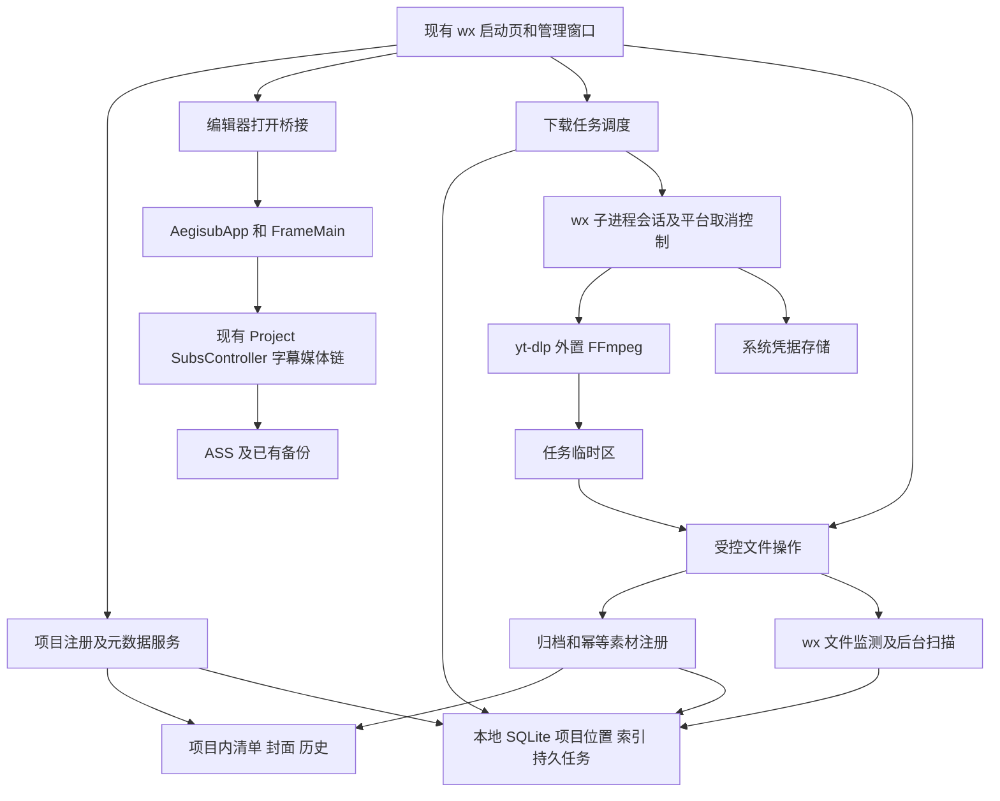

# Aeg 项目管理改版：仓库技术勘察报告

2026-11-19 · 版本 0.6 · PRD 1.0 对照审查

下文的源码勘察描述实施前的基线。工作区随后接入的主工作台、字幕保存保护、项目清单、模板和本地位置库，以及 Linux 实测结果，见[工作区实施记录](s0-baseline.md)。

对照 PRD 1.0 后，原生同窗、随目录迁移的项目 JSON 和本机任务库仍可作为实现起点。0.5 版遗漏的细节会直接改变用户看到的结果，例如只有一个“语言”字段、取消登记与删除文件含义不清、便携升级只测换目录。本次已修订设计并将首版条款逐项映射到验收。Windows 整包、真实站点和新工作流仍待实测。设计见[架构设计](architecture-design.md)，验收见[实施计划](implementation-plan.md)。

## 本次审查的基线

| 项目 | 本次核对结果 |
| --- | --- |
| 代码 | `/home/bily/project/Aegisub`，`codex/compare-tab`，`60f96f7acffaa99602d12d38156a6fbb85dbd392` |
| 本地 Git 状态 | 全历史检出，工作树在审查前干净。origin 指向 `xiaotianMC/Aegisub`，跟踪 `origin/codex/compare-tab`，本地缓存显示 +0/-0 |
| 与旧稿的关系 | 10 月 28 日勘察的 `88c34cf62`、10 月 29 日 AI 章节的 `03ba19cdf` 均是当前提交的祖先。由前者到本次 HEAD 有 279 个提交、441 个文件变化。旧稿的远程别名、浅克隆、未跟踪 wrap 和构建结果属于当时的环境 |
| 构建/依赖 | Meson/C++20；wx 默认最低 3.3.4，fallback 固定为 v3.3.4；内建识别由 whisper 构建选项决定。文档审查时 build 与 build-ci 的版本头均为 `a5cef9ad2`。随后 S0 重建 build-ci，版本头已更新至 `60f96f7ac`，Linux 测试结果见[执行记录](s0-baseline.md) |
| 需求基线 | [PRD 1.0](PRD.md.txt)，文件 SHA-256 为 `5afa12af09ad80f64ee2aa018c4250292bf727d8c191920fe6a59fbd77deaa8e`。以其 16 章及后续 D01–D03 为准。R 编号、技术选型、Windows 候选版本和浏览器方案按各自来源标记 |

## PRD 1.0 对照结果

| PRD 范围 | 0.5 版覆盖情况与差异 | 0.6 版处置及验证位置 |
| --- | --- | --- |
| 1 产品目标、2 个人创作场景、3 页面 | 同窗/独立窗及四类搜索已有路线。首页没有明确上次项目与未完任务如何同时出现，仪表盘、系统文件管理器入口缺少逐项观察条件 | 架构 3.4、7.3 明列首页五字段、仪表盘八项、分集列表与打开目录。计划 6.2 对 A–E 五个场景留证，S1/S3/S4/S7 |
| 4 项目与系列、5 监测与迁移 | 单个“语言”无法同时保留原语言和目标语言。状态建议主要描述下载。外部重定位假定本机有旧位置表 | 项目分存两种语言，系列按集进入独立项目，下载/编辑/导出触发建议。换机可用已有清单登记原 UUID，核对内部素材和外部引用。架构 3.4、4、8.1，T04/T05/T09 |
| 6 下载、导入与归档 | 队列模型只有笼统的来源/时间；规则快照没有说明按平台、系列或集数落到哪里。本地导入和真实站点下载列在同一项依赖验收下 | 补齐平台、来源 ID、时间、脱敏错误和输出引用。分别验离线导入、全局待分配、三种归档目录、封面提取失败和登记结果。架构 4、9.2，S6/T10/T11 |
| 7 配置与存储、8 删除与备份 | 四方案已有迁移、查询、备份等维度，可读性和结构升级成本未明列。删除动作已分三类，但用户无法据此判断两套默认策略、解除素材登记后磁盘有何变化 | 架构 5.1 按 PRD 七个维度比较；7.3 针对项目、已登记素材及磁盘普通文件说明可见结果。S4 设置相反的项目/文件偏好，重启及重扫后复核。T04/T07/T13 |
| 9 异常恢复 | 已有任务实物核查，“恢复最近页面”可能使无文件启动直接跳离首页 | 首页显示上次项目、页面提示和未完成任务，原目录失联时可重连，显式文件参数仍走编辑入口。架构 3.4、9.4，S7/T16 |
| 10 版本与更新、11 安全日志、12 技术约束 | 发布来源、手动升级和凭据边界已设计。缺工作台功能版本对应关系、用户手动核验发行资产的步骤，以及便携目录原地升级样例 | 按 D03 保留检查与提示，普通发布另验来源、完整性、人工升级失败恢复。日志覆盖路径关联与文件失败，敏感材料继续排除。架构 10.2–10.3、11.2，T12/T14/T15/T17 |
| 13 阶段范围 | P2 曾概括成异常、性能和按证据增强，漏列了历史版本恢复及根据首版反馈改进界面/工作流 | S0–S8 保留基本安全与反馈。计划 7.1 明列第二阶段的专项和两类改进，根据首版数据选择具体工作 |
| 14 首版验收、16 交付定义 | 已有 T01–T18 和分步骤演练，但没有逐条 PRD 对应关系，各步骤可分别用不同样本通过 | 计划 6.1 对应 32 项验收与五类测试，6.2 要求在同一个项目上完成编辑、状态维护、恢复、升级与重开 |
| 15 技术勘察 | 当前代码与 10 月历史观察已有区分，历史 fork 头与上游基线的差额仍需分开理解 | 本节下表列出七份勘察输出在现有三份文档中的位置和剩余证据 |

**后续决策的影响。** D01 细化 PRD 3.1、14.1 第 7 项的搜索字段，D02 补充 12.1 的系统支持政策。PRD 10.3 原定确认后下载与安装，D03 将获取和安装交给用户。10.3–10.5、13.1、14.5 第 5 项及第 16 章的升级验收据此调整，仍覆盖来源、完整性和升级后的项目数据。PRD 6.3 明确临时登录、长期授权和多账号，浏览器与 Cookie 采集细节留给技术勘察，R26.a–f 记录已有设计的选择。未来 AI 章节属于额外设计，首版和第二阶段按 PRD 13 验收。

**便携包需要单独验证。** 当前 CI 把签过名的主程序放回便携 ZIP 并上传，安装程序另有签名作业。便携包还包含脚本、依赖和默认配置，核对主程序签名只覆盖其中一个文件。S8/T17 增加整包来源及摘要核对，并以保留原主程序、仅更改包内脚本的样本验收。[Windows 打包作业](https://github.com/xiaotianMC/Aegisub/blob/60f96f7acffaa99602d12d38156a6fbb85dbd392/.github/workflows/ci.yml#L449)、[便携包内容](https://github.com/xiaotianMC/Aegisub/blob/60f96f7acffaa99602d12d38156a6fbb85dbd392/packages/win_installer/portable/create-portable.ps1#L83)

**PRD 15.1 的可复核基线。** 10 月勘察记录的上游固定快照 `d8ad83042ea828c69ff271072f12b3a23786659b` 是本地 HEAD 的祖先。`git rev-list --left-right --count d8ad83042ea828c69ff271072f12b3a23786659b...HEAD` 为 `0 / 292`，两端树的 `git diff --shortstat` 为 453 个文件有变化。292 是两个固定提交的可达提交数差，不代表 292 项自定义功能。基线表中的 279 个提交从旧 fork 工作头 `88c34cf62` 起算。实际发布或合并时由 S0/S8 重新固定采用的上游提交与自定义提交。本次仅核对本地 Git 对象。

| PRD 15.6 要求的输出 | 查阅位置与证据状态 |
| --- | --- |
| 1 仓库现状报告 | PRD 15.1 对应本节基线、本报告“当前实现的复核入口”和 10 月历史附录，已区分当前检出与历史环境 |
| 2 模块和依赖关系 | PRD 15.2–15.4 对应架构 2–5、9–10、13 的 F01–F18，标明现有模块、拟新增边界和须实测的外部工具 |
| 3 候选技术方案比较 | PRD 15.2–15.5 对应架构 2、5.1、6、10.1 和本报告历史第 5 章，当前推荐及取舍以架构为准 |
| 4 核心改动范围分析 | PRD 12.2、15.2 对应架构 3 及计划 S0/S1，涵盖窗口、主线程、回调、读写、已有命令和回归影响，核心改动需先审阅 |
| 5 风险清单与兼容评估 | 下节风险和架构 12.1、计划 4.1。目标 Windows、凭据、下载工具组合、普通发布及便携保护尚待 S0/S6/S8 实测 |
| 6 建议实施顺序 | 计划第 2、3、6 章列出依赖、S0–S8 和验收，P2 见第 7 章 |
| 7 需要确认的技术决策 | 架构 1.1、12.2 及计划各阶段前置区分已确认的 D01–D03、Q01–Q07 的决策进度，以及需要实际构建/运行才能判断的事项 |

## 0.5 版源码审查的风险与处理

表中的 P0 表示按旧假设实施可能丢失用户数据、破坏活动编辑会话或扩大账号授权范围。P1 表示设计需要在对应阶段修正，才能满足发布或恢复条件。阶段和测试编号可直接在实施计划查到。

| 优先级与位置 | 可重现的条件与后果 | 修订与验收 |
| --- | --- | --- |
| P0 · 字幕写盘与模型切换 | writer 已输出部分字节后抛错，或模型已发布但观察者无法确认；两者都不能笼统显示“原文档完好”。备份又属于提交后的独立步骤 | 清单明确提交，字幕保存检验原文件字节；打开桥接区分发布前失败、RecoveryBlocked 和带警告的成功。S1/S2，T02/T04/T13 |
| P0 · 持久目录 | 把队列和唯一未分配文件写到 `?local` 会跟随缓存策略。把它简单改成 `?state`，又会在 Windows 安装版进入漫游目录 | 工作台采用独立的本机持久目录，便携模式以可执行目录为根；清理后再重启核对库和 Inbox。S2/S7，T04/T16/T17 |
| P0 · 项目并发与跨卷移动 | 两个不同数据根可同时打开同一个项目；两次单独检查 revision 均可通过。跨卷校验后新加的源文件也可能被整树清理 | 项目锁内复核并替换，同卷提交后再登记；跨卷只清理搬运清单中仍匹配的源项。S2/S4/S5，T04/T07/T09 |
| P0 · 下载授权 | 旧采集示例把未过滤的浏览器授权与用户任务 URL 交给同一联网进程；事后域过滤无法限制此前请求。转录程序还会把整个父环境交给子进程 | 先验证采集和联网隔离，再用限定站点的私有副本；独立下载进程使用最小环境。门禁用合成授权和受控接收端验证，未证明的组合标出阻塞。S0/S6，T12/T14 |
| P1 · 窗口宿主 | 原路线从已删除的启动页搬 UI，并假设主窗只有一张编辑页。切页、拖放和逐窗退出可能丢失正在比较的决定 | 新管理页包在 WorkspaceTabs 外层；保留内部比较写锁、标签、状态栏和独立窗。退出先预检全部窗口和任务。S1/S3，T01–T03 |
| P1 · 队列恢复与素材登记 | “所有非终态改中断”会吞掉待分配和待处理意图；session 过期会挡住本来可离线的归档；重试新建 output_id 会绕过查重 | 区分活动/等待/终态，稳定产物键跨 attempt，重启对账文件、清单、DB。覆盖双产物和两次重启。S6/S7，T10/T11/T16 |
| P1 · 系列、副本与备份 | 系列和子项目双写所属关系，或只换恢复包顶层 UUID，会把副本指回原集。单库备份也记录不了正在改写的项目素材 | 系列清单裁决成员；副本整组重映射，逐项验证文件摘要与清单版本。扫描中断保留上一完整代。S2/S5/S7，T04/T06/T09/T13 |
| P1 · 复用范围 | 当前代码已有 Whisper、ElevenLabs、外部转录、密钥存储、文档代次、比较和单次撤销应用。按旧稿新造会重复已有功能 | 这些能力列为既有回归，未来阶段只处理工作台草稿与跨任务接入。持久下载队列、下载账号和 Job 异常退出仍需单独实现验证。S0/S1/S6，T03/T10/T12 |
| P1 · 发行与用户升级 | 自定义前缀与现有 CI/签名过滤和版本校验不一致；Inno 使用原 AppID 并清理用户目录中的指定文件，便携包自带默认 config.json | 标签贯穿 CI、两套版本头、签名和包元数据；按原版共存、已有用户脚本与改过的便携配置做升级试验。S0/S8，T15/T17 |

## 当前实现的复核入口

**窗口和命令。** OnInit 无条件创建 FrameMain，有文件参数再进入 OpenFiles。WorkspaceTabs 内有编辑与比较两个视图，比较在前景时普通命令受限。命令行的 frames[0] 路由和关闭时先结束比较再询问保存，是接入管理页需要调整的位置。旧首页在 11 月 17 日删除。[启动](https://github.com/xiaotianMC/Aegisub/blob/60f96f7acffaa99602d12d38156a6fbb85dbd392/src/main.cpp#L309)、[主窗内容](https://github.com/xiaotianMC/Aegisub/blob/60f96f7acffaa99602d12d38156a6fbb85dbd392/src/frame_main.cpp#L212)、[关闭顺序](https://github.com/xiaotianMC/Aegisub/blob/60f96f7acffaa99602d12d38156a6fbb85dbd392/src/frame_main.cpp#L372)、[命令路由](https://github.com/xiaotianMC/Aegisub/blob/60f96f7acffaa99602d12d38156a6fbb85dbd392/src/workspace_tabs.cpp#L203)、[删除首页的提交](https://github.com/xiaotianMC/Aegisub/commit/5f18e13143e6c633d68501b5c03a7f02288c2c39)。

**字幕发布和写盘。** Load/Close 由 SubtitleModelInstallation 准备、发布和确认重绑定，MRU、原件备份和 FileOpen 在确认后处理。Save 先写快照；序列化异常和保存后的通知异常分别核查磁盘与内存。现有比较可通过 CheckApply/ApplyComparison 在选定字段上实施一次撤销。[提交后动作](https://github.com/xiaotianMC/Aegisub/blob/60f96f7acffaa99602d12d38156a6fbb85dbd392/src/subs_controller.cpp#L383)、[保存快照](https://github.com/xiaotianMC/Aegisub/blob/60f96f7acffaa99602d12d38156a6fbb85dbd392/src/subs_controller.cpp#L444)、[底层输出析构](https://github.com/xiaotianMC/Aegisub/blob/60f96f7acffaa99602d12d38156a6fbb85dbd392/libaegisub/common/io.cpp#L53)、[比较应用](https://github.com/xiaotianMC/Aegisub/blob/60f96f7acffaa99602d12d38156a6fbb85dbd392/src/subs_controller.cpp#L1118)、[恢复与警告用例](https://github.com/xiaotianMC/Aegisub/blob/60f96f7acffaa99602d12d38156a6fbb85dbd392/tests/tests/ordinary_edit.cpp#L6350)。

**数据目录。** Windows 的 ?state 与 ?user 都在 Roaming，?local 别名指向 ?cache。可读的便携 config.json 会把 ?user/?state/?cache 一起重定向。Linux 在无旧配置目录时采用 XDG 分区，本项目已有模型目录对可清理缓存的处理先例。[别名](https://github.com/xiaotianMC/Aegisub/blob/60f96f7acffaa99602d12d38156a6fbb85dbd392/libaegisub/common/path.cpp#L43)、[Windows 路径](https://github.com/xiaotianMC/Aegisub/blob/60f96f7acffaa99602d12d38156a6fbb85dbd392/libaegisub/windows/path_win.cpp#L46)、[Linux 路径](https://github.com/xiaotianMC/Aegisub/blob/60f96f7acffaa99602d12d38156a6fbb85dbd392/libaegisub/unix/path.cpp#L89)、[便携启动](https://github.com/xiaotianMC/Aegisub/blob/60f96f7acffaa99602d12d38156a6fbb85dbd392/src/main.cpp#L179)、[XDG 目录规范](https://specifications.freedesktop.org/basedir/latest/)。

**任务与凭据。** 转录已有本地模型、ElevenLabs、外部程序及系统/会话凭据封装。transcribe::Program 继承环境、启动后关闭 stdin，合并并保留两路输出，取消调用 wxProcess::Kill。下载器另需有界读取、敏感输入隔离和可证实的整树退出。在应用和根构建定义中检索未见工作台 SQLite、下载 AccountProfile、yt-dlp runner 或项目 watcher。本机 PATH 找到 ffmpeg/ffprobe，未找到 yt-dlp。[转录入口](https://github.com/xiaotianMC/Aegisub/blob/60f96f7acffaa99602d12d38156a6fbb85dbd392/src/command/autotiming.cpp#L294)、[模型下载与校验](https://github.com/xiaotianMC/Aegisub/blob/60f96f7acffaa99602d12d38156a6fbb85dbd392/src/transcribe_models.cpp)、[凭据封装](https://github.com/xiaotianMC/Aegisub/blob/60f96f7acffaa99602d12d38156a6fbb85dbd392/src/secret.cpp#L20)、[进程](https://github.com/xiaotianMC/Aegisub/blob/60f96f7acffaa99602d12d38156a6fbb85dbd392/src/speech_transcribe.cpp#L652)、[yt-dlp 导出范围说明](https://github.com/yt-dlp/yt-dlp/wiki/FAQ#how-do-i-pass-cookies-to-yt-dlp)。

**存储一致性。** 建议保留单库。SQLite 的事务和在线备份覆盖数据库本身，项目清单、媒体目录及账号保护存储分别提交。故障恢复必须靠稳定业务 ID、受控替换与实物复核；恢复包只在所有条目验证后发布。新队列和文件操作尚无运行数据。见[SQLite 事务](https://www.sqlite.org/lang_transaction.html)和[SQLite 在线备份](https://www.sqlite.org/backup.html)。

**构建与发行。** Meson 的 enable_update_checker 构建选项还控制 libcurl 和 WITH_CURL，影响云转录与模型获取。已有运行时更新检查仍使用旧 revision 协议。CI 只在匹配 v* 的 tag push 等已配置事件运行，签名另有条件；正式 GitHub Release 和 CI artifact 是分开的发布步骤。现有 Inno 清理规则和便携默认配置都涉及用户数据。[curl 依赖](https://github.com/xiaotianMC/Aegisub/blob/60f96f7acffaa99602d12d38156a6fbb85dbd392/meson.build#L521)、[现有请求](https://github.com/xiaotianMC/Aegisub/blob/60f96f7acffaa99602d12d38156a6fbb85dbd392/src/dialog_version_check.cpp#L279)、[CI 触发器](https://github.com/xiaotianMC/Aegisub/blob/60f96f7acffaa99602d12d38156a6fbb85dbd392/.github/workflows/ci.yml#L7)、[版本检查](https://github.com/xiaotianMC/Aegisub/blob/60f96f7acffaa99602d12d38156a6fbb85dbd392/tools/check-release-version.sh)、[POSIX 版本头](https://github.com/xiaotianMC/Aegisub/blob/60f96f7acffaa99602d12d38156a6fbb85dbd392/tools/version.sh#L55)、[Windows 版本头](https://github.com/xiaotianMC/Aegisub/blob/60f96f7acffaa99602d12d38156a6fbb85dbd392/tools/version.ps1#L60)、[安装清理](https://github.com/xiaotianMC/Aegisub/blob/60f96f7acffaa99602d12d38156a6fbb85dbd392/packages/win_installer/fragment_automation.iss#L38)、[便携配置](https://github.com/xiaotianMC/Aegisub/blob/60f96f7acffaa99602d12d38156a6fbb85dbd392/packages/win_installer/portable/create-portable.ps1#L90)。

**测试。** 当前已有 gtest main、luajit-52、subtitle comparison integration、ordinary editing integration、live model owner access。Automation 的 POSIX fixtures 还依赖 LuaRocks 的 Lua 5.1 busted。首版用例应覆盖这些既有入口及新增的跨窗、下载和恢复情形。[基础测试](https://github.com/xiaotianMC/Aegisub/blob/60f96f7acffaa99602d12d38156a6fbb85dbd392/tests/meson.build#L93)、[比较集成](https://github.com/xiaotianMC/Aegisub/blob/60f96f7acffaa99602d12d38156a6fbb85dbd392/tests/meson.build#L127)、[编辑与所有权检查](https://github.com/xiaotianMC/Aegisub/blob/60f96f7acffaa99602d12d38156a6fbb85dbd392/meson.build#L715)、[Automation 注册条件](https://github.com/xiaotianMC/Aegisub/blob/60f96f7acffaa99602d12d38156a6fbb85dbd392/automation/tests/meson.build#L29)。

## 源码审查已执行的检查

| 检查 | 观察结果 | 证据边界 |
| --- | --- | --- |
| `git rev-parse HEAD`、`git status --porcelain=v2 --branch`、Git 历史及源码检索 | 当前提交、旧首页删除、文件和符号、两个旧基线的祖先关系已复核 | 环境使用本地 Git 引用，不声称远端分支或 PR 状态实时同步 |
| 在 Linux 临时目录对当前提交的 `libaegisub/common/io.cpp` 注入一次序列化异常 | 写入 `NEW-PARTIAL` 后抛错，原文件 `OLD-COMPLETE` 被部分内容替换 | 直接验证底层写入原语，使用既有 Linux 支持库；未测试所有格式或 Windows 文件系统 |
| `python3 tests/owner_access_check.py --source-root "$PWD" --build-root "$PWD/build-ci"` | 源码扫描干净，允许的访问成功编译，21 个禁止访问的反例全部按预期编译失败 | 使用已有编译参数检查当前源码；不代表完整产品构建或 GUI 回归通过 |
| `sh tools/check-release-version.sh v3.5.1` 与 `sh tools/check-release-version.sh aeg-v3.5.1` | 前者退出 0，后者退出 1 并指出标签不匹配 Meson 3.5.1 | 相同数值隔离了前缀问题。Q01 已决定本轮保留开发标识，正式产品名称、首版号和签名资源在 S8 前定稿 |

Windows 安装/便携、系统凭据、进程树、实际站点及新版工作台的 S0–S8 用例均待实测。GitHub 文档可核实 latest 与列表的接口语义，本次没有获得该仓库实时 latest API 响应；无发行、分页只见预发布、限流和网络失败均使用独立样本验收。[GitHub Releases API](https://docs.github.com/en/rest/releases/releases)

## 2026-10-28 历史勘察

下方保留当时的源码观察、候选方案和命令输出。正文中的“当前”“本次”和 E01–E38 等编号指该次调查日期。旧建议中的独立管理窗优先、工作台正文搜索、应用内更新、平台承诺均已由现行架构和计划取代。链接中的旧源码指定历史提交，未被 Git 收录的旧构建及附件仅保留位置说明。

<details>
<summary>展开 2026-10-28 调查全文及证据附录</summary>

调查日期：2026-10-28（Asia/Shanghai）。调查对象：实际工作区 `O:/Aegisub-Native`，并以 GitHub 只读查询核实远程基线。

**状态：只读调查完成，未开始实现。** 本报告保存在仓库外；没有创建仓库内的 `docs/project-management/technical-survey.md`，没有修改源码、构建配置、README、Git 引用或未提交文件，也没有提交、推送、同步或安装依赖。仓库已有 `docs/`，将来经审阅可将本报告纳入该目录。

全文使用以下标记：**[事实]**＝实际代码、命令或公开接口支持；**[推断]**＝由证据得出的判断，未作运行验证；**[建议]**＝待审阅的设计；**[待验证]**＝本次证据不足。E 编号指向第 12 章的证据附录。源码行号以本次工作区为准；构建目录中的信息是已有产物快照，不代表当前 HEAD 的构建结果。

## 1. 执行摘要（2026-10-28 历史记录）

### 1.1 当前仓库实际情况

- **[事实]** 当前分支为 `codex/style-name-width`，HEAD 为 `88c34cf62b7d337b86c81de68bb93b3767ef5e9d`，提交名称为 `fix(tests): decode escaped subtitle binding metadata`。本地分支跟踪 `fork/codex/style-name-width`，实际远程同名分支也指向这个 SHA。
- **[事实]** 工作区不是完全干净：存在未跟踪的 `subprojects/checkasm.wrap`；没有暂存或已跟踪文件的未提交修改。该文件原样保留。
- **[事实]** `origin` 指向 `TypesettingTools/Aegisub`；`fork` 指向目标 `xiaotianMC/Aegisub`。本地是浅克隆，但通过 GitHub compare API 已核实共同祖先为 `088ca6caa878209e279871f8897273f49342372b`，即本地 `v3.5.1` 标签剥离后的提交。
- **[事实]** 相对调查时的上游 `master`，当前分支多 15 个提交、少 2 个提交；当前两端文件树有 64 个文件不同。相对共同基线，自定义修改涉及 59 个文件，增加 2,415 行、删除 24 行，另含二进制资源变化。目标 fork 的 `master` 与上游 `master` 同为 `d8ad83042ea828c69ff271072f12b3a23786659b`。这些是不同分支的事实，不能将 fork 的默认分支当成当前开发分支。
- **[事实]** 目标 fork 的公开 PR 查询返回空列表。没有据提交署名推断 GitHub 写权限；本次未进行需要写权限的同步或发布。

### 1.2 已验证架构

这是 **Meson/Ninja + C++20 + wxWidgets 的原生桌面应用**。现有 `FrameMain` 是字幕编辑器窗口；`AegisubApp` 已管理多个编辑窗口以及另一个 `StartupWindow`。后者已有启动首页、仪表盘空状态和“返回编辑器”操作，但没有项目创建、项目列表或项目存储。[E01–E08]

现有 `Project` 是**一个字幕编辑会话的音视频、时间码及关键帧协调器**，不是项目文件夹模型。ASS 保存字幕本体、关联媒体路径和部分编辑状态；全局设置和最近文件保存在用户目录的 JSON 中。[E09–E15]

可复用 JSON、路径、日志、后台队列、菜单和快捷键机制。应用层没有找到项目索引数据库、项目级文件监测、凭据管理或下载任务管理；但已有 wxWidgets 依赖内包含文件监测、系统凭据存储和子进程 API，当前 Windows 构建快照启用了前两项。[E16–E23]

更新器已经实现联网版本检查、说明展示和下载链接，尚未实现二进制下载、签名校验、安装替换或回滚。[E24–E26]

### 1.3 最大风险和推荐下一步

1. 绕过现有“未保存字幕”检查直接调用 `Project::LoadSubtitles()`，会造成编辑会话被替换的风险。管理器必须经一个明确的编辑器打开入口转发。
2. 项目目录、ASS 状态、下载任务和可重建索引若没有权威来源区分，会在移动、崩溃或恢复后发生不一致。
3. 文件监测会丢事件，跨磁盘移动不是原子重命名，下载取消也必须处理 FFmpeg 等后代进程。
4. 当前版本号生成依赖完整历史；已有构建产物与当前 HEAD 不一致，旧测试记录不能证明最新代码通过。
5. 第三方二进制许可证不能由 Aegisub 根目录的 BSD 许可证概括，尤其是 yt-dlp 发布版、FFmpeg、VSFilter 及静态链接依赖。

**[建议]** 先审阅“项目清单与本地索引的权威边界”“管理窗口是否必须与编辑器同窗”“支持平台和最低系统版本”。技术上优先复用 wxWidgets，先扩展已存在的独立管理窗口；存储倾向项目目录中的 JSON 清单加本地 SQLite，但需按第 5 章的比较确认。随后才能进入实现阶段。

## 2. 仓库和版本基线（2026-10-28 历史记录）

### 2.1 本地和远程快照

| 项目 | 已验证结果 |
| --- | --- |
| 当前目录、仓库根目录 | `O:/Aegisub-Native` |
| 分支 | `codex/style-name-width` |
| HEAD | `88c34cf62b7d337b86c81de68bb93b3767ef5e9d` |
| 提交时间 | 2026-10-28 15:16:47 +08:00 |
| 跟踪分支 | `fork/codex/style-name-width`，本地缓存显示 `+0 -0`，并已用远程 SHA 独立复核 |
| 暂存和已跟踪修改 | 无 |
| 未跟踪文件 | `subprojects/checkasm.wrap`，内容为指向 `dav1d/subprojects/checkasm.wrap` 的 wrap redirect |
| `fork` fetch/push | `https://github.com/xiaotianMC/Aegisub.git` |
| `origin` fetch/push | `https://github.com/TypesettingTools/Aegisub.git` |
| 浅克隆 | `true`，浅边界为 `088ca6caa878209e279871f8897273f49342372b` |
| 本地 `v3.5.1` | 标签对象 `b7b3ffa4fb2149136e38f0c193a78d30f9e65963`，剥离后为 `088ca6c…` |
| fork 开发分支远端 | `88c34cf…` |
| fork 和上游默认分支 | 均为 `master`，均指向 `d8ad830…` |
| fork 开放 PR | 查询 `state=open&per_page=100` 返回 `[]` |

没有执行 fetch、checkout、reset、clean、pull、merge、rebase、commit 或 push；远程核实采用 `ls-remote` 和公开 REST API，未将远程对象写入本地仓库。

### 2.2 上游差异的三个口径

| 比较口径 | 结果 | 解释 |
| --- | --- | --- |
| 共同基线 `088ca6c…` → 当前 HEAD | 15 个提交；59 文件，37 新增、22 修改；文本 +2415/-24 | 自定义功能的准确差异范围 |
| 共同基线 → 上游 `d8ad830…` | 2 个提交；5 文件 | 当前分支尚未包含的上游变化 |
| 上游当前树 → 当前 HEAD 的树 | 64 文件，37 新增、27 内容不同 | 通过两份未截断 recursive tree 的 blob SHA 逐路径比较，是真正的两端树差异 |

GitHub compare `master...xiaotianMC:codex/style-name-width` 返回 `status=diverged`、`ahead_by=15`、`behind_by=2` 和相同共同祖先。**compare 接口的文件列表是共同祖先到 head 的差异，不能将其直接叫作两端树差异**；因此另做了 tree 比较。

上游两个缺失提交：

- `5bc77e4f61543bfa56132f99c87535ad6319d02e`：`Fix the name of aegisub.set_status_text in the docs (#754)`，修改 `automation/v4-docs/misc.txt`。
- `d8ad83042ea828c69ff271072f12b3a23786659b`：`Normalize video paths so index cache is reused (#752)`，修改 `libaegisub/common/path.cpp`、`libaegisub/include/libaegisub/fs.h`、`src/ffmpegsource_common.cpp`、`tests/tests/path.cpp`。它给相对路径展开及 FFMS 索引缓存键补充词法规范化。

**[推断]** 当前自定义文件集合与上述 5 个上游文件没有重合，因此本次补齐上游发生文本冲突的可能性较低；这不保证合并成功，也不证明无行为回归。本次没有实施合并。

### 2.3 自定义功能与上游代码归属

以下由实际 diff 和提交确认属于当前分支：

| 自定义功能 | 主要改动区域 | 代表提交 |
| --- | --- | --- |
| 长样式名原生下拉框、提示和精确匹配 | `src/subs_edit_box.cpp/.h` | `8f66fe3 fix(styles): fit native dropdown to long style names` |
| 矩形及多种形状创建、图形属性编辑 | `visual_tool_rectangle.*`、`shape_drawing.h`、`rectangle_drawing.h`、`dialog_rectangle.*`、工具栏和命令 | `30c48ae`、`c9212dd`、`dbaa12a`、`d749fb5` |
| 逐行隐藏及图标 | `base_grid.*`、`grid_column.cpp` | `3db4a59 feat(grid): toggle subtitle visibility from line numbers` |
| 反向移动路径 | `src/command/edit.cpp` | `bd6d9df feat(motion): reverse move paths from subtitle context menu` |
| 持久化字幕绑定与组色 | `subtitle_binding.*`、`ass_file.*`、网格和编辑命令、测试 | `9645c34 feat(binding): synchronize subtitle durations with persistent group colors` |
| 首选项菜单位置、助记键 | 菜单 JSON、`menu.cpp`、中文翻译 | `ef6b42c`、`acd33b9` |
| 原生启动首页、仪表盘入口和重开行为 | `startup_window.*`、`main.*`、`command/app.cpp`、菜单 JSON | `b5397e0`、`3951b6f` |
| 已保存字幕绑定元数据的转义解码验证 | `tests/data/check_subtitle_binding.py` | `88c34cf fix(tests): decode escaped subtitle binding metadata` |

ASS 格式、单会话 `Project`、字幕读写、原生窗口框架、JSON 设置、后台分发、更新检查器和打包流程都已存在于共同基线。`git diff v3.5.1 HEAD -- meson.build meson_options.txt .github packages libaegisub` 无输出：这些区域不是本分支新增能力。新增单元测试和 UI 改动不能推导出项目管理已经实现。

## 3. 技术架构地图（2026-10-28 历史记录）

### 3.1 构建系统和实际依赖

**[事实]** 根 `meson.build` 声明 Meson ≥0.60、C++20 和应用版本 3.5.1；主程序为 `aegisub`。Windows 需要 Visual Studio C/C++ 工具链与 Windows SDK，Meson 使用 Ninja 调度，wxWidgets fallback 通过 CMake 导入。动态 CRT 是源码明确要求；“静态第三方库”不等于“静态 CRT”。macOS 还使用 Objective-C/Objective-C++，当前默认部署目标为 13.0。[E01、E02]

主要依赖及职责：

| 依赖 | 实际用途 | 证据和边界 |
| --- | --- | --- |
| wxWidgets | 窗口、控件、菜单、对话框、事件、平台能力 | 系统依赖请求 `std/stc/gl`；fallback 构建 `wxmono` |
| StyledTextCtrl / Scintilla | 字幕文本编辑、语法和样式显示 | `SubsTextEditCtrl : wxStyledTextCtrl`，不是嵌入网页编辑器 |
| OpenGL | 视频画面、字幕预览及可视化工具绘制 | `VideoDisplay : wxGLCanvas`；找不到 OpenGL 时配置直接报错 |
| libass、FreeType、HarfBuzz、FriBidi | 字幕渲染、字体和文字排版 | 根 Meson 和 libass fallback |
| FFMS2 / FFmpeg | 本地视频及音频解复用、解码与索引 | FFmpeg 网络、编码器、复用器默认禁用；当前快照还禁用 programs |
| Boost、ICU、iconv、uchardet | 并发/工具、Unicode、编码转换和检测 | 部分 Boost 由头文件提供，具体链接随版本和配置变化 |
| LuaJIT、luabins、Automation | 自动化脚本及序列化 | LuaJIT 要求 Lua 5.2 兼容模式 |
| Hunspell | 拼写检查 | 可选 feature |
| libcurl | 版本检查 HTTP 请求 | 与 `enable_update_checker` 联动 |
| 各平台音频输出、CSRI/AviSynth | 音频回放和可选渲染/媒体后端 | 依平台及构建 feature 决定，并非每个平台都包含 |
| GoogleTest/GoogleMock | C++ 测试 | 测试依赖，不是产品业务存储或 UI 框架 |

已有 `build/meson-info` 快照显示：MSVC x64 19.51.36260、release、`default_library=static`、C++20、测试和更新检查启用；子项目包括 wxWidgets 3.2.13、FFMS2 5.0、FFmpeg 8.1.2、libass 0.17.5、Boost 1.83、ICU 67.1、curl 8.12.1 等。**这是已有配置快照，未重新构建，也不是锁定文件。** `wxWidgets.wrap` 指向可变的 `3.2` 分支，`ffmpeg.wrap` 指向 `meson-8.1`，可重复发布需要进一步固定实际提交。[E03]

WebView 的限制很明确：根 Meson fallback 设置 `wxUSE_WEBVIEW=false`，注释说明 Linux 构建问题；系统 wx 也没有请求 webview 模块。已有 Windows 生成的 `setup.h` 同样为 `wxUSE_WEBVIEW 0`。因此不能假定能直接塞入 HTML/React 页面；WebView2/WebKit、桥接和运行时打包都需要新增验证。原生 wx 界面无需这些新增运行时。[E02、E22]

**[推断]** SQLite 通常比引入完整浏览器 UI 运行时的维护面小；复用已编译 wx 的文件监测、凭据和进程 API 通常不会新增一整套运行时。具体新增 MB、内存和安装包变化未测量，不能给出已验证数值。已有 `build/aegisub.exe` 为 65,263,104 字节，也只能作为旧产物参考。

### 3.2 启动和窗口调用链

```text
AegisubApp::OnInit
  ├─ 初始化 dispatch → wx 主线程事件
  ├─ Path / config.json / 日志 / MRU / 命令 / 快捷键 / Automation
  ├─ 可选 PerformVersionCheck(false)
  └─ 检查 argv
       ├─ 有文件参数 → NewProjectContext → FrameMain → OpenFiles → Project::LoadList
       └─ 无文件参数 → ShowStartup → StartupWindow
                              ├─ home ↔ board（两个 wxPanel 显隐）
                              └─ OpenEditor → 复用 frames.back 或创建 FrameMain

FrameMain → 独立 agi::Context
              ├─ AssFile / SubsController / Project
              ├─ Selection / Video / Audio 控制器
              ├─ SubsGrid / SubsEditBox / VideoBox / AudioBox
              └─ DialogManager / Path / 本会话脚本
```

`StartupWindow` 自绘卡片，但仍用 `wxBitmapButton`、`wxPanel`、`wxBoxSizer` 等原生组件；Windows 标题栏和圆角由条件代码处理。首页和仪表盘已经能切换；`FrameMain` 本身没有顶层页面导航，其 `InitContents()` 用 sizer 固定组织编辑面板。存在 `DialogDetachedVideo`，只代表视频可分离，不能当成完整编辑器已支持嵌入/脱离页面。[E04–E08]

`ShowProjectDashboard()` 创建或显示单独的启动窗口，不销毁已有编辑器；`OpenEditor()` 则关闭管理窗口并激活已有最后一个编辑器。`NewProjectContext()` 创建独立 `FrameMain`，也会调用 `DismissStartup()`。最后一个编辑器销毁且没有启动窗口时退出主循环。**管理窗口若今后需长期存在，必须调整这些销毁和退出条件。**

命令行当前把参数视为待打开文件，没有发现恢复“上次打开的所有窗口/项目”的会话清单。MRU、窗口最大化状态、ASS 内的活动行/视频位置等可恢复，但它们并不构成全应用自动会话恢复。[E05、E09–E12]

### 3.3 菜单、快捷键和事件

`cmd::init_builtin_commands()` 注册命令；`cmd::call()` 查命令并执行 `Validate()`。菜单和工具栏由资源 JSON 定义，经 `menu.cpp`、`toolbar.cpp` 绑定到命令；键盘经 hotkey 上下文映射。配置、字幕提交和媒体状态使用 `agi::signal`，GUI 使用 wx 事件。`agi::Context` 中有大量具体视图指针，构造/销毁顺序有明确注释要求。[E07、E13]

管理器可以沿用命令注册方式，但管理页不能伪造一个缺少网格、视频等成员的编辑器 Context 后调用任意编辑命令；需要明确命令作用于管理服务还是某个真实编辑会话。当前 `app/project_manager` 不使用传入 Context，转调应用对象，这是已存在的安全边界。

### 3.4 字幕工程、读写和文件操作

现有 `Project` 持有媒体 provider、音频/视频/时间码/关键帧路径，并将这些路径更新到 `AssFile::Properties`。`ProjectProperties` 还包含导出、Automation 和部分 UI 状态。它们由 ASS writer 写入 `[Aegisub Project Garbage]`；绑定信息等写入 `[Aegisub Extradata]`。常规 `WriteFile()` 保存这两类信息，`ExportFile()` 不写工程属性和附加数据。[E09、E10]

读取链是 `Project::LoadSubtitles()` → 编码识别 → `SubsController::Load()` → `SubtitleFormat::GetReader()` → 对应格式读取器；ASS 使用 `TextFileReader` 和 `AssParser`。编码通过已有 charset/iconv 和行迭代处理，移除 UTF-8 BOM。保存经格式 writer、`TextFileWriter` 和 `agi::io::Save`；已有 UTF-8 默认路径、编码转换和平台换行行为。新管理器不应重写字幕解析器。[E11、E12]

`SubsController::Load()` 先读入临时 `AssFile`，成功后交换；它不会自行执行“是否保存旧字幕”的对话。该保护在 `src/command/subtitle.cpp` 的 `is_okay_to_close_subtitles()` 及窗口关闭处理中。Windows 新建字幕会关闭当前文档并加载空白，macOS 则新建编辑窗口；“关闭字幕”命令实际关闭 `FrameMain`。[E11、E14]

**[建议]** 产品项目应是独立的目录对象，以 UUID 关联零到多个字幕文件；编辑会话只关联其中一个文件。项目可有多个编辑会话，一个 ASS 也能独立打开。目录注册不等于创建 `Project`；必须先识别/注册项目目录，再在用户选中某个字幕时进入既有读取链。仪表盘打开具体字幕时，应选择明确的窗口、执行既有未保存保护、再调用读取和关联媒体逻辑，并向管理器返回成功/取消/失败结果。当前 `LoadSubtitles()` 返回 `void`，错误通过 GUI 展示，桥接层若需精确结果还需小范围接口设计。

### 3.5 设置、路径、文件系统、日志和后台任务

| 范围 | 当前位置/机制 | 限制 |
| --- | --- | --- |
| Windows 普通模式 | `?user=%APPDATA%/Aegisub`，`?local=%LOCALAPPDATA%/Aegisub` | fork 与原版可能共享配置命名空间 |
| Windows 便携模式 | 可执行目录存在可读的 `config.json` 时，将 `?user`、`?local` 都改为 `?data` | 实际检测依据是文件存在且可读，不只是 JSON 里的 `Local Config` 值 |
| Linux | `~/.aegisub` | 当前实现不是通用 XDG 配置目录布局 |
| macOS | Application Support 下 `Aegisub` | 便携规则没有照搬 Windows 分支 |
| 全局选项 | `?user/config.json`，`agi::Options` | 面向默认配置中已知选项；不适合直接塞任意项目对象 |
| 最近文件/快捷键 | `?user/mru.json`、`?user/hotkey.json` | 文件级记录，非项目库 |
| 当前字幕媒体关系 | ASS 工程属性，相对 `?script` | 跨盘会保留绝对路径；不能天然随项目移动 |
| 日志/崩溃 | `?user/log/*.json`、本地 crashlog/minidump、recovered 字幕 | 没有通用凭据脱敏机制，新增下载日志需专门处理 |
| 后台任务 | `agi::dispatch::{Main,Background,Create}`；macOS 有单独实现 | 调度工具不是持久化任务队列，也没有下载级取消/恢复状态机 |

JSON 已由内置 Cajun 支持；应用构建和应用源码搜索没有发现 SQLite。`Options` 加载时会跳过默认配置里不存在的键，因此项目 schema 应使用通用 JSON 解析层，而不是直接把全局 Options 当项目数据库。[E15–E18]

`agi::fs` 封装 `std::filesystem` 和平台操作，可复用 `Exists`、`DirectoryExists`、`Canonicalize`、`Absolute`、`DirectoryIterator`、`Rename`、`Copy`、`Remove`、空间检查和文件系统异常。但 `CopyFile(..., false)` 允许覆盖，Unix Copy 也走保存目标；测试还明确包含 `copy_overwrites` 和 `rename_overwrites`。`Remove` 是删除，不是回收站、撤销或“安全删除”。`Rename` 没有跨卷复制后删除的事务封装。[E16]

`Path::MakeRelative()` 区分磁盘根；本地 `MakeAbsolute()` 尚未包含上游此次补充的 `lexically_normal()`。词法规范化也不等于抵御符号链接/junction 越界，需要结合真实路径和目标根校验。[E17]

`agi::io::Save` 使用同目录的固定 `.tmp` 名并在析构时重命名，包含重试；可参考其写入模式，但未看到唯一临时名、多写者互斥、显式 durable commit 或跨文件事务。项目清单不能未经验证就将它当成完整的崩溃安全事务层。[E18]

## 4. 现有能力清单（2026-10-28 历史记录）

| 分类 | 能力 | 可用范围 |
| --- | --- | --- |
| 可复用 | 字幕读写、格式/编码、ASS 内状态、撤销、自动保存和原始备份 | 保留既有编辑行为；不是整个项目的备份 |
| 可复用 | wx 原生控件、菜单命令、热键、信号、主线程分发、日志 | 新页面和桥接应遵循现有线程/Context 生命周期 |
| 可复用 | Cajun JSON、路径 token、基础文件操作 | 增加 schema 和安全约束后用于项目清单 |
| 可复用 | Meson、Windows 安装包和便携 ZIP、版本生成、CI 测试和签名工作流 | fork 的签名身份、环境和服务权限仍待验证 |
| 可扩展 | `StartupWindow` 空仪表盘、`AegisubApp` 窗口管理、`app/project_manager` 命令 | 已有入口；需要项目数据与长期窗口生命周期 |
| 可扩展 | wx 文件监测 API | wx 中已存在，应用未接入；需增量扫描/重建逻辑 |
| 可扩展 | wx 系统凭据存储 API | 当前 Windows 构建启用；各平台运行可用性需验证 |
| 可扩展 | wx 子进程 API、现有 `RestartAegisub()` 启动示例 | 缺少管理型进程会话、管道、子进程树和任务状态 |
| 可扩展 | 更新检查器 | 可以复用后台请求与结果展示，协议和应用更新安全流程需重做 |
| 需要新增 | 独立/系列项目、目录模板、元数据/封面/状态/历史、目录注册 | 当前没有领域模型或持久化 |
| 需要新增 | 全局搜索、文件索引、完整文件管理器、安全移动/删除/冲突处理、项目备份恢复 | 不能以已有 MRU 或字幕查找代替 |
| 需要新增 | 下载队列、并发、取消、重试、持久化和重启协调、素材归档/注册 | 产品要求的下载任务整体尚不存在 |
| 需要新增 | schema 迁移、工具分发升级、应用升级/回滚、敏感信息脱敏 | 不能复用旧数字 revision 作为全部版本语义 |
| 尚未确认 | 当前 HEAD 在各桌面平台的构建、运行、可访问性和便携升级 | 本次只读，未运行应用和构建测试 |
| 尚未确认 | fork 的签名凭据、发布服务器和全量许可证履行 | 工作流文件存在不代表账号资源已配置 |

## 5. 候选方案比较（2026-10-28 历史记录）

### 5.1 UI 与窗口集成

| 方案 | 对实际代码的影响 | 优点 | 成本和风险 |
| --- | --- | --- | --- |
| A：现有 `FrameMain` 增加管理页面 | 调整 `frame_main.h/.cpp` 的顶层布局、菜单/工具栏、键盘上下文、拖放、标题、关闭行为；管理页需要避免误触编辑器事件 | 一窗口内切换，容易保持编辑控件实例 | 当前 FrameMain 构造时就创建 Context 和全部编辑控件；空首页也会承担初始化成本，页面切换需停止播放并管理焦点/OpenGL 生命周期 |
| B：编辑器外独立管理窗口 | 扩展 `startup_window.*`；调整 `main.*` 中 DismissStartup/退出规则；加指定字幕打开桥接，尽量保留 FrameMain | 最接近现状，字幕编辑器改动最少，可先实现产品功能 | 多窗口选中目标和退出语义需明确；不是“管理和编辑默认同窗” |
| C：默认同窗且支持独立编辑窗口 | 在 A 的基础上抽出可嵌入编辑页面，重新界定 Context/FrameMain/parent/状态栏/dialog 所有权；独立窗口作为另一种宿主 | 满足同窗与分离两种工作方式 | 当前 `Context::frame` 是具体 FrameMain，许多命令直接使用它；不是简单 Reparent 一次就能可靠实现，回归面最大 |

证据：`FrameMain::InitContents()` 固定布局；`Context` 直接持有网格、视频和 FrameMain 指针；`AegisubApp::frames` 已提供多编辑窗口；StartupWindow 已独立实现 home/board；分离视频对话框只承载 VideoBox。[E04–E08]

**[建议]** 若“默认同窗”尚非硬约束，第一阶段选 B，保留将来演进空间而不先抽象整个编辑器。若必须同窗，先做 A 的宿主设计评审，C 独立编辑窗口作为明确的后续阶段；不建议同一阶段同时重构宿主和实现全部文件/下载功能。以上是成本建议，尚未替用户确认产品交互。

### 5.2 项目数据存储 A/B/C

| 维度 | A 普通配置文件 | B SQLite | C 项目清单 + 本地数据库 |
| --- | --- | --- | --- |
| 仓库基础 | 已有 JSON 解析和配置 IO | 当前未依赖，需新增构建和访问代码 | 清单复用 JSON；索引和任务库新增 SQLite |
| 数据随目录移动 | 项目内相对路径很好迁移 | 项目内 DB 可以迁移；单个全局 DB 则需导入/重定位 | 清单是移动的权威来源；本地按 UUID 更新根路径 |
| 人类可读/版本管理 | 容易查看、比较和恢复 | 需要工具，二进制冲突难人工合并 | 核心资料可读；索引不进版本管理 |
| 查询/大目录 | 多项目全文扫描或内存索引，规模增大后成本较高 | 事务、索引、约束适合查询和任务状态 | 跨项目搜索走本地索引，清单不枚举每次文件变化 |
| 写入并发 | 需单写者、版本比较及替换保护 | 有事务和锁，仍需处理 busy/磁盘满 | 要避免清单和 DB 同时充当业务真相 |
| 备份恢复 | 关联系统文件和清单一起备份；多文件一致性需控制 | 使用一致性备份；运行中不能只随手复制主 DB | 项目包带清单/封面/历史；本地持久任务另备份，索引可重建 |
| 便携版 | 放项目内即可；全局注册表使用 ?user | DB 放 ?user，便携时跟随程序目录；只读目录/拔盘要处理 | 兼具可移动项目和便携应用状态，凭据不随项目迁移 |
| 跨平台 | UTF-8 和相对路径好处理 | SQLite 可跨平台；不建议多人共用网络文件系统上的活动数据库 | 数据库留本机，项目目录可另行共享；仍需解决多写者冲突 |
| schema 迁移 | 显式 schema_version、备份、逐版转换 | user_version/迁移事务；降级有约束 | 两套 schema 分开版本化，明确可重建与不可重建内容 |
| 新增成本 | 最低；不自动满足完整全局搜索和可靠任务队列 | 新依赖但业务一致性好管理 | 一致性设计成本较高，但贴合完整 PRD 的移动和查询需求 |

SQLite 官方提供在线备份 API；WAL 是数据库状态的一部分，不能忽略正在使用的 WAL 文件。项目在网络目录时，不能未经验证就在该目录启用 WAL 共用数据库。参见 [SQLite Backup API](https://www.sqlite.org/backup.html)、[SQLite WAL](https://www.sqlite.org/wal.html)。这些是候选依赖特性，不是当前仓库已有能力。

**[建议]** 完整 PRD 倾向 C：项目内清单保存 UUID、项目类型、系列关联、状态、封面、目录模板版本及相对路径；可携带的历史放项目受控元数据区。本地 DB 分为两类表：文件/搜索索引可重建，下载任务和未完成文件操作日志必须持久化并备份。不得把整个本地 DB 都称为可删除缓存。若首个可交付范围只包含创建/注册和打开字幕，A 可以先交付；SQLite 应在正式实现全局搜索/下载任务前引入，避免先写大型自制索引。B 也可行，但需要额外规定项目导出/迁移格式。最终选型取决于规模、多人并写和便携要求。

### 5.3 文件监测

| 方案 | 仓库证据 | 适用性和代价 |
| --- | --- | --- |
| wxFileSystemWatcher + 扫描校准 | vendored wx 有 Add/AddTree、rename、warning/overflow；Windows 实现使用 ReadDirectoryChangesW；当前生成配置启用 | 首选候选，沿用事件系统，无新增独立库；需验证各后端递归和目录移动行为 |
| 直接 Windows API | wx 本身已封装该 API | 可更细控制句柄和事件，但增加 Windows 专属代码及其他平台实现；无实测缺口前不优先重复封装 |
| 定时扫描 | 已有 DirectoryIterator/dispatch，但没有项目扫描器 | 可作为无监测支持、网络盘或丢事件后的后备；不宜每个文件事件都全量扫描或全量 hash |
| 新跨平台监测库 | 当前没有集成 | 增加依赖、线程与分发成本；应有明确 wx 后端缺口才引入 |

**[建议]** 用“首次扫描 + 事件批处理 + 溢出/失联后重扫”保证最终一致。监测是变化提示，不是完整审计日志。Windows 的缓冲溢出会丢失细节，官方要求重新枚举；网络监测缓冲超过 64 KiB 会失败。参见 [ReadDirectoryChangesW 官方说明](https://learn.microsoft.com/en-us/windows/win32/api/winbase/nf-winbase-readdirectorychangesw)。

### 5.4 yt-dlp 进程管理

产品已指定独立子进程，本报告不再比较嵌入 Python 下载库。当前应用仅发现 `src/utils.cpp` 的 `RestartAegisub()` 使用 `wxExecute`；没有可复用的完整进程任务管理器。wx 本身提供异步 `wxExecute(argv, …)`、`wxProcess::Redirect()`、两路输入流和终止事件。[E23]

| 候选 | 结论 |
| --- | --- |
| 扩展 wxProcess/wxExecute | 优先候选，契合当前 UI；新增管道读取、状态机、进程生命周期和平台取消控制 |
| 直接 CreateProcess / POSIX 进程 API | Windows Job Object/进程组等必要控制可局部使用；不必一开始重写全部跨平台启动逻辑 |
| 新进程库 | 当前未依赖；只有 wx 无法实现已确认需求时再评估，避免为一个工具引入另一套调度体系 |

**[建议：输出协议]** 不解析人类进度条。选择并锁定 yt-dlp 版本后，以 `--newline`、`--progress-template` 和 `--print after_move:…` 约定带标记、可转义的机器记录；显式读取下载量、总量/估算量、速度、ETA 和最终文件路径。stdout 与 stderr 都必须持续排空，处理分段 UTF-8、半行、超长行、无总大小和后处理阶段；UI 更新节流，原始输出先脱敏再记录。子进程退出码、最终输出和文件校验共同决定下载完成，不能将“100%”当作成功。[yt-dlp 官方选项](https://github.com/yt-dlp/yt-dlp#usage-and-options)

**[建议：调度和恢复]**

- 应用层限制并行任务数量；yt-dlp 的 fragment concurrency 是另一层资源消耗，需计入总带宽/CPU 控制。
- 每个任务至少持久化任务 UUID、项目 UUID、来源 ID/不含凭据的可重建定位信息、格式选择、工具版本、目标相对路径、staging 位置、状态、重试次数和最近错误类别；不保存裸 Cookie、令牌或带敏感 query 的 URL。
- 取消先请求正常退出并记录取消中，超时再终止整个下载/后处理进程树。Windows 的 Job Object 控制、POSIX 进程组和退出收割需要单独实现/验证；不能只杀主 PID 后遗留 FFmpeg，也不能把取消自动当失败重试。
- 网络类失败可有上限地退避重试；鉴权、路径冲突、空间不足和权限拒绝等待用户处理。不要把所有错误无限重试。
- 重启后将 running/postprocessing/cancelling 等非终态标为 interrupted，检查任务工作目录、部分文件和 journal，再决定恢复、重新下载或继续归档。不能仅凭旧 PID 认领进程，PID 可能重用。
- 任务记录恢复只恢复“做过什么/下一步做什么”；真正续传还依赖 `.part`/fragment 状态、服务器支持、来源有效性、相同格式等条件。yt-dlp 的 `--continue` 也不是每次都能从原字节继续。[yt-dlp 续传选项](https://github.com/yt-dlp/yt-dlp#filesystem-options)

**[建议：三个完成边界]**

```text
queued → running → postprocessing → downloaded
                                   ↓
                             archive_pending → archived
                                                   ↓
                                           register_pending → completed
```

各活动阶段可进入 failed/interrupted/cancelled。`downloaded`＝下载及工具内后处理成功且产物可验证；`archived`＝归档到产品目标位置成功；`completed`＝项目素材记录已提交。后两步失败时重试归档/注册，不重新下载。使用 task UUID/产物 ID 及唯一约束实现幂等，处理“文件移动成功但 DB 提交前崩溃”。下载器内部 `after_move` 不等于产品素材归档成功。

staging 使用任务专属目录，优先放在目标卷的受控临时区；索引忽略该区。完成归档后由明确的 FileOps/素材注册事件触发更新，监测仍参与最终校准；不能靠全局关闭 watcher 掩盖所有下载事件。重复判定先比较来源 ID/格式，再按需比较内容；同名不是同内容。目标路径需预留并执行不覆盖提交，发生冲突让用户选择复用、改名或明确覆盖；普通“先检查存在再 Copy”仍有并发竞争。[E16、E19、E23]

### 5.5 凭据存储

| 方案 | 代码依据 | 建议 |
| --- | --- | --- |
| wxSecretStore | 当前依赖内已有；Windows 实现调用 CredWrite/CredRead，macOS 使用 keychain，Unix 需要 libsecret；生成的 Windows 配置启用 | 优先候选，运行时检查 IsOk；数据中只存凭据引用和账号标识 |
| 平台原生凭据 API | wx 已封装主要平台 | 特殊容量/认证需求再补，不先做三套重复实现 |
| 项目 JSON/数据库明文 | 当前没有这种需求实现 | 不采用；会随项目备份/迁移泄露 |
| 单次会话凭据 | 不依赖持久化 secret store | 系统存储不可用或便携跨机时的明确后备，不偷偷降级为明文 |

Cookie jar 可能超出系统凭据接口的容量/格式能力，不能假定把完整文件塞进一个 secret 条目就可行。若 yt-dlp 要求 Cookie 文件，可经用户授权使用浏览器读取，或从受保护存储临时导出到权限受限目录并可靠清理；Cookie 内容不进入命令行、项目目录、日志和自动诊断包。Windows 命令行/环境也不是秘密保险箱。便携应用的数据可以移动，操作系统凭据不承诺跨机器携带。[E20]

### 5.6 更新机制

| 方案 | 当前基础 | 成本/风险 |
| --- | --- | --- |
| 版本通知 + 用户打开发布页/下载安装包 | 已有检查器 UI、curl 和超链接 | 第一阶段风险最低；换成 fork 专属版本与可信渠道，并明确安装/便携资源 |
| 应用自动下载并校验，用户确认安装/退出替换 | 尚缺产物下载、签名/hash 验证、替换器和回滚 | 需要独立设计权限、锁文件、磁盘空间和数据迁移；有签名 CI 不等于已有客户端升级器 |
| 覆盖正在运行的目录 | 无可靠实现 | 不采用；Windows 程序锁、便携用户数据及失败回滚均未解决 |

yt-dlp/FFmpeg 的工具升级应与完整应用版本分开管理；不让下载任务在运行时随意调用 `yt-dlp -U` 改写共享工具。工具升级也要校验、保留版本、记录兼容性，并确保无运行任务。[E24–E28]

### 5.7 安装版和便携版

| 形式 | 已有构建链 | 需要扩展/验证 |
| --- | --- | --- |
| Windows 安装版 | `win-installer` → `tools/win-installer-setup.ps1` → Inno Setup；拉取 DependencyControl、字典、VC runtime、x64 VSFilter 等 | fork 标识、第三方 notices、工具部署、用户数据目录、升级迁移与签名资源 |
| Windows 便携 ZIP | `win-portable` → `create-portable.ps1`；安装到 staging 后复制 exe/locale/字典/脚本/依赖和 config.json，生成 ZIP | 干净用户环境运行、CRT 可用性、目录可写、跨目录移动、升级保留用户数据、工具子目录和许可证文件 |
| macOS/Linux | CI 和 macOS bundle/sign/notarize/DMG、Linux 构建/源码包基础存在 | 新管理功能各平台后端和下载工具分发尚未验证；不把 Windows 便携规则直接外推 |

便携脚本复用 `installer-deps` 内容；单独执行 `win-portable` 前需要这些依赖已准备好，当前 CI 先构建安装包再构建便携包。`replace-executable.ps1` 是**构建时**将已签名 exe 放入 ZIP 并核对 SHA256 的脚本，不是面向用户的应用升级工具。[E27–E29]

## 6. 推荐架构（2026-10-28 历史记录）

本章全部为 **[建议]**；框图中的新服务是职责边界，不代表已经存在的类/文件，也不要求逐框创建抽象接口。



### 6.1 权威数据和关联规则

1. **字幕内容**由现有 ASS/编辑器负责；不得复制为项目数据库里的第二份可编辑字幕真相。项目索引可以提取文本搜索，但不能自动回写字幕。
2. **项目业务资料**由项目内清单和项目历史负责，使用独立 `project_id`、`kind`、schema 版本和相对路径；封面放元数据区或项目可迁移位置。文件索引随时可重扫，不把每个临时文件写进清单。
3. **系列关系**用系列 UUID 和子项目 UUID 关联；系列清单保存子项目相对位置，子项目保存所属系列 ID。ID 是身份，目录名/集数是可变属性。独立项目无需假装自己属于某个系列。
4. **本地注册库**保存 UUID → 当前根路径、最近访问和搜索索引。项目目录被外部复制后出现相同 UUID 时，需要区分副本/迁移并要求选择，不能自动合并或覆盖。
5. **下载任务及操作日志**是本地持久业务状态，不随索引重建而删除。项目备份默认不带可复用凭据；是否携带未完成下载和任务记录要有显式导出规则。

### 6.2 三条主要数据流

- **创建/注册项目：** 验证目录与权限 → 检测已有清单/注册记录 → 为新项目生成身份或读取已有身份 → 生成/验证模板目录 → 安全提交清单 → 更新本地位置表 → 首次扫描 → 展示。注册现有目录不得擅自移动、重命名或覆盖其中的文件。
- **从仪表盘打开字幕：** 项目 UUID + 相对字幕路径 → 根路径解析和文件类型验证 → 选中/创建真实编辑窗口 → 既有 TryToClose/保存取消语义 → LoadSubtitles/关联媒体链 → 返回明确结果 → 更新最近访问。重用已有窗口时以路径和会话映射选择，不能继续盲用 `frames[0]` 或 `frames.back()`。
- **下载归档素材：** 持久化 queued → 取凭据引用 → 独立子进程写 staging → 校验工具退出和产物 → 受控归档 → 幂等素材注册 → 项目/索引刷新 → 终态持久化。各步异常保留足够 journal 供重启协调。

### 6.3 文件监测、大目录和移动恢复

- 第一次扫描在后台分批执行，限制并行 IO，不在 UI 线程遍历。基础索引先用相对路径、类型、大小和 mtime，内容 hash、封面和字幕全文按需/后台提取；文件数为 N 的首次扫描至少需要 O(N) 枚举，不能承诺恒定成本。
- 事件按目录/时间窗合并，扫描期间记录增量或做末尾校准，避免“扫描结束漏掉扫描中的变化”。溢出、监听根丢失、网络重连时标记索引过期并安排校准。
- 同目录 rename 有机会获得旧/新路径；跨目录、跨卷和错失事件时可能只得到删除/新增。文件 ID、内容指纹可以辅助匹配，但不保证跨卷或跨平台稳定；不能仅按同名断定同一文件。
- watcher 不直接删除或移动用户文件，只更新模型/提出冲突。编辑中的 ASS 外部修改先比较已载入基线；提示重载、另存或保留，不能自动覆盖内存修改。应用自身保存/临时替换事件用操作 ID 和路径对照消重，仍做最终校准。
- 项目根目录外部移动：监测根自身/父目录或感知根消失；优先在用户选定的新位置读取 UUID 重定位，必要时扫描有限候选目录，不能无提示扫描整机。Windows 目录内容监听并不保证报告根目录自身移动。
- 系列父目录移动：读取系列 UUID，根据子项目相对位置逐个恢复，再验证每个子项目 UUID。找不到的集保持离线/待定位，不能静默新建或按文件夹名误配。
- 应用主动同卷移动：检查打开的媒体句柄和进行中的任务，暂停相关写入，规划冲突后执行并更新位置表/会话路径。跨卷移动：容量检查 → 复制到临时目标 → 按文件校验 → 提交新根 → 核实配置和索引 → 经明确规则处理源目录。失败保留原目录和 journal，不能把单次 Rename 当跨卷迁移。
- 模板中的路径拒绝绝对路径、`..` 越界、保留设备名和危险根目录；解析 junction/symlink 后再次校验目标边界。长路径、UNC、权限拒绝、大小写差异、网络盘和拔盘都需有显式错误结果。

### 6.4 项目备份和恢复

现有 `.ORIGINAL` 和 `.AUTOSAVE.ass` 只保护字幕文件。项目备份需要列出清单/封面/历史/字幕和可选素材的范围、格式版本与校验值；未完成下载另作明确选择。备份期间暂停项目元数据写入或取得一致快照，活动 DB 使用一致性备份方式。恢复先解包到受控临时目录，校验路径、文件大小/数量、格式版本和冲突，再注册/切换，禁止压缩包路径穿越和无确认覆盖现有项目。恢复成功后重建派生索引。

## 7. 核心修改影响分析及测试发布基础（2026-10-28 历史记录）

### 7.1 预计修改区域

下表全部是**未来影响分析，尚未实施**。

| 现有文件/模块 | 预计原因 | 风险 | 必要回归 |
| --- | --- | --- | --- |
| `src/startup_window.cpp/.h` | 项目列表/仪表盘/导航，管理窗口长驻 | 空状态、焦点、DPI、生命周期 | 无参数启动、键盘操作、多窗口关闭 |
| `src/main.cpp/.h` | 服务初始化/退出、管理窗口保留、指定文件定位 | 退出过早、悬空回调、任务进程遗留 | 命令行、文件关联、多编辑窗口、退出取消 |
| `src/command/app.cpp`、菜单/工具栏/快捷键资源、翻译 | 管理/下载/文件操作入口 | 命令误用编辑 Context、快捷键冲突 | 默认热键、菜单可用状态、多语言 |
| `src/command/subtitle.cpp`、`subs_controller.*`、`project.*` | 提取受控打开入口/明确结果；项目移动时协调路径 | 最高数据安全风险：未保存字幕及媒体链 | 保存/取消/失败、编码、撤销、自动保存、关联媒体 |
| `src/frame_main.*`、`include/aegisub/context.h` | B 仅少量桥接；A/C 需页面/宿主和所有权变化 | C 的生命周期和 OpenGL 回归面较大 | 音视频播放、分离视频、弹窗、焦点、绘图与绑定 |
| `libaegisub` 的 JSON/路径/fs/dispatch 周边 | 安全文件操作、任务持久化及监测/扫描 | 越界、覆盖、UI 卡死、并发/崩溃一致性 | Unicode/UNC/跨盘/权限/空间不足、并发冲突 |
| `src/dialog_version_check.cpp`、`version.*`、`tools/version.*` | fork 版本与发布渠道、未来安全升级 | 错误降级、错装原版、配置迁移失败 | 版本排序、渠道/平台选择、取消及回滚 |
| `meson.build`、`src/meson.build`、wrap | 条件新增 SQLite/业务源文件；能力检查 | fallback 和跨平台构建 | Windows/Linux/macOS 构建矩阵 |
| `packages/`、打包/签名工具、CI | 工具与许可证、便携保留数据、发布校验 | 丢用户数据、缺运行时、不可信二进制 | 安装升级、干净环境、便携移动和升级 |
| `tests/meson.build`、新业务测试及集成 fixture | 接入新模块验证 | 把独立校验脚本误当完整应用测试 | 见下一节 |

新项目领域、索引、下载状态机、FileOps、凭据桥接尚没有对应业务文件；本报告未虚构其现有路径或行号。建议先按职责实现少量直接模块，不为每个框预建一套接口/工厂。

### 7.2 实际存在的测试

| 需求范围 | 实际证据 | 覆盖判断 |
| --- | --- | --- |
| 字幕读写/编辑器回归 | C++ 有编码、文本语法、时间、路径等测试；有 rectangle_drawing/subtitle_binding 单元测试；`tests/data/check_*.py` 对外部保存出的 ASS 做断言 | 部分覆盖；没有看到完整 FrameMain/ASS 打开编辑保存的自动集成套件 |
| 项目配置读写 | `tests/tests/option.cpp` 有全局选项解析及 roundtrip | 是全局设置测试，不是新项目清单测试 |
| 路径 | `tests/tests/path.cpp`、`fs.cpp`、access/mru 等 | 已有；不代表安全迁移/跨卷事务已覆盖 |
| 文件监测 | 应用未接入，没有项目监测测试 | 无 |
| 下载任务状态 | 没有任务实现或测试 | 无 |
| 配置迁移 | hotkey 有专用迁移代码；全局 Options 有类型和错误处理测试 | 没有通用项目 schema/数据库迁移测试，不把 hotkey 迁移当成项目迁移框架 |
| 便携运行 | CI 生成 ZIP，签名替换脚本核对 exe hash | 没有看到便携首次运行、持久化和升级回归测试 |

`tests/meson.build` 注册 `gtest main` 和 `luajit-52`。Automation 测试仅在非 Windows 且 luarocks+busted 可用时注册；CI 在相应平台检查注册情况。因此 Windows 的“2/2”是 **C++ 主套件 + LuaJIT 兼容性检查**，不是完整 Lua Automation 回归。[E30、E31]

已有 `build/meson-logs/testlog.junit.xml` 记录 2 个测试任务通过，C++ stdout 记录 385 tests/40 suites passed；该 XML 文件时间为 2026-10-28 13:40:08。`testlog.txt` 和 `testlog.json` 在调查时均为 0 字节。已有 `git_version.h` 仍为 `6962-codex-style-name-width-b5397e0`，不是当前 `88c34cf`；gtest exe 时间为 13:01:23，主 exe 为 14:15:48。**不得把这些旧产物和旧日志写成当前 HEAD 已通过。** 文档中的历史验证记录也仅是既有记录。[E32]

本次没有运行编译、测试或 UI 操作。尤其测试 setup 会创建/删除 fixture，构建会刷新版本头等文件；只读调查阶段不执行这些会写盘的流程。

### 7.3 已有 CI、打包与版本检查

CI 包含 Windows MSVC、Ubuntu Debug/Release 和 macOS 构建配置，执行 `meson setup`、`meson compile -C build`、`meson test -C build --verbose --suite Aegisub`。Windows 生成 Inno 安装包与 portable ZIP；macOS 有签名、公证和 DMG；Linux 有源码分发检查。`tools/check-release-version.sh` 核对 tag、Meson 和 metainfo 版本。[E28、E33]

Windows 签名分为构建、单独受保护的签名工作流、再打包和安装器签名；工作流会核实 Authenticode 状态、时间戳和发布者。**[待验证]** fork 是否已配置 Azure 签名身份、release 环境和对应变量；没有执行发布或核实实际发布包内容。当前 CI 主要上传 artifacts，不能因此认定 fork 已有可用的完整应用更新服务。

### 7.4 第一阶段应增加的验证（计划，非现有能力）

| 类型 | 第一阶段必须达到的基本验证 |
| --- | --- |
| 单元测试 | 清单校验/迁移、系列关联、路径边界、状态转换、进度记录解析、幂等注册及冲突策略 |
| 集成测试 | 创建/注册→重启恢复；指定字幕打开→保存取消；模拟下载进程输出/退出→归档/注册；watcher→索引校准；跨卷移动/备份恢复的可恢复步骤 |
| 原功能回归 | ASS/SRT、编码、注释/Extradata、绑定/绘图、Undo/Redo、关联媒体、自动保存、分离视频、命令行文件打开 |
| 便携版 | 新用户/无预装依赖、可写/只读目录、移动目录后重启、保留配置/任务升级、移到另一台机器后凭据提示 |
| 安全测试 | 路径穿越、符号链接/junction、Shell/参数注入、恶意文件名和输出、覆盖竞态、Cookie/令牌脱敏、压缩包恢复边界、升级产物校验 |

第一阶段仍需模拟磁盘满、权限拒绝、取消和关键提交间崩溃等基本错误，不把数据丢失防护推迟。大规模故障组合、长时间压力和性能专项放第二阶段；届时再用真实目录规模定义扫描/搜索/UI 延迟目标。平台持久化矩阵要覆盖 Windows 安装/便携、Linux、macOS；本仓库未发现移动端应用目标，若产品新增移动端需另行评估，不能把桌面持久化当移动端已完成。

## 8. 版本、更新、许可证和安全方案（2026-10-28 历史记录）

### 8.1 当前更新器的完整调用链

**[事实]** 根选项默认 `enable_update_checker=true`，请求服务器默认 `https://aegisub-updates.redvice.org`，base path 为 `/trunk`。Meson 设置 `WITH_UPDATE_CHECKER` 和 URL 宏，并在启用时依赖 libcurl。[E24]

自动链：`OnInit()` 首次启动询问用户是否自动检查 → `PerformVersionCheck(false)` → Background 队列 → 检查开关和 Next Check → 互斥锁 → `DoCheck()` → curl → 主线程结果对话框。手动链：菜单 `app/updates` → `PerformVersionCheck(true)`。未交互模式的错误不弹结果对话框；通常把下次检查设为一小时后，也有“一周后提醒”入口。[E25、E26]

请求使用 `rev`（GetSVNRevision）、`rel`（官方标记）、OS、系统语言、应用语言；User-Agent 含应用长版本。响应不是 JSON，而是逐行 `|` 分隔的 6 字段，第二字段转整数与当前 revision 比较，后面三个字段解码为 URL、显示名和说明；第 0、2 字段未实际使用。UI 展示说明和链接。[E25]

只追踪到用户点击超链接，没有程序包下载、校验、安装提权、程序替换、差分补丁或回滚。检查会更新用户选项中的检查开关/时间，未发现该调用链写程序二进制或安装目录。便携模式下选项写回本地 config；**支持便携模式里的检查不等于支持便携升级**。未主动请求旧更新服务器，本次不证明其服务在线或响应正确。

该实现还未看到显式 HTTP 状态校验、请求超时、响应大小上限、下载链接信任策略或签名验证，不能直接作为安全自动升级器使用。现有网络请求含 OS/语言信息；后续应让用户明确知晓并同意检查范围，不扩展为未经同意的遥测。

### 8.2 应用版本与上游同步

**[事实]** 应用版本数字来自 Meson，展示/资源/安装包又由 `tools/version.ps1` 或 `.sh` 生成 `git_version.h`。Windows 脚本以历史 SVN revision 6962 加指定旧提交到 HEAD 的提交数生成整数；浅克隆缺少旧锚点时该计数不能可靠反映版本。已有头文件恰为 6962，足以说明不能把这个整数当 fork 的全局升级顺序。[E34]

**[建议]** 完整应用使用独立的 fork 应用标识、版本和 release channel，另记录上游基线 SHA、当前自定义 SHA；项目 schema、数据库 schema、yt-dlp/FFmpeg 版本分别管理。不要仅用 Git 提交数量比较两个分支的新旧，不自动拿原版安装包替换自定义版。CI 使用完整历史/必要 tag，并增加浅历史检测，确保生成版本与打包 HEAD 一致。

**[建议]** 定期在独立集成分支合并固定的上游提交，保留自定义功能的聚焦提交，先审查开放 PR，再检查当前账号对源仓库的实际 `permissions.push`，根据权限选择同步目标；上游更新时也保持现有 fork 相应分支同步，不另行盲建 fork。验证构建、既有编辑器和持久化迁移后再发布。本次没有执行同步，也未验证当前账号写权限。

升级数据步骤应为：识别安装/便携和数据根 → 检测未保存字幕/运行下载 → 一致性备份 → 下载到受控 staging → 校验签名/可信摘要及应用/架构/渠道 → 用户确认退出 → 替换程序文件 → 迁移新副本数据 → 成功标记；失败恢复旧程序和与它兼容的数据。不可逆 schema 迁移要说明降级限制，不能只回滚 exe。

便携升级只替换明确的程序文件白名单，保留 config/mru/hotkey、项目登记、持久任务、日志和用户脚本；不以新包的默认 config.json 覆盖旧配置。项目目录不受安装器清理。当前有旧版本迁移/清理脚本，其中含用户确认与删除逻辑，扩展安装器时要逐路径审核，不能整体复用到新项目目录。[E29、E35]

### 8.3 yt-dlp、FFmpeg 的安装、分发和升级边界

| 组件 | 当前状态 | 建议和待核查事项 |
| --- | --- | --- |
| yt-dlp | 未集成；产品确定独立子进程 | 可选用户指定受信可执行文件或经确认安装受管版本；记录来源、平台、架构、版本、hash/签名；不要按项目目录/PATH 任意搜索后执行 |
| yt-dlp Windows/macOS 独立发布程序 | 源项目采用 Unlicense，但某些打包发布物包含不同许可证 | 官方 README 明确 PyInstaller 发布物组合适用 GPLv3+；必须按所选具体 asset 和第三方清单核查，不能只放一份 Unlicense 就分发 |
| FFmpeg/ffprobe 命令行工具 | 编辑器已有的是裁剪过的库依赖；当前 programs/编码/复用/网络禁用 | 下载合流/后处理需另行提供合适的 CLI 构建。审计其 configure、外部编解码库和确切许可证，不复用“已链接 FFmpeg”作为工具已具备的证明 |
| JS runtime / yt-dlp-ejs 等 | 下载工具的新依赖，不是本应用现有依赖 | 当前官方文档对完整 YouTube 支持列出相关依赖；按目标站点和锁定版本确定是否需要，分开审计和分发，不默认从远程即时拉脚本执行 |
| 工具更新 | 当前没有管理服务 | 工具安装与升级需用户可见；任务执行期间锁定版本，新版本失败可回退；不将工具安装器下载失败误当素材下载失败 |

yt-dlp 许可证和运行依赖依据：[官方 Licensing 与 Dependencies](https://github.com/yt-dlp/yt-dlp#installation)、[第三方许可证清单](https://github.com/yt-dlp/yt-dlp/blob/master/THIRD_PARTY_LICENSES.txt)。FFmpeg 可能为 LGPL、GPL 或受非自由选项限制，取决于实际构建；参见 [官方许可证文件](https://github.com/FFmpeg/FFmpeg/blob/master/LICENSE.md)。本次并未选择或分发下载工具二进制，具体分发义务仍待按选定产物核查。

### 8.4 当前仓库许可证检查

根 `LICENCE` 和 Meson 声明 BSD-3-Clause；部分现有文件、包括新增启动页使用 ISC。根许可证要求保留源码声明、在二进制随附材料重现声明，并禁止未经授权用原作者名称背书。它不统一覆盖所有第三方组件。[E36]

已检查的本地许可证/头部包括：

| 组件 | 本地证据 | 结论范围 |
| --- | --- | --- |
| wxWidgets | `subprojects/wxWidgets/docs/licence.txt` | wxWindows Library Licence 3.1 含二进制例外；保留第三方及修改声明，不能简单概括成 BSD |
| libass / luabins / Boost / LuaJIT | 各自 COPYING、COPYRIGHT、LICENSE_1_0.txt | 分别为 ISC、MIT、Boost、MIT 类许可；仍保留 notices |
| FFmpeg | `subprojects/ffmpeg/LICENSE.md`；当前构建 gpl/nonfree 禁用 | 当前选项有利于限制范围，但不构成完整二进制许可证审计 |
| FFMS2 | `subprojects/ffms2/COPYING` | 源码 MIT，同时文件明确提醒二进制许可受 FFmpeg 组成影响 |
| iconv / FriBidi | `subprojects/iconv/meson.build`、实现头部、`subprojects/fribidi/COPYING` | 存在 LGPL 类义务；iconv 目录顶层 COPYING 为 GPL 文本，必须按实际编译源码及对应完整许可逐件确认，不能仅凭目录文件名下结论 |
| Hunspell / uchardet | COPYING/COPYING.LESSER；uchardet 检测器源头部 | 存在多许可选择；选择和分发义务需要文件级核对 |
| HarfBuzz / ICU / FreeType / zlib / dav1d / curl | 各自 COPYING/LICENSE/FTL/COPYING | 已读取对应声明；仍需将实际被编译/分发的子组件纳入清单 |
| VSFilter、DependencyControl、字典、VC runtime | 安装/便携脚本明确复制或下载 | 不同上游和再分发条款；未完成所选版本/完整包内容审计 |
| 候选 SQLite | [SQLite Copyright](https://www.sqlite.org/copyright.html) | 官方交付库代码为公有领域；构建脚本、第三方扩展与所在法域事项需另看，当前仓库尚未集成 |

**[待验证]** 静态链接 LGPL 组件的对应源码、修改、重链接材料等具体履行方式；外置 GPL 工具与整包分发的法律关系；VSFilter、字典、VC runtime 及可选 FFTW/AviSynth 的最终许可组合。独立子进程有助于隔离运行与升级，并不能自动得出整包“无许可证义务”的结论。

当前 Inno 主程序 fragment 会复制 `license.txt`；便携创建脚本没有看到显式复制根许可证或集中第三方 notices 的步骤。依赖目录中可能另带声明，**未检查最终 ZIP，不能断言整包一定缺失**。正式发布需生成实际组件清单，逐一携带声明、源码位置/履约材料，核对脚本动态下载的具体版本；动态引用 `latest`、分支和未固定的资源都应纳入供应链检查。

### 8.5 安全边界

以下是开发验收要求，而非声称现有仓库已全部具备：

- 不增加未经明确同意的遥测，不自动上传日志、崩溃转储、项目资料或诊断信息。当前所查核心 crash writer 只追踪到本地写文件，未发现上传调用；这不是整个 Automation/第三方生态的完整网络审计。
- 下载 URL、HTTP headers、Cookie、账号令牌和签名 query 按敏感数据处理；统一在进入日志/历史/UI 错误前脱敏。持久任务只存必要定位信息及凭据引用。
- 使用参数数组启动已验证的工具，禁止拼接 shell 命令；URL 与文件名不能变成选项/命令。显式控制 yt-dlp 配置加载、插件与可执行后处理能力，防止用户机器或项目目录的隐式配置改变应用安全边界。
- 项目清单属于外部输入；模板、封面、恢复包、工具进度记录均限制尺寸/路径/类型，不自动执行项目内脚本。原有 Automation 和链接媒体提示的安全语义要保持。
- 所有移动、替换和删除有明确结果；默认不覆盖，不用递归删除处理“找不到项目”；区分移出登记与删除磁盘文件。可回收删除需按平台接入，不把现有 Remove 包装成有撤销的操作。
- 日志和崩溃 dump 也可能含敏感内存；仅本地保存仍需访问控制、保留期和导出确认。系统凭据不可用时明确采用会话内授权，不能明文回退。

## 9. 风险清单（2026-10-28 历史记录）

| 风险 | 依据/影响 | 控制建议 | 状态 |
| --- | --- | --- | --- |
| 上游合并冲突 | 自定义涉及菜单、主入口、网格、ASS 等活跃区域 | 聚焦提交、固定上游基线、集成分支和回归矩阵 | 当前缺 2 提交，未同步 |
| 字幕编辑器回归/数据丢失 | LoadSubtitles 自身不询问旧文档保存；Context 耦合具体视图 | 统一打开桥接、保留 TryToClose、失败结果与原功能回归 | 高优先级 |
| 大目录监听丢事件 | OS/wx 有 overflow；递归扫描和 hash 有成本 | 有界批处理、增量索引、重扫校准、UI 节流 | 未实现 |
| 下载器取消/崩溃恢复 | 外部进程和 FFmpeg 后代、状态跨多个提交点 | 整树取消、持久 journal、重启协调、幂等归档注册 | 未实现 |
| 项目/系列目录移动 | 绝对媒体路径、文件句柄、UUID 副本、跨卷非原子 | 相对路径、重定位、复制校验后提交、离线状态 | 未实现 |
| 凭据泄露 | 新任务、子进程参数、输出、项目备份 | 系统凭据引用、脱敏、受限临时文件、不随项目携带 | 应用未接入 |
| 便携升级覆盖数据 | 程序与 ?user 同根；默认 config 随包提供 | 程序白名单更新、预备份、兼容迁移和回滚 | 未验证 |
| schema 迁移/降级 | 当前无新项目格式；Options 不是通用 schema 层 | 版本化、备份、逐版转换、拒绝未知较新格式写入 | 未实现 |
| 双写一致性 | JSON 清单、DB、磁盘产物各自提交 | 明确权威源、operation ID、唯一约束、恢复协调 | 设计需确认 |
| 第三方/供应链许可证 | 外置打包工具许可、静态库、动态下载资源 | 固定版本/校验、实际包清单、对应源码和 notices 核查 | 待专项核查 |
| 更新协议/版本身份 | 旧 revision、官方地址、浅克隆计数和 fork 共用配置根 | fork 专属 ID/渠道/版本、完整历史、先通知再升级 | 高优先级 |
| 平台支持承诺 | 有桌面 CI，没有移动端目标；secret/watcher 平台条件不同 | 明确支持矩阵、能力探测、后备路径和实机验收 | 待确认 |
| 旧构建误作最新验证 | 版本头停在 b5397e0，最新文本日志空 | 后续在准确 HEAD 做干净构建和分层验证 | 本次未执行 |

## 10. 实施顺序建议（2026-10-28 历史记录）

本节只给依赖顺序，不授权或开始开发。

1. **架构确认和可验证基线：** 确认第 11 章决策；将读写任务另开实现阶段；保护未跟踪 wrap，确认其依赖用途；补齐上游和 fork 时先查 PR/账号写权限。建立与准确 HEAD 对应的构建、原功能回归和许可证清单基线，修正版本身份方案。
2. **项目身份及持久化：** 清单 schema、独立/系列关联、创建/现有目录注册、模板安全、位置登记、最小仪表盘和字幕打开桥接；先通过重启、移动重定位和保存取消测试。项目配置随文件夹迁移在这一阶段验收。
3. **文件管理、监测和搜索：** 加受控 FileOps 和操作 journal，再接首次扫描/watcher/索引；逐步补齐重命名、复制、移动、删除、冲突及全局搜索。实现项目备份/恢复，不能把完整文件管理器长期缩减成只读列表。
4. **下载基础：** 先完成工具来源、许可和凭据桥接；再实现可模拟的子进程协议、任务持久化、并发/取消/重试，接入 staging→归档→注册，最后验证真实站点和重启恢复。下载功能依赖已经可靠的 FileOps/项目身份。
5. **第一阶段发布门槛：** 单元/集成/原功能回归/便携/安全测试全部接入；验证所有承诺桌面平台的数据持久化和升级保留数据；完成工具/notices/签名产物核查。第一版应用更新可先通知并引导用户下载。
6. **第二阶段专项：** 大目录、搜索、扫描、连续下载的性能和压力；网络盘/拔盘/多点故障专项；若产品确认，再实现 C 的宿主重构和更完整的安全自动升级。

按完整功能阶段组织 `<type>(<scope>): <description>` 提交；实现阶段按用户规则推送，但本只读调查没有 Git 提交。没有为报告或极小调查动作创建提交。

## 11. 待用户确认的问题（2026-10-28 历史记录）

只保留会明显改变成本、兼容性或数据安全的事项：

1. **窗口约束：** 首版能否沿用独立管理窗口 B，还是“管理与编辑默认同窗，并支持独立编辑窗口”是第一阶段硬要求？是否允许同时编辑多个项目/字幕？
2. **平台和系统下限：** 首版只承诺 Windows，还是同时承诺 Linux/macOS？是否保留当前安装器声明的 Windows 7 SP1 范围？yt-dlp 当前官方推荐 Windows exe 要求 Win10+，不能默认兼容旧系统；移动端是否完全不在本次范围？
3. **项目共享和规模：** 项目是单人本地目录，还是多人/多应用实例会在共享盘/同步盘同时修改？典型及最大项目数、文件数、字幕全文搜索范围是多少？这决定锁、冲突和索引策略。
4. **存储权威边界：** 是否接受项目清单随目录迁移、本地 DB 保存位置/索引/任务、凭据留系统存储的混合模式？未完成下载是否也要跟项目跨机携带？
5. **下载范围和分发：** 目标站点、登录/Cookie 要求、是否包含 YouTube；工具由用户安装还是随应用分发/确认下载；离线包是否必须即装即用？会影响运行时体积、许可和升级维护。
6. **文件操作与备份：** “移动项目”何时允许删除源目录，删除是否必须进入回收站；备份默认包括大体积视频还是只含字幕/元数据，是否需要版本保留？
7. **应用身份和升级：** 自定义版能否与原版并存并使用独立配置根？是否接受首版手动升级，自动下载/替换留到下一阶段；发布签名与托管渠道由哪套资源承担？

## 12. 证据附录（2026-10-28 历史记录）

### 12.1 实际执行的关键命令和输出

以下命令均为本次执行过的只读查询；长列表以关键结果摘录。未使用任何修改工作区或同步 Git 的命令。

```powershell
Get-Location
git rev-parse --show-toplevel
# O:/Aegisub-Native
git branch --show-current
# codex/style-name-width
git show -s --format=fuller HEAD
# 88c34cf62b7d337b86c81de68bb93b3767ef5e9d
# fix(tests): decode escaped subtitle binding metadata
git status --porcelain=v2 --branch
# branch.head codex/style-name-width
# branch.upstream fork/codex/style-name-width
# branch.ab +0 -0
# ? subprojects/checkasm.wrap
git remote -v
# fork   https://github.com/xiaotianMC/Aegisub.git (fetch/push)
# origin https://github.com/TypesettingTools/Aegisub.git (fetch/push)
git branch -avv
git config --get-regexp '^branch\.'
git rev-parse --is-shallow-repository
# true
Get-Content .git/shallow
# 088ca6caa878209e279871f8897273f49342372b
git merge-base HEAD v3.5.1
git rev-parse 'v3.5.1^{}'
# 088ca6caa878209e279871f8897273f49342372b
git rev-list --left-right --count v3.5.1...HEAD
# 0 15
git diff --stat v3.5.1 HEAD
# 59 files changed, 2415 insertions(+), 24 deletions(-)
git diff --name-status v3.5.1 HEAD
# 37 A, 22 M
git log --format='%h %s' v3.5.1..HEAD
git diff v3.5.1 HEAD -- meson.build meson_options.txt .github packages libaegisub
# 无输出
```

远程查询：普通 `git ls-remote` 先遇到 `127.0.0.1:7890` 代理无法连接；禁用该次命令的代理后，在受限环境又遇到 DNS/线程错误。随后在允许联网的只读进程中用 `git -c http.proxy=` 和 `Invoke-RestMethod -NoProxy` 成功查询，未持久修改代理配置：

```powershell
git -c http.proxy= ls-remote --symref fork HEAD refs/heads/master refs/heads/codex/style-name-width refs/tags/v3.5.1
# HEAD/master = d8ad83042ea828c69ff271072f12b3a23786659b
# codex/style-name-width = 88c34cf62b7d337b86c81de68bb93b3767ef5e9d
git -c http.proxy= ls-remote --symref origin HEAD refs/heads/master refs/tags/v3.5.1
# HEAD/master = d8ad83042ea828c69ff271072f12b3a23786659b
# v3.5.1 = b7b3ffa4fb2149136e38f0c193a78d30f9e65963
```

实际调用的公开 REST 查询：

- [fork 开放 PR](https://api.github.com/repos/xiaotianMC/Aegisub/pulls?state=open&per_page=100)：`[]`。
- [共同基线到上游](https://api.github.com/repos/TypesettingTools/Aegisub/compare/088ca6caa878209e279871f8897273f49342372b...d8ad83042ea828c69ff271072f12b3a23786659b)：ahead 2、behind 0、merge base 为 `088ca6c…`；读取了提交及 5 文件 patch。
- [跨 fork compare](https://api.github.com/repos/TypesettingTools/Aegisub/compare/master...xiaotianMC:codex/style-name-width)：diverged、ahead 15、behind 2。
- [上游固定树](https://api.github.com/repos/TypesettingTools/Aegisub/git/trees/d8ad83042ea828c69ff271072f12b3a23786659b?recursive=1)、[自定义固定树](https://api.github.com/repos/xiaotianMC/Aegisub/git/trees/88c34cf62b7d337b86c81de68bb93b3767ef5e9d?recursive=1)：两者 `truncated=false`；按 blob 路径/SHA 比较为 64 文件不同。

本机 `gh` 不存在，因此 `gh auth status`/`gh pr list` 未成功；改用公开 API 检查 PR。未读取或输出认证令牌，没有确认写权限，也未需要写权限作决策。

源码和构建证据检索实际采用了这些查询及带行号读取：

```powershell
rg --files -g AGENTS.md -g '!build' -g '!node_modules' -g '!vendor'
# 仓库内未找到额外 AGENTS.md；遵循用户提供的指令
rg --files src
rg --files libaegisub
rg --files tests
rg -n 'FileSystemWatcher|ReadDirectoryChanges|inotify|FSEvent|sqlite|SQLite|CredWrite|CredRead|SecretService|wxSecretStore|Keychain|telemetry' src libaegisub tests meson.build
# 应用范围未命中这些新增能力；不把 subprojects 中能力算作已接入
rg -n 'wxExecute\(|wxProcess|CreateProcess[AW]?\(|ShellExecute[AW]?\(|popen\(|std::system\(' src libaegisub automation --glob '*.{cpp,h,mm,lua}'
# 应用命中 src/utils.cpp:105,107 的重启启动操作
rg -n 'PerformVersionCheck|WITH_UPDATE_CHECKER|Update Check|Updates|Next Check|Last Version' src/main.cpp src/command/help.cpp src/libresrc/default_config.json src/meson.build src/preferences.cpp
rg -n 'PerformVersionCheck|version_check|updates|check_version' src .github tools
rg -n 'wxUSE_FSWATCHER|wxUSE_SECRETSTORE|wxUSE_WEBVIEW' build/subprojects/wxWidgets -g 'setup.h' -g 'CMakeCache.txt'
# release setup.h: FSWATCHER=1, SECRETSTORE=1, WEBVIEW=0
Get-Content build/meson-info/intro-compilers.json -Raw
Get-Content build/meson-info/intro-buildoptions.json -Raw | ConvertFrom-Json
Get-Content build/meson-info/intro-projectinfo.json -Raw | ConvertFrom-Json
Get-Content build/meson-info/intro-tests.json -Raw | ConvertFrom-Json
Get-Content build/meson-logs/testlog.junit.xml -Raw
Get-Content build/git_version.h
```

调查中遇到个别推测文件名不存在时，已重新定位：选项实现位于 `libaegisub/common/option.cpp`，不存在 `src/options.cpp`；iconv 实际是 `libiconv/iconv.c` 和 `libcharset/localcharset.c`，并非 win_iconv.c；Windows rg 不展开某些参数通配符，改用目录加 `-g` 检索。报告不以这些失败查询作为“功能不存在”的证据。

### 12.2 关键文件、函数、行号及验证方法

所有本地路径均位于实际仓库根目录。表内范围用于定位，链接跳转到其中起始行；若后续代码更新，需以本报告 HEAD 复核。

| ID | 文件及代码位置 | 对应事实、验证方式 |
| --- | --- | --- |
| E01 | [meson.build](https://github.com/xiaotianMC/Aegisub/blob/88c34cf62b7d337b86c81de68bb93b3767ef5e9d/meson.build#L1)，1–23、47–81、105–124、末尾 executable | Meson/C++20/版本、CRT/Windows、版本头目标、更新宏；读源码 |
| E02 | [meson.build](https://github.com/xiaotianMC/Aegisub/blob/88c34cf62b7d337b86c81de68bb93b3767ef5e9d/meson.build#L201)，201–252、335–349、434–456、484 以后 | wx std/stc/gl、禁用 WebView、依赖和 curl、OpenGL；读源码 |
| E03 | [meson_options.txt](https://github.com/xiaotianMC/Aegisub/blob/88c34cf62b7d337b86c81de68bb93b3767ef5e9d/meson_options.txt#L1)、[wxWidgets.wrap](https://github.com/xiaotianMC/Aegisub/blob/88c34cf62b7d337b86c81de68bb93b3767ef5e9d/subprojects/wxWidgets.wrap#L1)、[ffmpeg.wrap](https://github.com/xiaotianMC/Aegisub/blob/88c34cf62b7d337b86c81de68bb93b3767ef5e9d/subprojects/ffmpeg.wrap#L1)、intro-projectinfo.json（历史快照 `build/meson-info/intro-projectinfo.json`） | 配置选项/移动依赖引用及已有实际子项目版本；读取 JSON/配置 |
| E04 | [startup_window.cpp](https://github.com/xiaotianMC/Aegisub/blob/88c34cf62b7d337b86c81de68bb93b3767ef5e9d/src/startup_window.cpp#L142)，142–167、213–276；[startup_window.h](https://github.com/xiaotianMC/Aegisub/blob/88c34cf62b7d337b86c81de68bb93b3767ef5e9d/src/startup_window.h#L1) | StartupWindow、ShowBoard、空 dashboard、按钮及导出函数；逐行读取 |
| E05 | [main.cpp](https://github.com/xiaotianMC/Aegisub/blob/88c34cf62b7d337b86c81de68bb93b3767ef5e9d/src/main.cpp#L285)，285–314、366–429、517–524；[main.h](https://github.com/xiaotianMC/Aegisub/blob/88c34cf62b7d337b86c81de68bb93b3767ef5e9d/src/main.h#L66) | 启动、frames、Show/DismissStartup、OpenEditor、NewProjectContext、退出与 OpenFiles；追调用链 |
| E06 | [frame_main.cpp](https://github.com/xiaotianMC/Aegisub/blob/88c34cf62b7d337b86c81de68bb93b3767ef5e9d/src/frame_main.cpp#L96)，96–162、186–217、312–329；[frame_main.h](https://github.com/xiaotianMC/Aegisub/blob/88c34cf62b7d337b86c81de68bb93b3767ef5e9d/src/frame_main.h#L45) | 每窗口 Context、固定编辑布局、关闭询问；读源码 |
| E07 | [context.cpp](https://github.com/xiaotianMC/Aegisub/blob/88c34cf62b7d337b86c81de68bb93b3767ef5e9d/src/context.cpp#L35)，35–50；[context.h](https://github.com/xiaotianMC/Aegisub/blob/88c34cf62b7d337b86c81de68bb93b3767ef5e9d/src/include/aegisub/context.h#L43)，43–71 | 控制器和视图指针，构造/销毁顺序；读源码 |
| E08 | [dialog_detached_video.cpp](https://github.com/xiaotianMC/Aegisub/blob/88c34cf62b7d337b86c81de68bb93b3767ef5e9d/src/dialog_detached_video.cpp#L40)、[dialog_manager.h](https://github.com/xiaotianMC/Aegisub/blob/88c34cf62b7d337b86c81de68bb93b3767ef5e9d/src/dialog_manager.h#L30)、[video_display.h](https://github.com/xiaotianMC/Aegisub/blob/88c34cf62b7d337b86c81de68bb93b3767ef5e9d/src/video_display.h#L62)、[subs_edit_ctrl.h](https://github.com/xiaotianMC/Aegisub/blob/88c34cf62b7d337b86c81de68bb93b3767ef5e9d/src/subs_edit_ctrl.h#L48) | 独立视频/弹窗管理、GLCanvas、StyledTextCtrl；读类定义 |
| E09 | [project.h](https://github.com/xiaotianMC/Aegisub/blob/88c34cf62b7d337b86c81de68bb93b3767ef5e9d/src/project.h#L1)、[project.cpp](https://github.com/xiaotianMC/Aegisub/blob/88c34cf62b7d337b86c81de68bb93b3767ef5e9d/src/project.cpp#L68)，68–103、163–194、488–574 | 会话资源，路径写入、打开/关闭和批量识别；读定义和实现 |
| E10 | [ass_file.h](https://github.com/xiaotianMC/Aegisub/blob/88c34cf62b7d337b86c81de68bb93b3767ef5e9d/src/ass_file.h#L66)，66–84；[subtitle_format_ass.cpp](https://github.com/xiaotianMC/Aegisub/blob/88c34cf62b7d337b86c81de68bb93b3767ef5e9d/src/subtitle_format_ass.cpp#L90)，90–111、125–169；[ass_parser.cpp](https://github.com/xiaotianMC/Aegisub/blob/88c34cf62b7d337b86c81de68bb93b3767ef5e9d/src/ass_parser.cpp#L46)，46–66 | ProjectProperties、工程垃圾区、Extradata、WriteFile/ExportFile 区别；读写两端对照 |
| E11 | [subs_controller.cpp](https://github.com/xiaotianMC/Aegisub/blob/88c34cf62b7d337b86c81de68bb93b3767ef5e9d/src/subs_controller.cpp#L168)，168–252 | Load 临时对象、备份、Save、Close 和 TryToClose；追调用链 |
| E12 | [project.cpp](https://github.com/xiaotianMC/Aegisub/blob/88c34cf62b7d337b86c81de68bb93b3767ef5e9d/src/project.cpp#L105)，105–160、187–316；[text_file_reader.cpp](https://github.com/xiaotianMC/Aegisub/blob/88c34cf62b7d337b86c81de68bb93b3767ef5e9d/src/text_file_reader.cpp#L24)，24–42；[text_file_writer.cpp](https://github.com/xiaotianMC/Aegisub/blob/88c34cf62b7d337b86c81de68bb93b3767ef5e9d/src/text_file_writer.cpp#L16)，16–57 | 编码、媒体恢复、BOM/换行及输出；读源码 |
| E13 | [command.cpp](https://github.com/xiaotianMC/Aegisub/blob/88c34cf62b7d337b86c81de68bb93b3767ef5e9d/src/command/command.cpp#L48)，48–64、93 起；[menu.cpp](https://github.com/xiaotianMC/Aegisub/blob/88c34cf62b7d337b86c81de68bb93b3767ef5e9d/src/menu.cpp#L170)，170–213、238–245、548–552；[hotkey.cpp](https://github.com/xiaotianMC/Aegisub/blob/88c34cf62b7d337b86c81de68bb93b3767ef5e9d/src/hotkey.cpp#L79)，79–126 | 注册、Validate、菜单事件、快捷键持久化/迁移；rg + 定位读取 |
| E14 | [subtitle.cpp](https://github.com/xiaotianMC/Aegisub/blob/88c34cf62b7d337b86c81de68bb93b3767ef5e9d/src/command/subtitle.cpp#L219)，219–276；[app.cpp](https://github.com/xiaotianMC/Aegisub/blob/88c34cf62b7d337b86c81de68bb93b3767ef5e9d/src/command/app.cpp#L217)，217–226 | 新建/关闭/打开的平台差异与保护、管理器命令；读源码 |
| E15 | [main.cpp](https://github.com/xiaotianMC/Aegisub/blob/88c34cf62b7d337b86c81de68bb93b3767ef5e9d/src/main.cpp#L159)，159–225；[path_win.cpp](https://github.com/xiaotianMC/Aegisub/blob/88c34cf62b7d337b86c81de68bb93b3767ef5e9d/libaegisub/windows/path_win.cpp#L43)，43–54；[unix/path.cpp](https://github.com/xiaotianMC/Aegisub/blob/88c34cf62b7d337b86c81de68bb93b3767ef5e9d/libaegisub/unix/path.cpp#L70)，70–93 | 配置/便携重定向/平台目录；追初始化 |
| E16 | [common/fs.cpp](https://github.com/xiaotianMC/Aegisub/blob/88c34cf62b7d337b86c81de68bb93b3767ef5e9d/libaegisub/common/fs.cpp#L85)，85–105；[windows/fs.cpp](https://github.com/xiaotianMC/Aegisub/blob/88c34cf62b7d337b86c81de68bb93b3767ef5e9d/libaegisub/windows/fs.cpp#L63)，63–75；[unix/fs.cpp](https://github.com/xiaotianMC/Aegisub/blob/88c34cf62b7d337b86c81de68bb93b3767ef5e9d/libaegisub/unix/fs.cpp#L43)，43–49；[tests/fs.cpp](https://github.com/xiaotianMC/Aegisub/blob/88c34cf62b7d337b86c81de68bb93b3767ef5e9d/tests/tests/fs.cpp#L109)，109、132 附近 | 基础封装、允许覆盖、无业务事务/回收站；读源码和测试断言 |
| E17 | [common/path.cpp](https://github.com/xiaotianMC/Aegisub/blob/88c34cf62b7d337b86c81de68bb93b3767ef5e9d/libaegisub/common/path.cpp#L66)，66–115；[tests/path.cpp](https://github.com/xiaotianMC/Aegisub/blob/88c34cf62b7d337b86c81de68bb93b3767ef5e9d/tests/tests/path.cpp#L123) | Decode/Relative/Absolute、跨卷和未补齐规范化；与上游 patch 比较 |
| E18 | [common/io.cpp](https://github.com/xiaotianMC/Aegisub/blob/88c34cf62b7d337b86c81de68bb93b3767ef5e9d/libaegisub/common/io.cpp#L39)，39–65；[option.cpp](https://github.com/xiaotianMC/Aegisub/blob/88c34cf62b7d337b86c81de68bb93b3767ef5e9d/libaegisub/common/option.cpp#L176)，176–208、228–249、261 起；[json.h](https://github.com/xiaotianMC/Aegisub/blob/88c34cf62b7d337b86c81de68bb93b3767ef5e9d/libaegisub/include/libaegisub/json.h#L17) | 临时保存、默认配置限制及 Cajun；读源码 |
| E19 | wx/fswatcher.h（历史快照 `subprojects/wxWidgets/interface/wx/fswatcher.h:30`），30–105、304–351；msw/fswatcher.cpp（历史快照 `subprojects/wxWidgets/src/msw/fswatcher.cpp:158`），158、252–268、339、458 起 | 依赖具备文件监测、Windows API 和 overflow；不代表应用已接入 |
| E20 | wx/secretstore.h（历史快照 `subprojects/wxWidgets/interface/wx/secretstore.h:178`），178–202、243–297；msw/secretstore.cpp（历史快照 `subprojects/wxWidgets/src/msw/secretstore.cpp:67`），67–117 | 系统存储、平台限制、IsOk、CredWrite/CredRead；读依赖源码 |
| E21 | [common/dispatch.cpp](https://github.com/xiaotianMC/Aegisub/blob/88c34cf62b7d337b86c81de68bb93b3767ef5e9d/libaegisub/common/dispatch.cpp#L34)，34–103、127–138；[dispatch.h](https://github.com/xiaotianMC/Aegisub/blob/88c34cf62b7d337b86c81de68bb93b3767ef5e9d/libaegisub/include/libaegisub/dispatch.h#L22)，22–49；[dialog_progress.cpp](https://github.com/xiaotianMC/Aegisub/blob/88c34cf62b7d337b86c81de68bb93b3767ef5e9d/src/dialog_progress.cpp#L85) | 后台池/串行队列、主线程回投、进度取消基础；读源码 |
| E22 | 生成 wx setup.h（历史快照 `build/subprojects/wxWidgets/__CMake_build/lib/vc_x64_lib/mswu/wx/setup.h:217`），217、237、325；CMakeCache.txt（历史快照 `build/subprojects/wxWidgets/__CMake_build/CMakeCache.txt:679`） | SECRETSTORE/FSWATCHER 启用、WEBVIEW 禁用；读已有产物 |
| E23 | [utils.cpp](https://github.com/xiaotianMC/Aegisub/blob/88c34cf62b7d337b86c81de68bb93b3767ef5e9d/src/utils.cpp#L105)，105–107；wx/process.h（历史快照 `subprojects/wxWidgets/include/wx/process.h:68`），68–89、156；wx/utils.h（历史快照 `subprojects/wxWidgets/include/wx/utils.h:378`），378–409、471–489 | 现有重启启动、依赖进程 API；应用范围检索没有下载进程管理器 |
| E24 | [meson_options.txt](https://github.com/xiaotianMC/Aegisub/blob/88c34cf62b7d337b86c81de68bb93b3767ef5e9d/meson_options.txt#L1)、[meson.build](https://github.com/xiaotianMC/Aegisub/blob/88c34cf62b7d337b86c81de68bb93b3767ef5e9d/meson.build#L121)，121–124、434–456 | 更新开关、服务器及 curl；全文查选项及宏 |
| E25 | [dialog_version_check.cpp](https://github.com/xiaotianMC/Aegisub/blob/88c34cf62b7d337b86c81de68bb93b3767ef5e9d/src/dialog_version_check.cpp#L282)，282–346、350–382、100–158 | curl 请求、6 字段协议、revision 比较、结果链接和选项修改；逐行追踪 |
| E26 | [main.cpp](https://github.com/xiaotianMC/Aegisub/blob/88c34cf62b7d337b86c81de68bb93b3767ef5e9d/src/main.cpp#L287)，287–304；[app.cpp](https://github.com/xiaotianMC/Aegisub/blob/88c34cf62b7d337b86c81de68bb93b3767ef5e9d/src/command/app.cpp#L268)，268–275；[default_menu.json](https://github.com/xiaotianMC/Aegisub/blob/88c34cf62b7d337b86c81de68bb93b3767ef5e9d/src/libresrc/default_menu.json#L157) | 自动/手动入口真实可达，未停留在构建选项 |
| E27 | [packages/meson.build](https://github.com/xiaotianMC/Aegisub/blob/88c34cf62b7d337b86c81de68bb93b3767ef5e9d/packages/meson.build#L3)，3–14；[win-installer-setup.ps1](https://github.com/xiaotianMC/Aegisub/blob/88c34cf62b7d337b86c81de68bb93b3767ef5e9d/tools/win-installer-setup.ps1#L35)，35–155 | 目标到脚本、外部资源、Inno Setup；读配置/脚本，未执行 |
| E28 | [ci.yml](https://github.com/xiaotianMC/Aegisub/blob/88c34cf62b7d337b86c81de68bb93b3767ef5e9d/.github/workflows/ci.yml#L220)，220–281、386–444；[sign-windows.yml](https://github.com/xiaotianMC/Aegisub/blob/88c34cf62b7d337b86c81de68bb93b3767ef5e9d/.github/workflows/sign-windows.yml#L20)，20 起、73–83 | 编译、测试、包、受保护签名及验证；读工作流 |
| E29 | [create-portable.ps1](https://github.com/xiaotianMC/Aegisub/blob/88c34cf62b7d337b86c81de68bb93b3767ef5e9d/packages/win_installer/portable/create-portable.ps1#L41)，41–101 及 ZIP 部分；[replace-executable.ps1](https://github.com/xiaotianMC/Aegisub/blob/88c34cf62b7d337b86c81de68bb93b3767ef5e9d/packages/win_installer/portable/replace-executable.ps1#L1)、[portable/config.json](https://github.com/xiaotianMC/Aegisub/blob/88c34cf62b7d337b86c81de68bb93b3767ef5e9d/packages/win_installer/portable/config.json#L1) | staging、依赖、便携配置和构建时替换；读脚本 |
| E30 | [tests/meson.build](https://github.com/xiaotianMC/Aegisub/blob/88c34cf62b7d337b86c81de68bb93b3767ef5e9d/tests/meson.build#L14)，14–51、77–90；[automation/tests/meson.build](https://github.com/xiaotianMC/Aegisub/blob/88c34cf62b7d337b86c81de68bb93b3767ef5e9d/automation/tests/meson.build#L16)，16–36 | 实际测试列表、注册任务、Windows 不注册 Automation；读配置 |
| E31 | [option.cpp 测试](https://github.com/xiaotianMC/Aegisub/blob/88c34cf62b7d337b86c81de68bb93b3767ef5e9d/tests/tests/option.cpp#L131)、[path.cpp 测试](https://github.com/xiaotianMC/Aegisub/blob/88c34cf62b7d337b86c81de68bb93b3767ef5e9d/tests/tests/path.cpp#L30)、[绑定保存校验](https://github.com/xiaotianMC/Aegisub/blob/88c34cf62b7d337b86c81de68bb93b3767ef5e9d/tests/data/check_subtitle_binding.py#L1) 及其他 `check_*.py`；[setup.bat](https://github.com/xiaotianMC/Aegisub/blob/88c34cf62b7d337b86c81de68bb93b3767ef5e9d/tests/setup.bat#L1) | 全局 roundtrip/路径/独立保存产物校验和会写入的测试 setup；读源码，未运行 |
| E32 | 旧 JUnit 报告（历史快照 `build/meson-logs/testlog.junit.xml`）、版本头（历史快照 `build/git_version.h:6`）、旧产物目录（历史快照 `build`） | XML 属性/stdout、文件长度/时间和版本头；Get-Item/只读解析 |
| E33 | [check-release-version.sh](https://github.com/xiaotianMC/Aegisub/blob/88c34cf62b7d337b86c81de68bb93b3767ef5e9d/tools/check-release-version.sh)、[ci.yml](https://github.com/xiaotianMC/Aegisub/blob/88c34cf62b7d337b86c81de68bb93b3767ef5e9d/.github/workflows/ci.yml#L20)，20–29、246–254、源码包/平台任务 | tag/Meson/metainfo 校验和 CI 调用；读相关工作流和配置 |
| E34 | [version.ps1](https://github.com/xiaotianMC/Aegisub/blob/88c34cf62b7d337b86c81de68bb93b3767ef5e9d/tools/version.ps1#L10)，10–12、gitRevision/gitVersionString 及输出部分；[version.cpp](https://github.com/xiaotianMC/Aegisub/blob/88c34cf62b7d337b86c81de68bb93b3767ef5e9d/src/version.cpp#L1) | 旧锚点计数、tag、版本 getter；读脚本和已有生成头交叉检查 |
| E35 | [fragment_setupbase.iss](https://github.com/xiaotianMC/Aegisub/blob/88c34cf62b7d337b86c81de68bb93b3767ef5e9d/packages/win_installer/fragment_setupbase.iss#L9)，9–38；[fragment_migrate_code.iss](https://github.com/xiaotianMC/Aegisub/blob/88c34cf62b7d337b86c81de68bb93b3767ef5e9d/packages/win_installer/fragment_migrate_code.iss#L56) 及删除分支 | 安装器标识/最低版本和旧版迁移清理；源码检索，未执行 |
| E36 | [LICENCE](https://github.com/xiaotianMC/Aegisub/blob/88c34cf62b7d337b86c81de68bb93b3767ef5e9d/LICENCE#L1)，1–44；[安装版 license](https://github.com/xiaotianMC/Aegisub/blob/88c34cf62b7d337b86c81de68bb93b3767ef5e9d/packages/win_installer/license.txt#L1)；[主文件 fragment](https://github.com/xiaotianMC/Aegisub/blob/88c34cf62b7d337b86c81de68bb93b3767ef5e9d/packages/win_installer/fragment_mainprogram.iss#L24)，24–27 | 根许可证范围/例外、安装器复制声明；读文件 |
| E37 | [common/log.cpp](https://github.com/xiaotianMC/Aegisub/blob/88c34cf62b7d337b86c81de68bb93b3767ef5e9d/libaegisub/common/log.cpp#L95)，95–116；[crash_writer.cpp](https://github.com/xiaotianMC/Aegisub/blob/88c34cf62b7d337b86c81de68bb93b3767ef5e9d/src/crash_writer.cpp#L69)、[crash_writer_minidump.cpp](https://github.com/xiaotianMC/Aegisub/blob/88c34cf62b7d337b86c81de68bb93b3767ef5e9d/src/crash_writer_minidump.cpp#L103) | JSON 日志及本地崩溃输出；读实现/检索上传调用，范围限所查核心 |
| E38 | [差异清单](https://github.com/xiaotianMC/Aegisub/blob/88c34cf62b7d337b86c81de68bb93b3767ef5e9d/%E6%9C%AC%E7%89%88%E4%B8%8E%E5%8E%9F%E7%89%88%E5%B7%AE%E5%BC%82%E6%B8%85%E5%8D%95.md#L1)、[启动页说明](https://github.com/xiaotianMC/Aegisub/blob/88c34cf62b7d337b86c81de68bb93b3767ef5e9d/docs/startup-page.md#L1) | 辅助核对设计范围；实现结论仍以源码/diff 为准，历史测试记录不作本次通过证明 |

必要短代码片段（仅用于定位事实）：

```cpp
// src/command/subtitle.cpp:272：保护位于命令入口
if (!is_okay_to_close_subtitles(c)) return;

// src/project.cpp:163–169：直接 LoadSubtitles 不包含该询问
if (!DoLoadSubtitles(path, encoding, properties)) return;
if (load_linked) LoadUnloadFiles(properties);

// libaegisub/windows/fs.cpp:66：false 允许覆盖目标
CopyFile(from.wstring().c_str(), to.wstring().c_str(), false)

// src/dialog_version_check.cpp:320–324：实际更新协议
agi::Split(parsed, line, '|');
if (parsed.size() != 6) continue;
if (atoi(parsed[1].c_str()) <= GetSVNRevision()) continue;
```

这些片段是报告引用，不是对源码的改动。

### 12.3 仍未验证的事项和边界

- 当前 HEAD 的全量编译、自动测试、GUI 实机行为及每个平台持久化；未运行鼠标测试或 UI 自动化。
- 下载工具的最终版本/分发产物、站点兼容性、真实续传/取消/进程树清理；当前未安装、运行 yt-dlp。
- 文件监测在目标用户大目录、网络盘、UNC、外置盘和 Linux/macOS 上的行为及性能。
- `wxSecretStore` 在目标平台运行时是否可用、容量是否适合 Cookie 场景；当前只核实依赖实现与 Windows 编译开关。
- 完整打包产物的第三方许可证材料、静态链接履约和最终分发法律判断；本次没有给出“已全面合规”的结论。
- fork 签名资源、应用更新服务、账号写权限、正式发布和便携版升级结果。
- 推荐模块的规模目标、多人并写语义及数据迁移格式，需要产品决策后才能给出准确成本与性能承诺。

交付前已再次执行 `git status --porcelain=v2 --branch`、`git diff --exit-code`、`git diff --cached --exit-code` 和 `git rev-parse HEAD`：HEAD 仍为 `88c34cf62b7d337b86c81de68bb93b3767ef5e9d`，两份 diff 均为空，仍只有最初的未跟踪 `subprojects/checkasm.wrap`。报告 12 章齐全，所有本地文件链接及链接起始行已通过只读检查。本次交付未改变项目工作区。

</details>
