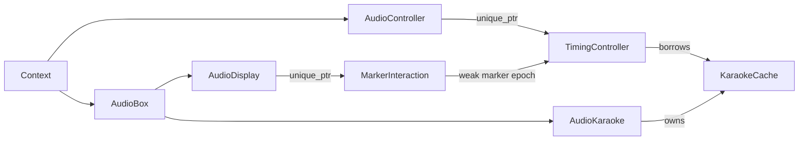

# C1-B1 音频迁移实施记录

基线 a9b4e3a，codex/style-name-width；远端相同，fork 无开放 PR。相关上游 #744、#668、#718、#762 未合入。两份用户原有改动保留。

## 实际写入与调用链

| 文件 | 类/函数 | 修改对象 | 写入方式 | 生命周期 | 迁移方案 |
| --- | --- | --- | --- | --- | --- |
| audio_timing_dialogue.cpp | TimeableLine::Apply / AudioTimingControllerDialogue::DoCommit | Start/End/邻行边界 | marker 缓存后直接写行，再 Commit | 点击、拖动、待确认 | 独立行快照保存 ID；先登记会话，再改 marker；批量验证写回 |
| audio_timing_dialogue.cpp | OnLeftClick/OnRightClick/OnMarkerDrag/SetMarkers；Next/Prev；Lead/Modify | marker、modified_lines、选择 | Commit 前已改变缓存 | 多回调 | 授权失败不得先更新缓存；完成/取消/切行结束会话 |
| audio_timing_karaoke.cpp | DoCommit / ApplyLead | Text/Start/End | Text 直接写回；Lead 原本提前写时间 | 音节修改和延迟提交 | 共享缓存与写授权分离；时间仅在正式提交时写回 |
| audio_timing_karaoke.cpp | AddLeadIn/Out、ModifyLength/Start、MoveMarker、OnMarkerDrag、OnLeftClick/RightClick、Next/Prev | 音节、marker、label、播放选择 | 调整缓存、自动或手动确认 | 拖动/按键 | 操作前校验缓存版本和授权；保留原有歌词取整规则 |
| audio_karaoke.h/.cpp | OnMouse、SetTagType、AcceptSplit、CancelSplit、LoadFromLine、SetEnabled | 共享 Karaoke、Text | split/join 缓存，AcceptSplit 写 Text | 切分、确认、取消、切模式 | 行 ID + 修订；只读重建不 Commit；共享任务在确认/取消结束 |
| command/audio.cpp、command/time.cpp | Commit/CommitNext/CommitStay/CommitDefault、karaoke 模式切换与计时委托 | 字幕和播放状态 | 委托 timing controller | 同步命令进入持续交互 | 控制器内部授权，不能依赖菜单边界 |
| audio_controller.cpp | SetTimingController | 控制器所有权 | unique_ptr 先替换旧对象，再通知 | 模式/音频切换 | 使旧 marker 凭据失效；避免拖动回调访问已销毁对象 |
| audio_display.cpp | AudioMarkerInteractionObject、SetDraggedObject、ForwardMouseEvent、OnTimingController、OnAudioOpen | 拖动对象/marker 指针 | unique_ptr 拥有拖动对象，内部借用控制器和 marker | 捕获至释放/关闭 | 弱失效凭据；通知前后均不能解引用过期 marker；明确结束/取消 |
| audio_marker.h/.cpp | marker provider、keyframe/video markers | UI 标记 | 不直接写 AssFile | provider 生命周期 | 区分只读 provider 与 controller 拥有的可写标记 |
| libaegisub/ass/karaoke.cpp | Karaoke/Syllable | 独立歌词数据 | 不保存当前 AssDialogue*，SetLine/拆分/计时修改数据 | AudioKaraoke 拥有、controller 借用 | 保持独立模型 API；缓存重建不授予写入权 |
| dialog_kara_timing_copy.cpp | KaraokeLineMatchDisplay | 独立匹配结果、延迟行写回 | DialogKanjiTimer 在 OnClose 写回 | B3 长生命周期对话框 | 本批只记录边界，不提前迁移 B3 |

## 对象关系

原顺序：替换控制器并销毁旧对象 → 发送切换通知 → 显示对象可能仍读取拖动对象中的旧 marker。
必须保证旧 marker 凭据先失效；拖动对象在调用控制器或读取 marker 前验证凭据。对象析构不执行字幕提交。缓存重建也必须先失效凭据，再删除 marker。

## 实施顺序

先独立验证失效/解绑协议，再迁移 ID 缓存与 Interaction 写回，最后执行真实事件及控制器测试。
本批不修改 C1-C 的加载、保存、Lua、旧容器访问面；不能由本批成功推断完整工程隔离。

## 实际实现与文件

新增 `src/audio_edit_session.h`，组合 C1-B Interaction，不建立第二套锁。只保存完整独立行快照、ID、修订令牌和待提交的 Karaoke 时间；所有 live row 查找与授权都在现有工程访问层执行。当前工程读取使用 const 数据。

| 实际修改文件 | 职责 |
| --- | --- |
| `src/audio_timing.h` | marker 弱生命周期凭据；显式 BeginDrag/EndDrag 协议；Karaoke 工厂传递共享会话 |
| `src/audio_display.cpp` | 开始拖动先授权；每次回调/定位前检查 marker 凭据；鼠标释放、捕获丢失、窗口销毁、音频切换与异常取消 |
| `src/audio_controller.cpp` | 替换计时控制器前显式取消；取消观察者抛异常时仍销毁旧控制器，之后传播异常 |
| `src/audio_timing_dialogue.cpp` | TimeableLine 改为独立 AssDialogueBase；批量 ID 写回；原有相邻联动、单行撤销合并；精确毫秒 |
| `src/audio_karaoke.h/.cpp` | UI 拥有 Karaoke；当前行独立快照；与控制器共享音频任务；切分/标签改动授权；确认、取消、缓存重建和拥有者销毁 |
| `src/audio_timing_karaoke.cpp` | 独立当前行快照；音节/Lead 修改前授权；Lead 暂存；确认统一写 Text/Start/End；原有音节百分秒规则 |
| `src/subtitle_project_access.h/.cpp` | Interaction::Commit 增加 single_line_id，保持现有单行 Undo 合并；LinkAdjacent 在完整目标集合验证后复用旧联动函数 |
| `src/ass_file.h/.cpp` | LinkAdjacentLine 增加可选精确毫秒模式；仅音频新调用显式启用，其他调用维持默认旧行为 |
| `tests/tests/ordinary_edit.cpp` | 24 项音频生产控制器与 wx 事件测试；复用现有实际应用测试宿主 |
| `docs/subtitle-edit-migration-c1b1.md` | 调查、所有权、交付边界及验证记录 |

### 授权与缓存规则

- 点击、拖动、Lead、音节修改、切分和标签修改在改变编辑缓存前调用 Begin。授权失败不修改当前字幕或编辑缓存。悬停、绘制、滚动等纯 UI 状态不要求模型写权限。
- 自动提交拖动从鼠标按下持续登记至释放；每个提交沿用原 amend id 与单行优化。手动拖动释放后继续登记，直到确认或取消。不会持有门禁内部互斥锁处理字幕或等待 UI。
- 一项音频多行操作授权同一份原始 ID 集合。写回重新定位和检查全部目标；邻行联动要求完整 live ID 集合与授权集合相等，包括数量及重复检查。
- 已开始的会话过期后失败并释放登记，保持拒绝直到显式 Refresh/Revert；不能再次点击确认就重新采用旧缓存。
- C1-A 写租约即使没有实际修改，也会推进代数。空闲缓存可以在同一工程、全部行字段逐项完全相等时重新绑定，并重新申请 Interaction；对时间使用原始毫秒比较。真实数据不同则拒绝，不无条件接受外部修订。
- Refresh、切行、外部 Commit、Undo/Redo 和音频源切换结束旧任务并只读重建缓存，不触发 Commit。Undo 的 Commit 先于新选择集安装，音频只比较旧选择地址与 live 集合，并通过稳定 ID 回退，不对旧选择执行 iterator_to。
- 普通字段、字幕顺序、样式、附加数据、绑定字段和行 ID 不由本批重新生成。UpdateRows 仅把从当前行复制并修改过时间/文本的独立数据写回。

### 取消与销毁顺序

正常释放：鼠标事件 → EndDrag(false) → 自动模式结束任务，手动模式保留待确认任务 → 释放捕获和拖动对象。

取消/捕获丢失：拖动对象销毁 → 仅在弱凭据有效时 EndDrag(true) → 丢弃独立待提交状态并重建 → 释放登记。未计时行也不会保留被取消的 marker，之后再确认不能补写取消结果。

切换控制器：旧控制器 EndDrag(true) → 替换并销毁旧控制器（凭据失效）→ 通知显示端 → 显示端清除拖动对象。取消观察者异常不阻止旧借用者退休。

重建 marker：先失效凭据，再清除/重建列表。正在派发的拖动对象不在自己的通知回调中删除；它下一次收到事件先检查凭据。滚动定时器也跳过过期标记。

销毁显示窗口：在窗口成员及连接仍有效时先清除拖动对象，避免成员析构到一半才回调控制器。销毁 AudioKaraoke：先退休借用其缓存的控制器，再销毁共享 Karaoke；析构中的取消异常被限制在本地，绝不写回当前字幕。

本批未修改通用 `signal.h`，普通 Commit 观察者保留原有异常传播。Interaction 及音频会话的提交异常释放登记。若原有 Commit 已写入字幕并记录历史后某个观察者抛异常，不声称自动回滚：已提交结果按正常 Undo 恢复。这不是未来比较应用的原子发布事务。

## 剩余指针与隔离边界

音频三个最终字幕写回入口现在都走 Interaction：Dialogue::DoCommit、Karaoke timing::DoCommit、AudioKaraoke::AcceptSplit。第四个原始写回点 ApplyLead 已移除直接字幕字段赋值，只修改独立缓存。检索 `src/audio*.cpp` 与 `src/command/audio.cpp` 没有发现剩余直接字幕字段/容器写回；`command/time.cpp` 的普通写命令沿用 C1-A，计时委托由控制器内部授权。

仍有合法的非拥有指针：DialogueTimingMarker → 自己控制器内的 TimeableLine（不是 live AssDialogue）；拖动对象 → 控制器/marker（每次通过弱凭据验证）；Karaoke 控制器 → AudioKaraoke 拥有的独立 Karaoke；Context/窗口借用。当前选择通知仍使用旧 AssDialogue* 参数，但音频不跨回调保存它；只读选择集合在栈上按地址与当前集合比较，不通过旧借用解引用。

全工程仍存在绕过门禁的旧公开模型/选择访问、Lua、加载/关闭队列、保存及 CleanExtradata，以及 B2/B3 业务写入。本批没有把这些数量算作 0，也没有启用比较窗口。正常主窗口在 Context 关闭前销毁子窗口；任意后台工程销毁/关闭队列的完整隔离仍属于 C1-C。

完整行缓存为 O(n) 数据；取得初次交互目标以及多行验证沿用现有校验路径，目标排序为 O(n log n)，不使用二维矩阵，不运行 wxYield。持续自动提交会刷新独立基线；未在本批另行引入缓存性能优化。

## 实际验证

Windows x86_64、Meson `buildtype=release`、Visual Studio Release 主程序与全部测试目标构建通过；仍有工程原有的编译警告。

| 测试程序 | 实际结果 |
| --- | --- |
| `build/ordinary-edit-tests.exe` | 40/40：原普通编辑 16 项 + 新音频 24 项 |
| `build/tests/subtitle-compare-tests.exe` | 33/33：阶段一读取/模型及 C0/C1-B 交互/选择测试 |
| `build/tests/gtest-main.exe` | 435/435：全部基础回归，包括阶段一比较及一万行场景 |
| 合计 | 508/508，新增 24 项 |

全部使用 `tests/run_isolated.py` 复制数据到 build 下的隔离目录，没有运行旧 setup 脚本，没有修改源测试夹具。最终日志：`build/c1b1-verified-build.log`、`build/c1b1-verified-ordinary.log`、`build/c1b1-verified-model.log`、`build/c1b1-base-tests.log`。

新增测试覆盖手动拖动确认/取消；精确毫秒与 ID；连续自动拖动 Undo 合并/Redo；多行修改；切行；比较期间拒绝及缓存不变；Karaoke Lead 取消/提交；控制器更换；实际 wx 音频鼠标事件释放、窗口销毁、捕获丢失、异常取消；过期修订/无效目标/关闭令牌；嵌套时间命令；实际 Karaoke 切分按钮确认/取消/历史重建；音频关闭；邻行联动及未授权邻行拒绝；取消观察者异常；Karaoke 连续自动提交；Undo 替换节点后的邻行缓存；无操作导航；过期待确认状态持续拒绝；1ms Lead；未计时行取消后不能补交。

这里的实际交互测试是向生产 wxWidgets 控件派发鼠标/按钮事件，并运行实际 AudioController、dummy audio provider 和计时控制器，不仅调用 DoCommit。没有执行实体鼠标人工验收；真实声卡播放、连续拖动多字幕的主窗口手感、完整工程关闭与异常弹窗交互仍需人工验收。不能把这些项目宣称为人工测试通过，B1 的人工验收项保留，整个 C1-B 及完整工程隔离均未完成。

## 后续与 Git

B2 需要迁移视觉工具及拖动基类/派生类的目标缓存和预览恢复。B3 需要独立审查五类长生命周期对话框的实时预览及取消协议；KanjiTimer 的 KaraokeLineMatchDisplay 属于该边界。二者可以复用 C1-B Interaction 和本批的生命周期思路，不得把音频专用快照助手直接当作通用事务。C1-C 继续处理 Lua、异步任务、工程加载/关闭队列、保存链和旧公开访问面，完成这些之前不能开放工程级比较隔离。

提交名称：`refactor(compare): gate audio subtitle edits`。目标 `fork/codex/style-name-width`；提交前确认账号 xiaotianMC 对 fork 有 push 权限、对上游没有 push 权限，fork 无开放 PR，远程头仍是 a9b4e3a。

受保护的两份用户文件在修改前后 SHA256 一致，且不纳入本批提交：`本版与原版差异清单.md`、`subprojects/checkasm.wrap`。最终提交哈希和远端核对结果见交付回复。
